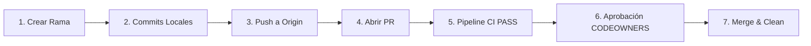

# PLATAFORMA MUNICIPAL DE REPORTES CIUDADANOS E INCIDENCIAS URBANAS EN TIEMPO REAL (S.I.U.)

> **Sistema de Incidencias Urbanas (S.I.U.)** — Solución Web Progresiva (PWA) de nivel empresarial con motor geoespacial, desduplicación inteligente en tiempo real, canalización automatizada multi-organismo y panel operativo con tableros Kanban e indicadores de SLA para la Zona Metropolitana de La Laguna.

---

## 🏛️ Información Institucional del Proyecto

* **Institución:** Universidad Tecnológica de Torreón (UTT)
* **División:** División de Tecnologías de la Información y Comunicación
* **Carrera:** Ingeniería en Desarrollo y Gestión de Software en Competencias Profesionales
* **Asignatura:** Desarrollo Web Profesional (Grado: 8°, Sección: A)
* **Docente Evaluador:** Ing. Jesús Del Toro Robledo
* **Entregable:** Avances del Proyecto · Unidad 1 (`F-ACAD-174`)
* **Fecha de Presentación:** 08 de Octubre de 2026
* **Ubicación:** Torreón, Coahuila, México

### 👥 Integrantes del Equipo de Desarrollo

| Nombre del Integrante | Matrícula | Rol Principal en el Proyecto |
| :--- | :---: | :--- |
| **González Acosta Sergio** | `23170137` | Arquitecto de Backend y Base de Datos |
| **Hernández Ayala Erik Fernando** | `22170133` | Líder del Proyecto y Desarrollador Frontend PWA |
| **Castañeda Barraza Gema Daniela** | `21170129` | Diseñadora UI/UX y Desarrolladora de Interfaces Interactivas |
| **Reyes Cortinas César Fabián** | `22170039` | Especialista en DevOps, Sistemas GIS y Seguridad |

---

## 📋 Tabla de Contenidos

1. [Problemática y Justificación](#1-problemática-y-justificación)
   - [1.1 Planteamiento y Contextualización](#11-planteamiento-y-contextualización-de-la-problemática)
   - [1.2 Justificación del Proyecto](#12-justificación-del-proyecto)
2. [Objetivos del Proyecto](#2-objetivos-del-proyecto)
   - [2.1 Objetivo General](#21-objetivo-general)
   - [2.2 Objetivos Específicos](#22-objetivos-específicos)
3. [Alcances, Limitaciones y MVP](#3-alcances-limitaciones-y-mvp)
   - [3.1 Alcance del Proyecto](#31-alcance-del-proyecto)
   - [3.2 Limitaciones Explícitas](#32-limitaciones-explícitas-del-proyecto)
   - [3.3 Definición del MVP](#33-definición-del-mvp-minimum-viable-product)
4. [Requisitos del Sistema](#4-requisitos-del-sistema)
   - [4.1 Requisitos Funcionales (RF)](#41-requisitos-funcionales-rf)
   - [4.2 Requisitos No Funcionales (RNF)](#42-requisitos-no-funcionales-rnf)
5. [Análisis de Riesgos](#5-análisis-de-riesgos)
6. [Metodología y Roles del Equipo](#6-metodología-y-roles-del-equipo)
   - [6.1 Justificación Metodológica (Scrum Adaptado)](#61-justificación-de-la-metodología-ágil-scrum-adaptado)
   - [6.2 Roles y Responsabilidades](#62-roles-y-responsabilidades-del-equipo)
7. [Separación del Proyecto en Tareas (WBS / EDT)](#7-separación-del-proyecto-en-tareas-wbs--edt)
8. [Cronograma de Actividades e Hitos Verificables](#8-cronograma-de-actividades-e-hitos-verificables)
9. [Definición y Diseño del Flujo de Trabajo (Workflow)](#9-definición-y-diseño-del-flujo-de-trabajo-workflow)
   - [9.1 Modelo GitHub Flow Adaptado](#91-selección-del-modelo-de-flujo-de-trabajo-github-flow-adaptado)
   - [9.2 Nomenclatura de Ramas y Conventional Commits](#92-nomenclatura-de-ramas-y-convenciones-de-commits)
   - [9.3 Ciclo de Vida del Trabajo por Tarea](#93-ciclo-de-vida-del-trabajo-por-tarea-flujo-paso-a-paso)
   - [9.4 Políticas de Combinación y Protección de Ramas](#94-políticas-de-combinación-merge-policies-y-protección-de-ramas)
   - [9.5 CODEOWNERS y Definición de Hecho (DoD)](#95-gestión-de-pull-requests-codeowners-y-definición-de-hecho-dod)
   - [9.6 Versionado Semántico](#96-versionado-semántico-semantic-versioning)
10. [Elección de Estructura Web y Tecnologías](#10-elección-de-estructura-web-y-tecnologías)
11. [Selección y Justificación de Patrones de Diseño](#11-selección-y-justificación-de-patrones-de-diseño)
12. [Wireframes y Arquitectura de Información](#12-wireframes-y-arquitectura-de-información)
13. [Búsquedas en el Sitio Web y Filtros Avanzados](#13-búsquedas-en-el-sitio-web-y-filtros-avanzados)
14. [Validación de la Información (FrontEnd y BackEnd)](#14-validación-de-la-información-frontend-y-backend)
15. [Definición e Inventario de Contenido y Licenciamiento](#15-definición-e-inventario-de-contenido-y-licenciamiento)
16. [Estructura del Proyecto y Guía de Instalación](#16-estructura-del-proyecto-y-guía-de-instalación)

---

## 1. Problemática y Justificación

### 1.1 Planteamiento y Contextualización de la Problemática

**Diagnóstico Situacional y Arquitectura Institucional:**  
En los municipios que integran la Zona Metropolitana de La Laguna (*Torreón y Matamoros en Coahuila; Gómez Palacio y Lerdo en Durango*), la atención operativa de servicios públicos e infraestructura urbana primaria enfrenta una ineficiencia sistémica atribuible a la desarticulación tecnológica y administrativa de los canales de atención ciudadana. Las dependencias gubernamentales y organismos descentralizados autónomos —como el **Sistema Municipal de Aguas y Saneamiento (SIMAS)**, la **Comisión Federal de Electricidad (CFE)**, la **Dirección de Obras Públicas** y la **Dirección de Alumbrado Público**— operan en silos de información aislados, utilizando sistemas legados heterogéneos, registros manuales en bitácoras físicas o líneas de atención telefónica analógicas (*Call Centers*) desprovistas de mecanismos de integración de software o canalización automatizada en tiempo real.

Esta falta de interoperabilidad tecnológica y la ausencia de un concentrador georreferenciado generan **cinco vectores de falla crítica** que degradan sustancialmente los niveles de servicio municipal (*SLA*):

* **Descoordinación Competencial y Rebote Traspasivo:** El ciudadano promedio desconoce las fronteras jurisdiccionales y la delimitación de competencias entre entes municipales, federales y empresas concesionarias (por ejemplo, distinguiendo si una falla en luminarias deriva de líneas de alta tensión de CFE, infraestructura subterránea municipal o redes de telecomunicaciones privadas). Esto provoca el rechazo sistemático y traspaso recurrente de folios entre dependencias, incrementando la fricción y el abandono del trámite.
* **Opacidad Transaccional ("Efecto Caja Negra"):** Al ingresar un reporte vía telefónica o ventanilla, el usuario no recibe un identificador alfanumérico estandarizado ni acceso a una interfaz de seguimiento en tiempo real. La falta de transparencia sobre el estado de procesamiento (*registrado, asignado, en cuadrilla, resuelto*) destruye la confianza cívica y genera sobrecarga por consultas reiteradas sobre un mismo problema.
* **Duplicidad Redundante e Ineficiencia Operativa:** Ante contingencias visibles de alto impacto (*colapso de colectores, foso de drenaje abierto o fallas de red eléctrica en avenidas principales*), decenas de ciudadanos reportan de forma independiente el mismo suceso. Sin una capa cartográfica distributiva con motor de desduplicación geográfica en tiempo real, las dependencias capturan $N$ folios redundantes, saturando la capacidad de atención y dispersando los recursos de las cuadrillas.
* **Deficiencia en Trazabilidad y Evidencia Técnico-Campo:** El despacho de órdenes de trabajo hacia las unidades operativas de campo carece de geolocalización satelital estricta y auditoría fotográfica en tiempo real. Es habitual que se cierren tickets administrativamente sin la debida resolución física o que múltiples unidades atiendan sin coordinación la misma ubicación por falta de un tablero unificado de control de flotas.

### 1.2 Justificación del Proyecto

La justificación técnica, económica y social del proyecto se fundamenta sólidamente en cuatro pilares estratégicos de la ingeniería de software moderna:

* **Justificación Teórica y Paradigmática:** Se adhiere a los marcos normativos internacionales de Ciudades Inteligentes (*Smart Cities, ISO 37122*) y Gobierno Abierto. El modelo promueve la corresponsabilidad cívica mediante *crowdsourcing* de información geoespacial, permitiendo la validación distribuida (**"Upvoting"**) para establecer prioridades dinámicas según el impacto social comunitario real.
* **Justificación Operativa y Financiera:** Optimiza el presupuesto público reduciendo drásticamente los desplazamientos innecesarios y el consumo de combustible de las cuadrillas operativas. Mediante la consolidación de reportes bajo folios maestros y el requisito de evidencia fotográfica georreferenciada del *"antes"* y *"después"*, se garantiza una tasa de efectividad superior al **90%** en la resolución técnica al primer intento.
* **Justificación Arquitectónica y Tecnológica:** Implementa un stack tecnológico moderno, desacoplado y de código abierto (*Next.js PWA, NestJS, PostgreSQL/PostGIS, Redis, Tailwind CSS*) que erradica la dependencia de licencias privativas costosas y proporciona capacidades PWA nativas con alta resiliencia offline y bajo consumo de datos móviles.

---

## 2. Objetivos del Proyecto

### 2.1 Objetivo General

Diseñar, desarrollar e implementar una plataforma web progresiva (**PWA**) de nivel empresarial para la gestión integral de incidencias urbanas en la Zona Metropolitana de Torreón, incorporando un motor geoespacial de deduplicación inteligente en tiempo real, canalización automatizada multi-organismo (SIMAS, CFE, Obras Públicas), mecanismos de validación vecinal distribuida y un panel de control operativo (*Backoffice*) multirol con tableros Kanban e indicadores de SLA, orientados a reducir en más del **40%** los tiempos de atención técnica en campo y elevar la transparencia cívica municipal.

### 2.2 Objetivos Específicos

* **OE1 (Frontend PWA y Captura Asistida):** Desarrollar una interfaz de usuario Web Progresiva (PWA) bajo el enfoque Mobile-First accesible (*WCAG 2.1 AA*), implementando un flujo intuitivo de reporte en 3 pasos respaldado por geolocalización GPS de precisión, captura fotográfica en vivo con bloqueo de almacenamiento local y categorización estandarizada mediante DTOs.
* **OE2 (Motor Geoespacial y Deduplicación Algorítmica):** Construir un motor espacial sobre PostgreSQL/PostGIS e índices GiST que ejecute consultas de proximidad métrica (`ST_DWithin`) en menos de 100 ms para agrupar automáticamente incidencias similares en un radio configurable de 20 a 50 metros bajo un único folio maestro.
* **OE3 (Mecanismo de Colaboración Vecinal y Prioridad Dinámica):** Implementar un subsistema social de confirmación comunitaria (*"Sigue ahí" / "Upvoting"*) que permita a la ciudadanía respaldar incidentes activos cercanos, recalculando automáticamente la severidad y el nivel de urgencia dentro de las colas de atención de cada dependencia.
* **OE4 (Backoffice Operativo e Indicadores SLA):** Diseñar una plataforma administrativa multi-organismo dotada de tableros Kanban drag-and-drop, semáforos temporales de cumplimiento de SLA por criticidad y herramientas de asignación inteligente de órdenes de trabajo hacia flotas de campo.
* **OE5 (Trazabilidad E2E y Cierre Técnico Auditado):** Establecer un protocolo obligatorio de validación de resolución en campo requiriendo coordenadas GPS dentro del perímetro y la adjunción de una foto de evidencia del *"después"*, disparando notificaciones en tiempo real (PWA y correo Resend API) hacia los ciudadanos involucrados.

---

## 3. Alcances, Limitaciones y MVP

### 3.1 Alcance del Proyecto

El alcance global abarca el ciclo de vida completo de ingeniería de software para la entrega de una plataforma de grado de producción, cubriendo:

* **Módulo Ciudadano Progressive Web App (PWA):** Aplicación web responsiva con Service Workers, `manifest.json` y almacenamiento persistente IndexedDB para capacidades offline, operable desde dispositivos móviles (Android/iOS) y equipos de escritorio sin instalación previa desde tiendas digitales.
* **Plataforma Backoffice y Gestión Multi-Organismo:** Panel administrativo centralizado con control de acceso basado en roles (RBAC) para la supervisión y despacho de órdenes de trabajo en tres entidades primarias: SIMAS (agua y saneamiento), CFE (red eléctrica y alumbrado) y Obras Públicas (pavimentación y bacheo).
* **Capa Cartográfica Interactiva y BI:** Integración de visualización vectorial sobre Leaflet/OpenStreetMap con soporte de mapas de calor (*Heatmaps*) para análisis de densidad de averías e inteligencia de negocios municipal.
* **Servicios Notificacionales y Trazabilidad Pública:** Pipeline automatizado de mensajería transaccional vía Resend API y notificaciones PWA en vivo, complementado con un portal público de rastreo por folio alfanumérico sin autenticación obligatoria.
* **Infraestructura DevSecOps y Cloud Deployment:** Contenerización completa mediante Docker/Docker Compose, automatización de pruebas e integración continua vía GitHub Actions y despliegue sobre arquitectura Cloud con certificados TLS 1.3.

### 3.2 Limitaciones Explícitas del Proyecto

* **Dependencia de Conectividad Móvil:** La sincronización remota requiere conexión activa (4G/5G/WiFi). Si bien la PWA permite la captura inicial y almacenamiento local temporal en IndexedDB sin red, la transmisión del paquete hacia los servidores centrales queda pospuesta hasta restablecer el enlace.
* **Exclusión de Servicios de Emergencia Seguridad Ciudadana:** La plataforma no actúa como sustituto del sistema de emergencias 911 ni procesa denuncias de delitos en flagrancia. Su alcance se acota estrictamente a infraestructura y servicios urbanos municipales.
* **Interoperabilidad Limitada con ERPs Legados:** La integración con bases de datos legacy o ERPs internos de CFE o SIMAS se efectuará exclusivamente mediante APIs REST/Webhooks expuestos por dichas entidades. De no contar con interfaces web modernas, se proporcionarán módulos de exportación estandarizada en formato CSV/JSON.
* **Responsabilidad Exclusiva del Software:** El equipo de desarrollo es responsable únicamente del diseño, construcción, pruebas y despliegue del sistema tecnológico. La disponibilidad de cuadrillas, tiempos físicos de reparación en campo y aprovisionamiento de insumos son responsabilidad exclusiva de las dependencias gubernamentales.

### 3.3 Definición del MVP (Minimum Viable Product)

#### 3.3.1 Autenticación y Gestión de Usuarios
* **Usuarios Ciudadanos (Comunes):** El registro requiere datos básicos como nombre(s), apellido paterno, apellido materno, correo electrónico y contraseña. Una vez registrados, pueden iniciar sesión mediante sus credenciales institucionales o personales en el portal oficial.
* **Usuarios Institucionales (Con Privilegios):** Para delegaciones como SIMAS o CFE, se utilizan credenciales predeterminadas por entidad. El sistema identifica automáticamente la dependencia asociada al inicio de sesión y restringe el acceso a una sola sesión activa simultánea por razones de seguridad, redirigiendo al usuario al panel de administración (*dashboard*) con sus permisos correspondientes.

#### 3.3.2 Pantalla Principal e Interfaz Operativa
* **Interfaz Ciudadana:** Incluye una barra superior con el nombre de usuario activo, un campo de búsqueda global, un centro de notificaciones para el seguimiento de solicitudes y un menú lateral desplegable con accesos rápidos a *"Mis Reportes"* y *"Nuevo Reporte"*. El cuerpo principal presenta un mapa interactivo geolocalizado con marcadores visuales de las incidencias activas dentro del radio del usuario.
* **Panel Administrativo:** Muestra indicadores estadísticos clave (reportes totales, resueltos y pendientes). A través del menú principal, los administradores acceden a la gestión avanzada de folios, filtros por estatus y asignación de trabajos.

#### 3.3.3 Flujo de Registro y Desduplicación de Reportes
El usuario inicia el proceso desde el menú desplegable seleccionando *"Nuevo Reporte"*. El formulario asistido solicita la ubicación mediante un mapa interactivo para posicionar el pin de la incidencia, la categorización de la falla (bache, fuga de agua, alumbrado, etc.) y la evaluación del nivel de riesgo. Todas las selecciones se realizan mediante listas desplegables estandarizadas.

Si el sistema detecta un reporte previo registrado dentro del mismo rango geográfico con características similares, redirige automáticamente al usuario hacia la incidencia existente. Esto permite al ciudadano respaldar o sumar confirmaciones al reporte original, consolidando la prioridad sin duplicar folios operativos.

En la pantalla principal en el body se muestra el mapa donde se encuentra el usuario en ese momento, visualizando con íconos las incidencias existentes dentro de su rango.

#### 3.3.4 Canalización y Gestión Operativa de Incidencias
Las nuevas incidencias activan notificaciones inmediatas para el personal de la delegación correspondiente. En el listado asignado a la dependencia, los administradores revisan el detalle, la ubicación y las evidencias fotográficas. Tienen la facultad de aceptar la solicitud asignando una flotilla operativa específica según la zona, o bien rechazarla justificando formalmente el motivo.

#### 3.3.5 Resolución en Campo y Evidencia Técnica
Las cuadrillas operativas acceden al apartado de *"Reportes Asignados"* para consultar la ubicación georreferenciada y especificaciones de la falla. Para marcar una incidencia como resuelta, el personal debe encontrarse físicamente dentro del rango de coordenadas reportado y adjuntar una fotografía final capturada en tiempo real a través de la cámara de la aplicación, **bloqueando la carga de imágenes desde la galería local** para garantizar la autenticidad de la reparación.

#### 3.3.6 Administración de Flotillas Operativas
Los usuarios administradores cuentan con un módulo específico para el alta de cuadrillas de trabajo. En este apartado se define el nombre de la flotilla, la asignación de la zona de cobertura mediante la delimitación en mapa, y la creación de credenciales exclusivas de acceso para el personal de campo.

---

## 4. Requisitos del Sistema

### 4.1 Requisitos Funcionales (RF)

| ID | Nombre del Requisito | Prioridad | Descripción Funcional | Criterio de Aceptación / Historia |
| :---: | :--- | :---: | :--- | :--- |
| **RF-01** | **Autenticación Diferenciada y Portal Unificado** | Alta | El portal debe permitir el inicio de sesión unificado para ciudadanos (mediante correo/contraseña) y personal institucional de delegaciones como SIMAS o CFE (mediante credenciales predeterminadas), identificando la entidad, restringiendo a una sola sesión activa y redireccionando al panel correspondiente. | *Como usuario institucional o ciudadano, quiero ingresar desde un portal unificado para acceder automáticamente a las funciones según mi rol y dependencia asignada.* |
| **RF-02** | **Interfaz Principal con Mapa Geolocalizado** | Alta | La pantalla principal debe integrar una barra superior con datos de sesión, búsqueda global, centro de notificaciones, menú desplegable y un mapa interactivo que muestre con marcadores visuales las incidencias activas en el rango actual del usuario. | *Como ciudadano, quiero visualizar las incidencias cercanas sobre un mapa interactivo para informarme del estado del entorno urbano.* |
| **RF-03** | **Captura Asistida mediante Listas Desplegables** | Alta | El formulario de registro de reportes debe guiar al usuario mediante posicionamiento de pin en mapa y listas desplegables estandarizadas para seleccionar la categoría de la falla (fuga de agua, alumbrado, bache) y el nivel de riesgo. | *Como ciudadano, quiero seleccionar la categoría de la falla desde listas estandarizadas para registrar mi reporte de forma rápida y sin errores de captura.* |
| **RF-04** | **Redirección Automática por Desduplicación Geográfica** | Alta | El sistema debe evaluar la ubicación y tipo de fallo durante la captura; si detecta un reporte previo dentro del rango espacial, redirigirá automáticamente al usuario para confirmar o respaldar la incidencia existente sin duplicar folios. | *Como usuario, quiero respaldar un reporte existente cercano para elevar la prioridad del problema sin generar folios duplicados.* |
| **RF-05** | **Canalización y Evaluación Operativa de Incidencias** | Alta | El panel administrativo notificará en tiempo real las incidencias asignadas a la delegación correspondiente (SIMAS/CFE/Obras Públicas), permitiendo al personal revisar evidencias, aceptar asignando flotillas por zona o rechazar justificando el motivo. | *Como administrador de delegación, quiero revisar el detalle de las solicitudes para aceptarlas asignando flotillas o rechazarlas con justificación formal.* |
| **RF-06** | **Resolución en Campo con Evidencia Fotográfica de Cámara** | Alta | Para marcar una incidencia como resuelta, las cuadrillas operativas deberán estar dentro del radio de coordenadas reportado y adjuntar obligatoriamente una fotografía tomada en el instante con la cámara de la aplicación, bloqueando la carga desde la galería local. | *Como supervisor municipal, exijo foto en tiempo real tomada desde la cámara para garantizar la veracidad física del trabajo concluido.* |
| **RF-07** | **Administración y Alta de Flotillas Operativas** | Alta | El sistema debe proveer a los administradores un módulo exclusivo para dar de alta cuadrillas, definir el nombre de la flotilla, delimitar su zona de cobertura geográfica en mapa y generar credenciales de acceso para el personal de campo. | *Como administrador, quiero dar de alta cuadrillas y definir su zona de cobertura en el mapa para organizar eficientemente las áreas de atención.* |
| **RF-08** | **Tablero Kanban y Control de SLA por Delegación** | Alta | El sistema proporcionará tableros Kanban para mover solicitudes por estados y calculará semáforos de SLA según la criticidad (Rojo: Vencido, Amarillo: Por vencer, Verde: En tiempo). | *Como supervisor de área, quiero monitorear los indicadores de tiempo de respuesta mediante semáforos de SLA para evitar demoras en las reparaciones.* |
| **RF-09** | **Notificaciones Automatizadas de Estatus** | Media | El sistema enviará notificaciones automáticas dentro de la PWA y por correo transaccional al ciudadano cuando el reporte cambie de estado a "Asignado" o "Resuelto". | *Como ciudadano, quiero recibir alertas automáticas sobre los avances de mi reporte para mantenerme informado sin necesidad de consultar manualmente.* |
| **RF-10** | **Consulta Pública y Rastreo por Folio** | Alta | El sistema permitirá la búsqueda pública y directa del historial y avance de cualquier reporte utilizando el número de folio alfanumérico generado. | *Como usuario, quiero ingresar el número de folio en el portal para verificar el estado de mi solicitud en cualquier momento.* |

### 4.2 Requisitos No Funcionales (RNF)

| ID | Categoría / Criterio | Especificación Verificable |
| :---: | :--- | :--- |
| **RNF-01** | **Rendimiento y Tiempo de Respuesta** | El tiempo de carga inicial de la aplicación PWA no debe superar los 2.0 segundos en redes móviles 4G; las consultas al backend deben responder en un lapso inferior a 300 ms. |
| **RNF-02** | **Seguridad y Protección de Datos** | El tráfico de datos se protegerá mediante HTTPS/TLS 1.3. La autenticación utilizará tokens JWT con expiración controlada, restricción de sesión única para cuentas institucionales y saneamiento contra inyecciones SQL y XSS. |
| **RNF-03** | **Disponibilidad del Sistema** | La infraestructura web garantizará una disponibilidad operativa del 99.5% continuo durante las 24 horas del día. |
| **RNF-04** | **Precisión y Eficiencia Geoespacial** | El motor espacial PostGIS ejecutará consultas de proximidad e índices GiST para resolver la desduplicación geográfica y validación de límites territoriales en menos de 100 ms. |
| **RNF-05** | **Usabilidad y Accesibilidad (WCAG)** | La interfaz web responderá al enfoque Mobile-First y cumplirá el estándar WCAG 2.1 Nivel AA, asegurando relaciones de contraste adecuadas y facilidad de uso en pantallas táctiles. |
| **RNF-06** | **Compatibilidad Multiplataforma** | La plataforma PWA ofrecerá un funcionamiento uniforme en navegadores web modernos (Chrome, Safari, Firefox, Edge) tanto en dispositivos móviles (Android, iOS) como de escritorio. |

---

## 5. Análisis de Riesgos

Se ha formalizado una Matriz de Riesgos exhaustiva para evaluar y mitigar factores críticos:

* 📄 **Documento de Referencia:** `Matriz de Riesgos - Plataforma Municipal de Reportes.xlsx`
* **Dimensiones Clave de Mitigación:**
  1. *Fallo de geolocalización o imprecisión en dispositivos móviles de gama baja:* Implementación de ajuste manual por pin cartográfico interactivo asistido.
  2. *Saturación de red o caída de señal en campo:* Persistencia local mediante IndexedDB y sincronización diferida vía Service Workers.
  3. *Spam o reportes apócrifos masivos:* Rate limiting por IP/JWT (máx. 5 reportes por hora), bloqueo de galería local y validación obligatoria con cámara web/móvil en vivo.
  4. *Fricción interinstitucional entre SIMAS, CFE y Obras Públicas:* Matriz de reglas de canalización automática basada en taxonomía fija de fallas.

---

## 6. Metodología y Roles del Equipo

### 6.1 Justificación de la Metodología Ágil (Scrum Adaptado)

Se selecciona el marco de trabajo **Scrum adaptado** a entornos de desarrollo web profesional por su capacidad para gestionar requisitos cambiantes, facilitar entregas incrementales funcionales al final de cada iteración y permitir la validación continua con dependencias públicas municipales.

* **Duración de Sprints:** 2 semanas por ciclo de trabajo.
* **Ceremonias Ágiles:**
  * **Sprint Planning:** Definición del Sprint Backlog y estimación de esfuerzo en puntos de historia.
  * **Daily Standup:** Sesión de sincronización de 15 minutos para remover bloqueos.
  * **Sprint Review:** Demostración de incrementos funcionales con stakeholders/docente.
  * **Sprint Retrospective:** Análisis de mejora continua de procesos técnicos y de equipo.

### 6.2 Roles y Responsabilidades del Equipo

* 👑 **Hernández Ayala Erik Fernando — Líder del Proyecto y Desarrollador Frontend PWA**
  * Responsable de la dirección estratégica, planificación ágil de Sprints y supervisión del cronograma general.
  * Desarrollo del cliente web progresivo (PWA) utilizando Next.js, React 19 y Tailwind CSS.
  * Flujo de captura en 3 pasos (geolocalización GPS, toma de fotografía en vivo y categorización).
  * Mecanismo de validación comunitaria vecinal (*"Upvotes"*) e integración de Service Workers con IndexedDB.
* ⚙️ **González Acosta Sergio — Arquitecto de Backend y Base de Datos**
  * Diseño e implementación de la arquitectura del servidor basada en NestJS y TypeScript.
  * Modelado entidad-relación y gestión de migraciones en PostgreSQL con TypeORM.
  * Desarrollo de la API RESTful con validaciones estrictas vía DTOs y `class-validator`.
  * Integración del servicio transaccional de correo (*Resend API*), optimización de consultas SQL y pruebas unitarias/integración con Jest y Supertest.
* 🎨 **Castañeda Barraza Gema Daniela — Diseñadora UI/UX y Desarrolladora de Interfaces Interactivas**
  * Diseño del sistema visual, prototipado de alta fidelidad y wireframes responsivos en Figma bajo WCAG 2.1 AA.
  * Integración cartográfica del mapa vectorial interactivo (*Leaflet / OpenStreetMap*).
  * Desarrollo del Tablero Kanban drag-and-drop para el Backoffice por dependencias.
  * Portal público de consulta de estatus por folio alfanumérico y elaboración de manuales de usuario y documentación técnica.
* 🛡️ **Reyes Cortinas César Fabián — Especialista en DevOps, Sistemas GIS y Seguridad**
  * Infraestructura de desarrollo y producción utilizando Docker y pipelines CI/CD en GitHub Actions.
  * Diseño del motor geoespacial de desduplicación y clustering de reportes mediante consultas nativas PostGIS (`ST_DWithin`).
  * Seguridad mediante autenticación JWT, control de acceso basado en roles (RBAC) y encriptación TLS 1.3.
  * Integración con Cloud Storage para optimización de imágenes y ejecución de pruebas de estrés/carga con k6 y JMeter.

---

## 7. Separación del Proyecto en Tareas (WBS / EDT)

Estructura de Desglose de Trabajo organizada a lo largo de 4 meses (8 Sprints de 2 semanas):

| Fase / Sprint | ID Tarea | Descripción de la Tarea | Entregable / Criterio de Aceptación | Persona Asignada |
| :--- | :---: | :--- | :--- | :--- |
| **Mes 1: Sprint 1**<br>*(Semanas 1-2)* | **T-1.2** | Levantamiento de requisitos detallados, definición de historias de usuario y matriz. | Product Backlog documentado y validado en Jira/GitHub Projects. | Hernández Ayala Erik Fernando |
| | **T-1.3** | Diseño UI/UX de wireframes de alta fidelidad para PWA y sistema Backoffice en Figma. | Prototipo interactivo navegable mobile y desktop en Figma. | Castañeda Barraza Gema Daniela |
| | **T-1.4** | Configuración de entornos (Docker local, PostgreSQL + PostGIS, repositorio GitHub y CI/CD). | `docker-compose` funcional con PostgreSQL/PostGIS e integración continua configurada. | Reyes Cortinas César Fabián |
| **Mes 1: Sprint 2**<br>*(Semanas 3-4)* | **T-2.1** | Inicialización de proyecto NestJS, definición de módulos core y configuración de TypeORM. | Estructura NestJS base con conexión ORM y migraciones automáticas funcionales. | González Acosta Sergio |
| | **T-2.2** | Desarrollo del módulo de Autenticación, Roles (RBAC), JWT y endpoints Auth en Backend. | Endpoints Auth protegidos con JWT y roles (Admin, Cuadrilla, Ciudadano). | Reyes Cortinas César Fabián |
| | **T-2.3** | Inicialización de Next.js 19 con Tailwind CSS y componentes de Layout base. | Estructura Next.js con diseño responsivo, temas de color y navegación base. | Castañeda Barraza Gema Daniela |
| | **T-2.4** | Construcción de formularios de autenticación e integración con API Auth en Frontend. | Flujo completo de Login/Registro y almacenamiento de sesión JWT en cliente. | Hernández Ayala Erik Fernando |
| **Mes 2: Sprint 3**<br>*(Semanas 5-6)* | **T-3.1** | Desarrollo de API REST para creación y consulta de reportes con validaciones DTO. | Endpoints `POST /reports` y `GET /reports/:folio` con `class-validator`. | González Acosta Sergio |
| | **T-3.2** | Implementación de motor de geo-desduplicación y clustering con PostGIS (`ST_DWithin`). | Función de agrupación espacial a 50m que asigna folio maestro a reportes duplicados. | Reyes Cortinas César Fabián |
| | **T-3.3** | Desarrollo de la interfaz de captura de reporte en 3 pasos PWA (GPS, Foto, Categoría). | Wizard de reporte asistido con detección de ubicación GPS e imágenes en vivo. | Hernández Ayala Erik Fernando |
| | **T-3.4** | Integración de mapas vectoriales interactivos con Leaflet / OpenStreetMap en Frontend. | Mapa interactivo con pines de fallas geolocalizadas y controles de zoom/desplazamiento. | Castañeda Barraza Gema Daniela |
| **Mes 2: Sprint 4**<br>*(Semanas 7-8)* | **T-4.1** | Integración de servicio Cloud Storage (Amazon S3 / Cloudinary) para subida de fotos. | Servicio de upload que optimiza imágenes a WebP y retorna URLs seguras firmadas. | Reyes Cortinas César Fabián |
| | **T-4.2** | Desarrollo del sistema de notificaciones por email transaccional usando Resend API. | Envío automático de correos con folio y actualizaciones de estado del reporte. | González Acosta Sergio |
| | **T-4.3** | Desarrollo del portal público de consulta de estatus por folio alfanumérico. | Vista pública con línea del tiempo de trazabilidad y evidencia fotográfica. | Castañeda Barraza Gema Daniela |
| | **T-4.4** | Construcción del sistema de validación comunitaria vecinal ("Upvotes" / "Sigue ahí"). | Botón funcional de confirmación vecinal que incrementa prioridad del ticket. | Hernández Ayala Erik Fernando |
| **Mes 3: Sprint 5**<br>*(Semanas 9-10)* | **T-5.1** | Desarrollo de API y lógica de gestión de órdenes de trabajo para Backoffice multirol. | Endpoints para cambio de estado, asignación de cuadrillas y filtros por dependencia. | González Acosta Sergio |
| | **T-5.2** | Diseño y desarrollo del Tablero Kanban interactivo para despacho por dependencias. | Tablero Kanban drag-and-drop con columnas: Nuevos, Asignados, En Proceso, Resueltos. | Castañeda Barraza Gema Daniela |
| | **T-5.3** | Implementación del cálculo de semáforos SLA y alertas visuales de vencimiento. | Semáforo de SLA dinámico (Rojo/Amarillo/Verde) según tiempos configurables. | Reyes Cortinas César Fabián |
| | **T-5.4** | Desarrollo del módulo de Cierre Técnico Obligatorio con fotografía del "después". | Formulario de cierre para cuadrilla que bloquea el cambio a "Resuelto" sin foto. | Hernández Ayala Erik Fernando |
| **Mes 3: Sprint 6**<br>*(Semanas 11-12)* | **T-6.1** | Implementación de panel de Búsqueda Avanzada y Filtros Multicriterio en Backoffice. | Filtros combinados funcionales (dependencia, fechas, colonia, estado SLA, cuadrilla). | Castañeda Barraza Gema Daniela |
| | **T-6.2** | Desarrollo de Dashboard Ejecutivo BI con Mapas de Calor (Heatmaps) de incidencias. | Dashboard con indicadores clave (KPIs) y capa de mapa de calor geoespacial. | Reyes Cortinas César Fabián |
| | **T-6.3** | Configuración PWA (Service Workers, Manifest, IndexedDB para persistencia offline). | PWA instalable con soporte de almacenamiento local de reportes sin conexión. | Hernández Ayala Erik Fernando |
| | **T-6.4** | Optimizaciones Backend de rendimiento (consultas SQL, índices GiST en PostGIS). | Tiempos de respuesta de la API < 300 ms verificados con pruebas de carga. | González Acosta Sergio |
| **Mes 4: Sprint 7**<br>*(Semanas 13-14)* | **T-7.1** | Ejecución de Pruebas Unitarias y de Integración en Backend (Jest / Supertest). | Cobertura de código > 80% y reporte de ejecución sin errores en CI/CD. | González Acosta Sergio |
| | **T-7.2** | Pruebas End-to-End (E2E) con Cypress/Playwright e inspección de accesibilidad WCAG 2.1 AA. | Flujos críticos validados de punta a punta y cumplimiento de accesibilidad. | Castañeda Barraza Gema Daniela |
| | **T-7.3** | Pruebas de Estrés y Carga con k6/JMeter (5,000 usuarios concurrentes) y auditoría OWASP. | Informe de pruebas de carga satisfactorio y remediación de vulnerabilidades OWASP. | Reyes Cortinas César Fabián |
| | **T-7.4** | Pruebas de Aceptación de Usuario (UAT) y corrección de observaciones del cliente. | Acta de conformidad firmada y feedback incorporado en el sistema. | Hernández Ayala Erik Fernando |
| **Mes 4: Sprint 8**<br>*(Semanas 15-16)* | **T-8.1** | Configuración de la infraestructura de producción en la nube (Vercel, AWS/DigitalOcean, SSL). | Servidores de producción aprovisionados con SSL TLS 1.3 y dominio oficial activo. | Reyes Cortinas César Fabián |
| | **T-8.2** | Despliegue final (Go-Live), monitoreo con Sentry/Datadog y respaldo inicial de BD. | Plataforma operando en producción al 100% con telemetría activa. | González Acosta Sergio |
| | **T-8.3** | Elaboración de manuales de usuario (Ciudadano y Operativo) y documentación Swagger API. | Manuales en PDF y portal OpenAPI/Swagger disponible. | Castañeda Barraza Gema Daniela |
| | **T-8.4** | Capacitación a personal de dependencias municipales y entrega formal del proyecto. | Sesiones de capacitación completadas y acta de entrega final firmada. | Hernández Ayala Erik Fernando |

---

## 8. Cronograma de Actividades e Hitos Verificables

```
MES 1: SPRINT 1 & 2 ──► Requisitos, Wireframes, Docker/PostGIS, Base NestJS & Next.js, Auth RBAC
MES 2: SPRINT 3 & 4 ──► Motor Espacial ST_DWithin, Wizard 3 Pasos, Leaflet OSM, Resend, Upvoting
MES 3: SPRINT 5 & 6 ──► Kanban Backoffice, Semáforos SLA, Cierre Fotográfico, Filtros, Heatmaps BI
MES 4: SPRINT 7 & 8 ──► Pruebas Unit/E2E/k6 (>80% cov), Despliegue Cloud TLS 1.3, Go-Live y Manuales
```

* **Hito 1 (Fin de Sprint 2):** Repositorio monorepo configurado con CI/CD, autenticación diferenciada JWT y base de datos con PostGIS inicializada.
* **Hito 2 (Fin de Sprint 4):** PWA funcional con reporte asistido en 3 pasos, desduplicación espacial a 50m y confirmación comunitaria activa.
* **Hito 3 (Fin de Sprint 6):** Backoffice operativo multi-organismo con Kanban, semáforos SLA, mapas de calor y PWA con capacidades offline.
* **Hito 4 (Fin de Sprint 8):** Pruebas de carga aprobadas (5,000 usuarios concurrentes), despliegue en producción con TLS 1.3, documentación Swagger y entrega formal.
* 🖼️ *Referencia visual:* `Cronograma del proyecto.png`

---

## 9. Definición y Diseño del Flujo de Trabajo (Workflow)

**Responsable de Gobernanza y Flujo:** Hernández Ayala Erik Fernando

### 9.1 Selección del Modelo de Flujo de Trabajo (GitHub Flow Adaptado)

Para el desarrollo del Sistema de Incidencias Urbanas (S.I.U.), se adopta la estrategia **GitHub Flow adaptado a Scrum**, descartando el modelo tradicional Git Flow.

**Justificación Técnica:**
* **Escala del Equipo e Iteraciones Cortas:** El equipo está conformado por 4 integrantes trabajando en Sprints de 2 semanas. Mantener ramas permanentes de larga duración como `develop` o ramas intermedias de `release/*` introduciría sobrecarga innecesaria en la gestión de fusiones y resolución de conflictos.
* **Integración Continua (CI/CD) Directa:** Al contar con una arquitectura monorepo desacoplada (`/apps/web`, `/apps/api`, `/infra`, `/docs`), un flujo basado en una rama principal única protegida (`main`) permite integraciones atómicas frecuentes y despliegues automatizados en entornos de staging y producción (*Vercel para el frontend y Docker/Cloud para el backend*).
* **Desarrollo Paralelo sin Bloqueos:** Garantiza que cada integrante trabaje de manera independiente en ramas ligeras de vida corta asociadas a tareas específicas de la WBS/EDT.

### 9.2 Nomenclatura de Ramas y Convenciones de Commits

#### 9.2.1 Nomenclatura Estandarizada de Ramas

Toda rama secundaria debe crearse obligatoriamente a partir de la versión actualizada de `main`. Su nombre debe reflejar el tipo de trabajo, la clave de la tarea de la WBS y una breve descripción en minúsculas separada por guiones:

| Tipo de Rama | Formato de Nomenclatura | Propósito | Ejemplo Práctico |
| :--- | :--- | :--- | :--- |
| **Rama Principal** | `main` | Código estable, auditado y listo para despliegue. Recibe etiquetas de versión (`v0.1.0`) al cierre de cada sprint. | `main` |
| **Feature (Funcionalidad)** | `feat/T-x.y-descripcion` | Desarrollo de una tarea específica del WBS. Vida corta (idealmente < 3 días). | `feat/T-3.2-geo-desduplicacion` |
| **Fix (Corrección)** | `fix/T-x.y-descripcion` | Solución de errores o ajustes derivados de pruebas durante el sprint. | `fix/T-3.3-gps-accuracy-pwa` |
| **Hotfix (Urgente)** | `hotfix/descripcion` | Corrección crítica e inmediata que debe aplicarse directamente sobre producción. | `hotfix/resend-api-key-rotation` |

#### 9.2.2 Convención de Mensajes de Commit (Conventional Commits)

Para mantener un historial navegable y permitir la generación automatizada del registro de cambios (*Changelog*) por sprint en la plataforma S.I.U., los commits deben estructurarse bajo la especificación **Conventional Commits**:

$$\text{formato: } \texttt{<tipo>(<alcance>): <descripción corta> (ID\_Tarea)}$$

* **Tipos Permitidos:**
  * `feat`: Nueva funcionalidad.
  * `fix`: Corrección de errores.
  * `docs`: Cambios en la documentación.
  * `test`: Adición o modificación de pruebas unitarias/E2E.
  * `chore`: Tareas de mantenimiento, configuración de dependencias o CI/CD.
  * `refactor`: Reestructuración de código sin alterar su comportamiento externo.
* **Ejemplo Real:**
  ```text
  feat(api): agrupa reportes a 50 m con ST_DWithin (T-3.2)
  
  Implementa consulta espacial con ST_DWithin para consolidar folios
  en un radio de 50 metros bajo el mismo folio maestro.
  ```

### 9.3 Ciclo de Vida del Trabajo por Tarea (Flujo Paso a Paso)

Cada desarrollador sigue de forma estricta una secuencia de 7 pasos para completar cualquier tarea asignada en el WBS:



1. **Sincronización y Creación de Rama:** Se descarga la última versión de `main` y se crea la rama de la tarea:
   ```bash
   git checkout main && git pull origin main
   git checkout -b feat/T-3.2-geo-desduplicacion
   ```
2. **Desarrollo y Commits Locales:** Implementación modular manteniendo mensajes claros bajo convención.
3. **Validación Local y Publicación:** Se ejecutan las pruebas unitarias locales (`npm test`) antes de subir la rama al servidor remoto:
   ```bash
   git push -u origin feat/T-3.2-geo-desduplicacion
   ```
4. **Apertura de Pull Request (PR):** Se solicita la integración hacia `main` completando la plantilla estándar de PR con vinculación explícita al Issue/Tarea correspondiente.
5. **Verificación Automatizada de CI:** GitHub Actions ejecuta automáticamente el pipeline de pruebas (*Jest, linter, compilación de TypeScript y escaneo de credenciales*).
6. **Revisión de Código (Code Review):** Los revisores asignados examinan el código, realizan observaciones o aprueban la solicitud.
7. **Combinación y Limpieza (Squash and Merge):** Una vez aprobado y verificado, se realiza la fusión a `main` y se elimina la rama funcional para mantener el repositorio limpio.

### 9.4 Políticas de Combinación (Merge Policies) y Protección de Ramas

Para garantizar la estabilidad operativa del entorno de producción y mantener un estándar de calidad homogéneo en el Sistema de Incidencias Urbanas (S.I.U.), se establecen políticas estrictas sobre la rama `main`:

* **Bloqueo de Push Directo:** Está estrictamente prohibido hacer `git push` directo a `main`. Todo cambio debe ingresar vía Pull Request.
* **Verificaciones de Estado Obligatorias (Status Checks):** Ningún PR puede fusionarse si las pruebas automáticas del pipeline de CI fallan o si la cobertura de código es menor al **80%** (T-7.1).
* **Revisión de Código Obligatoria:** Se requiere la aprobación explícita de al menos 1 integrante autorizado según la ruta afectada.
* **Historial Limpio:** Se habilita la opción de **Squash and Merge** como método predeterminado de combinación. Esto condensa todos los commits individuales de la rama en un único commit limpio sobre `main`, conservando la trazabilidad con el folio de la tarea.

### 9.5 Gestión de Pull Requests, CODEOWNERS y Definición de Hecho (DoD)

#### 9.5.1 Asignación Automática de Revisores (`CODEOWNERS`)

Para evitar aprobaciones cruzadas sin la especialidad adecuada, se configura el archivo `.github/CODEOWNERS` para asignar responsables automáticos por módulo de trabajo:

```text
# Asignación de revisores obligatorios por área de responsabilidad
/apps/api/        @GonzalezSergio    # Arquitecto Backend (NestJS / TypeORM / PostGIS)
/apps/web/        @HernandezErik     # Líder Frontend (Next.js PWA / UI/UX)
/infra/           @ReyesCesar        # Especialista DevOps (Docker / CI/CD / GIS)
/docs/            @CastanedaGema     # Diseñadora / Documentación
```

> ⚠️ **Regla de Gobernanza:** Ningún autor de un Pull Request puede aprobar su propio código.

#### 9.5.2 Criterios de Aceptación y Definición de Hecho (Definition of Done - DoD)

Para que un Pull Request sea aceptado y marcado como completado en el tablero Kanban/WBS, debe cumplir integralmente la siguiente lista de verificación:
* [x] El código implementa al 100% los criterios de aceptación especificados en la tarea de la WBS.
* [x] El pipeline de CI/CD completa exitosamente la compilación, linter y escaneo de vulnerabilidades sin alertas.
* [x] Las pruebas unitarias y de integración pasan satisfactoriamente con una cobertura superior al 80%.
* [x] Se cuenta con la aprobación formal (Code Review) del miembro designado en `CODEOWNERS`.
* [x] La documentación técnica correspondiente (Swagger, variables de entorno, manuales) ha sido actualizada.

#### 9.5.3 Versionado Semántico (Semantic Versioning)

Cada sprint cerrado en el S.I.U. genera un incremento de versión etiquetado en `main` bajo la sintaxis `vMAJOR.MINOR.PATCH` (*ej. v0.1.0 para Sprint 1, v0.2.0 para Sprint 2*). Las notas del lanzamiento (*GitHub Releases*) consolidan las características entregadas en el Sprint Review.

---

## 10. Elección de Estructura Web y Tecnologías

La arquitectura del sistema sigue el modelo **Cliente-Servidor desacoplado** mediante una API RESTful y una Aplicación Web Progresiva (PWA):

| Capa de Arquitectura | Tecnología Seleccionada | Justificación Técnica Frente a Requisitos |
| :--- | :--- | :--- |
| **Frontend (PWA)** | **Next.js / React 19 + Tailwind CSS** | Permite renderizado híbrido (SSR/SSG), arquitectura basada en componentes reutilizables, carga ultra rápida en dispositivos móviles y funcionamiento PWA sin tiendas de apps. |
| **Cartografía Digital** | **Leaflet + OpenStreetMap / Mapbox GL** | Solución de código abierto, ligera en peso de transferencia (< 40 KB de bundle), sin costo de licenciamiento por volumen y compatible con geometrías vectoriales GeoJSON. |
| **Backend API REST** | **NestJS (Node.js con TypeScript)** | Framework empresarial altamente estructurado, orientado a módulos, inyección de dependencias, tipado estricto y manejo declarativo de DTOs con `class-validator`. |
| **Base de Datos** | **PostgreSQL 16 + Extensión PostGIS 3.4** | Motor relacional robusto con soporte espacial nativo de clase industrial. Permite indexación GiST y funciones geométricas de distancia métrica en tiempo real (`ST_DWithin`). |
| **Almacenamiento de Fotos** | **Cloud Storage (S3 / Cloudinary)** | Almacenamiento de objetos escalable con políticas de acceso seguro y generación de URLs firmadas temporales para consulta pública. |
| **Mensajería y Notificaciones** | **Resend (API de Correo Electrónico)** | Servicio transaccional de alta entregabilidad para el envío automático de confirmaciones de folios, actualizaciones de estatus y avisos de conclusión de obra vía correo electrónico. |

---

## 11. Selección y Justificación de Patrones de Diseño

Para garantizar alta mantenibilidad, bajo acoplamiento y alta cohesión, se seleccionaron los siguientes patrones:

### 11.1 Patrones Creacionales
* **Factory Method (Fábrica):** Se utiliza en el Backend (NestJS) para la generación dinámica de notificaciones (*correo transaccional vía Resend API, avisos PWA e in-app*) y la creación de folios alfanuméricos estandarizados según el tipo de dependencia asignada (*SIMAS, CFE, Obras Públicas*).
* **Singleton:** Aprovechado de manera nativa por NestJS para instanciar un solo pool de conexiones a PostgreSQL/PostGIS, el cliente de almacenamiento Cloud Storage y servicios globales de caché/autenticación, optimizando el consumo de recursos en el servidor.

### 11.2 Patrones Estructurales
* **Repository Pattern (Repositorio):** Implementado junto con TypeORM en NestJS para abstraer el acceso a la base de datos relacional y espacial. Desacopla la lógica de negocio de las consultas SQL/PostGIS directas, facilitando la creación de pruebas unitarias mediante repositorios simulados (*mocks*).
* **Dependency Injection (Inyección de Dependencias):** Patrón medular provisto por NestJS que gestiona las dependencias de controladores, servicios y módulos mediante decoradores (`@Injectable()`), asegurando una arquitectura con bajo acoplamiento y alta mantenibilidad.
* **Adapter Pattern (Adaptador):** Empleado para homogenizar las respuestas del motor cartográfico (Leaflet/Mapbox) hacia estructuras GeoJSON estándar, así como para integrar la comunicación con posibles sistemas legacy de las dependencias municipales.

### 11.3 Patrones Comportamentales
* **Strategy Pattern (Estrategia):** Permite alternar dinámicamente los algoritmos de cálculo de prioridad y asignación de cuadrillas según la dependencia de atención (SIMAS, CFE, Obras Públicas), los tiempos de SLA y el nivel de confirmaciones vecinales recibidas.
* **Observer Pattern (Observador / Event-Driven):** Utilizado para reaccionar a cambios en el estado de un reporte (*ej. "En Reparación" -> "Resuelto"*). Dispara de forma desacoplada la actualización de indicadores en los mapas de calor, el refresco del tablero Kanban y el envío de alertas automáticas al ciudadano.

---

## 12. Wireframes y Arquitectura de Información

La arquitectura visual y de interacción fue prototipada en Figma abarcando los siguientes módulos clave:

```
┌─────────────────────────────────────────────────────────────────────────────┐
│                       ARQUITECTURA DE PANTALLAS (S.I.U.)                    │
├──────────────────────────────────────┬──────────────────────────────────────┤
│           VISTAS CIUDADANAS          │        BACKOFFICE Y ADMINISTRACIÓN   │
├──────────────────────────────────────┼──────────────────────────────────────┤
│ 1. Home / Mapa General de Cercanía   │ 8. Tablero Kanban Multidependencia   │
│ 2. Portal Unificado de Acceso (Auth) │ 9. Despacho y Asignación Cuadrilla   │
│ 3. Wizard de Reporte en 3 Pasos      │ 10. Dashboard BI y Mapas de Calor    │
│ 4. Detección de Duplicados (Upvotes) │ 11. Cierre Auditado con Foto Cámara  │
│ 5. Trazabilidad Pública por Folio    │ 12. Búsqueda y Filtros Multicriterio │
└──────────────────────────────────────┴──────────────────────────────────────┘
```

### 12.1 Flujo Ciudadano PWA (Mobile-First)
1. **Pantalla Principal (Home):**
   * Barra superior con buscador rápido de folios/calles y botón de acceso.
   * Mapa interactivo de pantalla completa centrado en la ubicación GPS actual del ciudadano con marcadores categorizados por color institucional.
   * Botón flotante de acción principal: `+ REPORTAR FALLA`.
2. **Portal Unificado de Autenticación:**
   * Selector por pestañas: `Ciudadano` / `Personal / Delegación`.
   * Formulario con validación en tiempo real y módulo de acceso rápido ciudadano mediante SMS.
   * Acceso directo a consulta pública: *¿Solo deseas consultar un reporte?* con caja de texto para folio y botón `Rastrear`.
3. **Flujo de Reporte Asistido en 3 Pasos:**
   * **Paso 1 (Evidencia y Categoría):** Captura fotográfica obligatoria desde la cámara en vivo, selector de dependencia (SIMAS, CFE, Obras Públicas) y campo de descripción/referencias.
   * **Paso 2 (Geolocalización GPS):** Mapa interactivo de precisión con pin deslizable para confirmar la dirección exacta reportada.
   * **Paso 3 (Confirmación y Desduplicación):** Si el motor PostGIS detecta una avería similar a menos de 50 metros, se despliega el diálogo interactivo:
     > *"¡Incidencia Ya Reportada Cerca! Detectamos un reporte a menos de 35 metros: Fuga de agua en banqueta. Para agilizar la atención y no duplicar cuadrillas: [👍 SÍ, SIGUE AHÍ (SUMAR MI VOTO)] / [No, es un problema totalmente diferente]"*
4. **Pantalla de Éxito y Generación de Folio:**
   * Generación de Folio Maestro estandarizado (*ej. `SIM-2026-0842`*), confirmación de canalización automática, indicador de SLA (24 hrs) y botón `Ver Estatus en Tiempo Real`.
5. **Módulo "Mis Reportes" y Vista Pública de Trazabilidad:**
   * Filtrado por pestañas (`Todos`, `Activos`, `Resueltos`).
   * Línea de tiempo visual del avance: *1. Reporte recibido y geo-validado -> 2. Asignado a Cuadrilla -> 3. Personal trabajando en sitio -> 4. Cierre técnico y evidencia final (fotos Antes y Después)*.

### 12.2 Panel de Control Operativo (Backoffice)
1. **Tablero Kanban por Dependencia:**
   * Columnas de flujo operativo: `Nuevos (3)`, `Asignados (2)`, `En Reparación (2)`, `Resueltos (8)`.
   * Tarjetas con folios, dirección, resumen del fallo y semáforos de SLA dinámicos (Rojo: Urgente/Vencido, Amarillo: En riesgo, Verde: En tiempo).
2. **Modal de Despacho de Orden de Trabajo:**
   * Consulta de la evidencia ciudadana en vivo y geolocalización.
   * Listado de cuadrillas en turno disponibles con cálculo de distancia y carga de trabajo actual (*ej. "Cuadrilla #04 - Fontana: Disponible ahora - Distancia estimada: 1.2 km"*).
   * Campo de instrucciones prioritarias y botón de despacho instantáneo.
3. **Dashboard de Inteligencia Urbana (BI):**
   * Indicadores clave (KPIs): Total de incidencias, porcentaje de cumplimiento de SLA (*ej. 91.4%*), tiempo medio de solución (*18.5 hrs*) y total de reportes agrupados desduplicados (*423 desduplicados vía PostGIS*).
   * Capa cartográfica con **Mapa de Calor (Heatmap)** para identificación de zonas críticas y gráficos de distribución porcentual por dependencia.

---

## 13. Búsquedas en el Sitio Web y Filtros Avanzados

Para garantizar la localización inmediata de incidencias y facilitar la toma de decisiones operativas en el municipio, se diseñó un motor de búsqueda dividido en dos capas funcionales:

### 13.1 Búsqueda Rápida Ciudadana
* **Búsqueda por Folio Único:** Caja de texto con validación instantánea por expresión regular para consultar de forma directa el historial, estatus de atención y evidencias de folios alfanuméricos (*ej. `'SIM-2026-0842'` o `'CFE-2026-0199'`*).
* **Búsqueda Geográfica y Geocodificación:** Buscador integrado con geocodificación inversa sobre el mapa interactivo para ubicar calles, avenidas y colonias de la Zona Metropolitana de Torreón, permitiendo verificar reportes activos antes de crear una nueva solicitud.

### 13.2 Búsqueda Avanzada y Filtros Multicriterio (Backoffice Operativo)

| Dimensión de Filtro | Opciones y Parámetros Disponibles | Comportamiento del Sistema |
| :--- | :--- | :--- |
| **Estado del Reporte** | Registrado, Validado, Asignado, En Reparación, Resuelto, Rechazado. | Filtra las órdenes de trabajo según la etapa exacta del ciclo de vida de la incidencia. |
| **Por Dependencia** | SIMAS (Agua/Drenaje), CFE (Energía/Alumbrado) y Obras Públicas (Vías/Bacheo). | Aísla y canaliza las incidencias al organismo municipal correspondiente. |
| **Nivel de Prioridad / Riesgo** | Baja, Media, Alta, Crítica / Emergencia de Protección Civil. | Jerarquiza las incidencias según el riesgo para la seguridad vial o salud pública. |
| **Respaldo Vecinal ("Upvotes")** | Rango numérico de confirmaciones acumuladas (> 5, > 10, > 25 votos "Sigue ahí"). | Identifica las averías con mayor impacto social e insistencia ciudadana. |
| **Delimitación Territorial** | Sector urbano, colonia, polígono de cobertura o radio en metros (20m - 500m) desde coordenadas GPS. | Ejecuta consultas espaciales nativas en PostGIS para agrupar reportes por zona. |
| **Estado de Cumplimiento SLA** | En tiempo (Verde), Próximo a vencer < 4 hrs (Amarillo), Vencido / Fuera de tiempo (Rojo). | Prioriza en el panel operativo los folios en riesgo de incumplir los plazos legales. |
| **Flotilla / Cuadrilla Asignada** | Desplegable por cuadrilla activa, personal técnico en turno o 'Sin Asignar'. | Muestra la carga de trabajo actual y la productividad por unidad operativa. |
| **Rango Temporal de Fechas** | Selector por fecha de registro, asignación o cierre (Atajos: 'Hoy', 'Última semana', 'Este mes'). | Delimita el periodo de análisis para generar reportes estadísticos y auditorías. |

---

## 14. Validación de la Información (FrontEnd y BackEnd)

Estrategia integral de doble anillo para blindar la plataforma contra datos inválidos, spam e inyecciones:

```
[ FRONTEND VALIDATION ]                           [ BACKEND VALIDATION ]
• Bloqueo sin GPS o Foto en Vivo                 • DTOs Class-Validator (@IsLatitude, etc.)
• Regex Folio: ^[A-Z]{3}-\d{4}-\d{4,6}$          • Unicidad de Folios en PostgreSQL
• MIME: jpeg, png, webp (< 10MB -> WebP < 800KB) • Polígono Jurisdiccional Torreón (PostGIS)
• Ventana modal de Confirmación Previa           • Throttling Antispam (Máx 5 reportes/hr/user)
                                                 • TypeORM con consultas parametrizadas
```

### 14.1 Validaciones en la Interfaz de Usuario (FrontEnd)
* **Campos Obligatorios:** Bloqueo del botón de avance si el usuario no ha capturado la fotografía o si el GPS se encuentra apagado en el dispositivo móvil.
* **Expresiones Regulares:** Validación del folio institucional en el buscador:
  $$\text{Regex: } \texttt{\textasciicircum[A-Z]\{3\}-\textbackslash d\{4\}-\textbackslash d\{4,6\}\$}$$
* **Formatos y Tipos MIME:** Filtro en selector de archivos exclusivo para `image/jpeg`, `image/png` e `image/webp`. Límite de tamaño a 10 MB con compresión automática en canvas a WebP < 800 KB.
* **Confirmación Previa:** Ventana de confirmación modal previa antes de transmitir el reporte con resumen visual de foto, coordenadas cartográficas y categoría seleccionada.

### 14.2 Validaciones en el Lado del Servidor (BackEnd)
* **Validación Estricta de DTOs:** Definición exhaustiva de DTOs con `class-validator` en NestJS (`@IsNotEmpty`, `@IsString`, `@IsLatitude`, `@IsLongitude`, `@IsEnum`). Cualquier petición anómala o maliciosa recibe respuesta HTTP `400 Bad Request`.
* **Datos Únicos:** Garantía de unicidad estricta en la base de datos para folios generados.
* **Coherencia Geoespacial:** Consulta espacial en PostGIS para verificar que el punto GPS reportado caiga dentro del polígono oficial del municipio de Torreón; descarte y notificación de error si está fuera de jurisdicción.
* **Verificación Antispam y Rate Limiting:** Límite de peticiones HTTP por dirección IP y token JWT (Throttling: máx. 5 reportes por hora por usuario) para prevenir ataques de denegación de servicio o falsificación masiva de incidencias.
* **Saneamiento de Entradas:** Uso del ORM (TypeORM) con consultas parametrizadas obligatorias para prevenir inyecciones SQL (SQLi).

---

## 15. Definición e Inventario de Contenido y Licenciamiento

### 15.1 Tono de Comunicación y Copywriting

El lenguaje empleado en la plataforma es institucional, cívico, respetuoso, claro y desprovisto de tecnicismos burocráticos. Los mensajes de retroalimentación son proactivos y orientados a la solución.  
* *Ejemplo de Copywriting:* `"Tu reporte ha sido asignado a la cuadrilla #4 de SIMAS. Tiempo estimado de atención: 24 horas."*

### 15.2 Tipografía y Semiótica Cromática

* **Tipografía Institucional:** Familia tipográfica **Inter** / **Roboto** (*sans-serif*), seleccionada por su óptima legibilidad en pantallas táctiles de baja resolución y soporte universal de glifos.
* **Código de Color por Dependencia:**
  * 🏛️ **Azul Marino Institucional:** `#0E315A` — Cabeceras, navegación y branding municipal.
  * 💧 **Azul Agua (SIMAS):** `#0284C7` — Incidencias de agua potable, fugas y alcantarillado.
  * ⚡ **Ámbar / Amarillo (CFE):** `#D97706` — Red de alumbrado público, cableado y energía eléctrica.
  * 🚧 **Naranja (Obras Públicas):** `#EA580C` — Pavimentación, bacheo y rehabilitación de vialidades.

### 15.3 Criterios de Selección de Recursos y Licencias Legales

* **Iconografía (SVG):** Basada en *Lucide Icons* y *Heroicons*, distribuidos bajo licencia **MIT** de código abierto sin costo de regalías.
* **Cartografía:** Mapas provistos por *OpenStreetMap* bajo licencia **Open Database License (ODbL)**, garantizando acceso abierto y soberanía de datos cartográficos.
* **Evidencias Fotográficas:** Al enviar un reporte, el ciudadano acepta el Aviso de Privacidad y cede los derechos no comerciales de la imagen al Ayuntamiento para fines de mantenimiento urbano y transparencia pública (conforme a la Ley General de Protección de Datos Personales en Posesión de Sujetos Obligados - LGPDPPSO).
* **Términos y Condiciones Institucionales por Entidad:**
  * **SIMAS:** Se establece que los reportes de fugas en tomas domiciliarias aplican únicamente hasta el límite del medidor, excluyendo instalaciones internas privadas.
  * **CFE:** Se estipula que las incidencias en redes de alta tensión o transformadores con riesgo inminente serán canalizadas de forma prioritaria pero sujetas a los protocolos de seguridad eléctrica nacional, deslindando al municipio de tiempos de respuesta en infraestructura federal.
  * **Obras Públicas:** Las solicitudes de bacheo y pavimentación quedan condicionadas a la viabilidad técnica y las condiciones meteorológicas de la zona.

---

## 16. Estructura del Proyecto y Guía de Instalación

El proyecto está organizado en una arquitectura monorepo desacoplada:

```text
aplicaciones-web-proyecto/
├── backend/                  # API REST construida con NestJS y TypeORM
│   ├── src/
│   │   ├── auth/             # Módulo de Autenticación, JWT y RBAC
│   │   ├── reports/          # Módulo de Reportes, DTOs y validaciones
│   │   └── ...
│   ├── package.json
│   └── tsconfig.json
├── frontend/                 # Progressive Web App (PWA) construida con Next.js 19
│   ├── app/                  # Rutas y páginas de Next.js App Router
│   ├── public/               # Iconos, manifest.json y assets estáticos
│   ├── package.json
│   └── tsconfig.json
├── docs/                     # Rúbricas y documentación de entregables
│   └── Rubrica_Unidad_2_Equipo_.xlsx
├── .github/                  # Workflows de CI/CD y CODEOWNERS
└── README.md                 # Documentación técnica integral del proyecto
```

### 🚀 Requisitos Previos

* **Node.js:** Versión 20 LTS o superior
* **Docker y Docker Compose:** Para la base de datos PostgreSQL 16 con PostGIS 3.4
* **Gestor de Paquetes:** `npm` o `pnpm`

### ⚙️ Puesta en Marcha Local

#### 1. Clonar el Repositorio
```bash
git clone https://github.com/Ezze191/aplicaciones-web-proyecto.git
cd aplicaciones-web-proyecto
```

#### 2. Base de Datos (PostgreSQL + PostGIS)
Iniciar el contenedor de base de datos espacial mediante Docker:
```bash
docker run --name siu-postgis -e POSTGRES_PASSWORD=postgres -e POSTGRES_DB=siu_db -p 5432:5432 -d postgis/postgis:16-3.4
```

#### 3. Backend (NestJS API)
```bash
cd backend
npm install
npm run start:dev
```
*El servidor de API estará disponible en `http://localhost:3000` con documentación interactiva Swagger en `/api/docs`.*

#### 4. Frontend (Next.js PWA)
En una nueva terminal:
```bash
cd frontend
npm install
npm run dev
```
*La aplicación cliente estará disponible en `http://localhost:3001` o `http://localhost:3000`.*

#### 5. Ejecución de Pruebas
```bash
# Pruebas unitarias y de integración en backend
cd backend
npm test

# Verificación de cobertura (> 80%)
npm run test:cov
```
