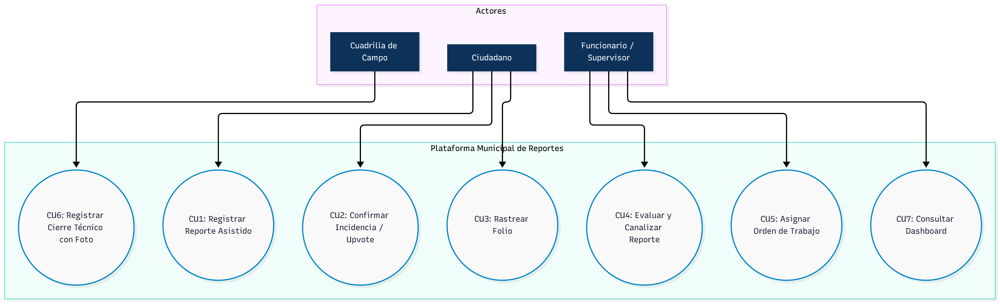

# UNIVERSIDAD TECNOLÓGICA DE TORREÓN
### DIVISIÓN DE TECNOLOGÍAS DE LA INFORMACIÓN Y COMUNICACIÓN
**INGENIERÍA EN DESARROLLO Y GESTIÓN DE SOFTWARE EN COMPETENCIAS PROFESIONALES**

---

# PLATAFORMA MUNICIPAL DE REPORTES CIUDADANOS E INCIDENCIAS URBANAS EN TIEMPO REAL (S.I.U.)
## Torreón Alerta — Sistema de Incidencias Urbanas

> Solución Web Progresiva (PWA) de nivel empresarial con motor geoespacial, desduplicación inteligente en tiempo real, canalización automatizada multi-organismo y panel operativo con tableros Kanban e indicadores de SLA para la Zona Metropolitana de La Laguna.

| Campo Institucional | Detalle de la Asignatura y Repositorio |
| :--- | :--- |
| **Institución** | Universidad Tecnológica de Torreón (UTT) |
| **División** | División de Tecnologías de la Información y Comunicación |
| **Carrera** | Ingeniería en Desarrollo y Gestión de Software en Competencias Profesionales |
| **Asignatura** | Desarrollo Web Profesional (Grado: 8°, Sección: A) |
| **Docente Evaluador** | Ing. Jesús Del Toro Robledo |
| **Fecha de Presentación** | Octubre de 2026 |
| **Ubicación** | Torreón, Coahuila, México |
| **Repositorio Remoto Oficial** | [https://github.com/Ezze191/aplicaciones-web-proyecto.git](https://github.com/Ezze191/aplicaciones-web-proyecto.git) |
| **Prototipo Interactivo & Maquetado (Figma)** | [SISTEMA DE GESTION DE INCIDENCIAS URBANAS – Figma](https://www.figma.com/design/CGnZg70NOCcgh4nI8NoP5a/SISTEMA-DE-GESTION-DE-INCIDENCIAS-URBANAS?node-id=0-1&p=f&t=wNc8P1ni78esi5Nz-0) |
| **Tipo de Documento** | Documentación Técnica Integral del Repositorio (README / Unidades 1 y 2) |

---

### Integrantes del Equipo de Desarrollo

| Nombre del Integrante | Matrícula | Rama de Trabajo | Rol Principal en el Proyecto |
| :--- | :---: | :---: | :--- |
| **González Acosta Sergio** | `23170137` | `origin/sergio` | **Arquitecto de Backend y Base de Datos:** Diseño de API RESTful con NestJS, modelado entidad-relación en PostgreSQL/PostGIS con TypeORM, validación DTO y servicios de mensajería. |
| **Hernández Ayala Erik Fernando** | `22170133` | `origin/fernando` | **Líder del Proyecto y Desarrollador Frontend PWA:** Dirección estratégica, gestión de Sprints, desarrollo del cliente web progresivo con Next.js 19, React 19 y Tailwind CSS, y lógica offline con IndexedDB. |
| **Castañeda Barraza Gema Daniela** | `21170129` | `origin/gema` | **Diseñadora UI/UX y Desarrolladora de Interfaces Interactivas:** Prototipado y wireframes de alta fidelidad en Figma (WCAG 2.1 AA), integración cartográfica con Leaflet, Tablero Kanban y Diccionario de Datos. |
| **Reyes Cortinas César Fabián** | `22170039` | `origin/cesar` | **Especialista en DevOps, Sistemas GIS y Seguridad:** Infraestructura Docker, pipelines de CI/CD en GitHub Actions, motor espacial PostGIS (ST_DWithin), seguridad JWT/RBAC y pruebas de carga k6. |

---

## Índice General del Contenido

- [Portada e Información Institucional](#universidad-tecnológica-de-torreón)
- [Unidad 1: Entregable de Avances del Proyecto (Análisis, Requerimientos y Arquitectura)](#unidad-1-entregable-de-avances-del-proyecto)
- [Unidad 2: Control de Versiones, Diagramas y Diccionario de Datos](#unidad-2-control-de-versiones-diagramas-y-diccionario-de-datos)

---

# Unidad 1: Entregable de Avances del Proyecto

> **Desarrollo Web Profesional | Avances del Proyecto — Unidad 1 (F-ACAD-174)**  
> **Ingeniería en Desarrollo y Gestión de Software — Universidad Tecnológica de Torreón**

---

## Índice de la Unidad 1

- [2. Problemática y Justificación](#2-problemática-y-justificación)
  - [2.1 Planteamiento y Contextualización de la Problemática](#21-planteamiento-y-contextualización-de-la-problemática)
  - [2.2 Justificación del Proyecto](#22-justificación-del-proyecto)
- [3. Objetivos](#3-objetivos)
  - [3.1 Objetivo General](#31-objetivo-general)
  - [3.2 Objetivos Específicos](#32-objetivos-específicos)
- [4. Alcances, Limitaciones y MVP](#4-alcances-limitaciones-y-mvp)
  - [4.1 Alcance del Proyecto](#41-alcance-del-proyecto)
  - [4.2 Limitaciones Explícitas del Proyecto](#42-limitaciones-explícitas-del-proyecto)
  - [4.3 Definición del MVP (Minimum Viable Product)](#43-definición-del-mvp-minimum-viable-product)
- [5. Requisitos Funcionales y No Funcionales](#5-requisitos-funcionales-y-no-funcionales)
  - [5.1 Requisitos Funcionales (RF)](#51-requisitos-funcionales-rf)
  - [5.2 Requisitos No Funcionales (RNF)](#52-requisitos-no-funcionales-rnf)
  - [5.3 Diagrama General de Casos de Uso del Sistema](#53-diagrama-general-de-casos-de-uso-del-sistema)
- [6. Análisis de Riesgos](#6-análisis-de-riesgos)
- [7. Elección de Metodología y Roles del Equipo](#7-elección-de-metodología-y-roles-del-equipo)
  - [7.1 Justificación de la Metodología Ágil (Scrum Adaptado)](#71-justificación-de-la-metodología-ágil-scrum-adaptado)
  - [7.2 Roles y Responsabilidades del Equipo](#72-roles-y-responsabilidades-del-equipo)
- [8. Separación del Proyecto en Tareas (WBS / EDT)](#8-separación-del-proyecto-en-tareas-wbs--edt)
- [9. Cronograma de Actividades e Hitos Verificables](#9-cronograma-de-actividades-e-hitos-verificables)
- [10. Elección de Estructura Web y Tecnologías](#10-elección-de-estructura-web-y-tecnologías)
  - [10.1 Diagrama de Arquitectura del Sistema](#101-diagrama-de-arquitectura-del-sistema)
  - [10.2 Comparativa y Justificación del Stack Tecnológico](#102-comparativa-y-justificación-del-stack-tecnológico)
  - [10.3 Arquitectura y Modelo de Base de Datos Relacional / Espacial](#103-arquitectura-y-modelo-de-base-de-datos-relacional--espacial)
- [11. Selección y Justificación de Patrones de Diseño](#11-selección-y-justificación-de-patrones-de-diseño)
  - [11.1 Patrones Creacionales](#111-patrones-creacionales)
  - [11.2 Patrones Estructurales](#112-patrones-estructurales)
  - [11.3 Patrones Comportamentales](#113-patrones-comportamentales)
- [12. Wireframes y Arquitectura de Información](#12-wireframes-y-arquitectura-de-información)
- [13. Búsquedas en el Sitio Web y Filtros Avanzados](#13-búsquedas-en-el-sitio-web-y-filtros-avanzados)
  - [13.1 Búsqueda Rápida Ciudadana](#131-búsqueda-rápida-ciudadana)
  - [13.2 Búsqueda Avanzada y Filtros Multicriterio (Backoffice Operativo)](#132-búsqueda-avanzada-y-filtros-multicriterio-backoffice-operativo)
- [14. Validación de la Información (FrontEnd y BackEnd)](#14-validación-de-la-información-frontend-y-backend)
  - [14.1 Validaciones en la Interfaz de Usuario (FrontEnd)](#141-validaciones-en-la-interfaz-de-usuario-frontend)
  - [14.2 Validaciones en el Lado del Servidor (BackEnd)](#142-validaciones-en-el-lado-del-servidor-backend)
- [15. Definición e Inventario de Contenido y Licenciamiento](#15-definición-e-inventario-de-contenido-y-licenciamiento)
  - [15.1 Tono de Comunicación y Copywriting](#151-tono-de-comunicación-y-copywriting)
  - [15.2 Tipografía y Semiótica Cromática](#152-tipografía-y-semiótica-cromática)
  - [15.3 Criterios de Selección de Recursos y Licencias Legales](#153-criterios-de-selección-de-recursos-y-licencias-legales)

---

## 2. Problemática y Justificación

### 2.1 Planteamiento y Contextualización de la Problemática

**Diagnóstico Situacional y Arquitectura Institucional:** En los municipios que integran la Zona Metropolitana de La Laguna (Torreón y Matamoros en Coahuila; Gómez Palacio y Lerdo en Durango), la atención operativa de servicios públicos e infraestructura urbana primaria enfrenta una ineficiencia sistémica atribuible a la desarticulación tecnológica y administrativa de los canales de atención ciudadana. Las dependencias gubernamentales y organismos descentralizados autónomos —como el Sistema Municipal de Aguas y Saneamiento (SIMAS), la Comisión Federal de Electricidad (CFE), la Dirección de Obras Públicas y la Dirección de Alumbrado Público— operan en silos de información aislados, utilizando sistemas legados heterogéneos, registros manuales en bitácoras físicas o líneas de atención telefónica analógicas (Call Centers) desprovistas de mecanismos de integración de software o canalización automatizada en tiempo real.

Esta falta de interoperabilidad tecnológica y la ausencia de un concentrador georreferenciado generan cinco vectores de falla crítica que degradan sustancialmente los niveles de servicio municipal (SLA):

- **Descoordinación Competencial y Rebote Traspasivo:** El ciudadano promedio desconoce las fronteras jurisdiccionales y la delimitación de competencias entre entes municipales, federales y empresas concesionarias (por ejemplo, distinguiendo si una falla en luminarias deriva de líneas de alta tensión de CFE, infraestructura subterránea municipal o redes de telecomunicaciones privadas). Esto provoca el rechazo sistemático y traspaso recurrente de folios entre dependencias, incrementando la fricción y el abandono del trámite.
- **Opacidad Transaccional ("Efecto Caja Negra"):** Al ingresar un reporte vía telefónica o ventanilla, el usuario no recibe un identificador alfanumérico estandarizado ni acceso a una interfaz de seguimiento en tiempo real. La falta de transparencia sobre el estado de procesamiento (registrado, asignado, en cuadrilla, resuelto) destruye la confianza cívica y genera sobrecarga por consultas reiteradas sobre un mismo problema.
- **Duplicidad Redundante e Ineficiencia Operativa:** Ante contingencias visibles de alto impacto (colapso de colectores, foso de drenaje abierto o fallas de red eléctrica en avenidas principales), decenas de ciudadanos reportan de forma independiente el mismo suceso. Sin una capa cartográfica distributiva con motor de desduplicación geográfica en tiempo real, las dependencias capturan N folios redundantes, saturando la capacidad de atención y dispersando los recursos de las cuadrillas.
- **Deficiencia en Trazabilidad y Evidencia Técnico-Campo:** El despacho de órdenes de trabajo hacia las unidades operativas de campo carece de geolocalización satelital estricta y auditoría fotográfica en tiempo real. Es habitual que se cierren tickets administrativamente sin la debida resolución física o que múltiples unidades atiendan sin coordinación la misma ubicación por falta de un tablero unificado de control de flotas.
- **Carencia de Métricas Centralizadas y Desconexión con Planes Municipales:** La falta de telemetría geoespacial impide a los directores y tomadores de decisiones identificar puntos críticos de recurrencia (hotspots) para programar obras preventivas, limitando la gestión pública a un modelo reactivo e ineficiente.

### 2.2 Justificación del Proyecto

La justificación técnica, económica y social del proyecto se fundamenta sólidamente en cuatro pilares estratégicos de la ingeniería de software moderna:

- **Justificación Teórica y Paradigmática:** Se adhiere a los marcos normativos internacionales de Ciudades Inteligentes (*Smart Cities*, ISO 37122) y Gobierno Abierto. El modelo promueve la corresponsabilidad cívica mediante crowdsourcing de información geoespacial, permitiendo la validación distribuida ("Upvoting") para establecer prioridades dinámicas según el impacto social comunitario real.
- **Justificación Operativa y Financiera:** Optimiza el presupuesto público reduciendo drásticamente los desplazamientos innecesarios y el consumo de combustible de las cuadrillas operativas. Mediante la consolidación de reportes bajo folios maestros y el requisito de evidencia fotográfica georreferenciada del "antes" y "después", se garantiza una tasa de efectividad superior al 90% en la resolución técnica al primer intento.
- **Justificación Arquitectónica y Tecnológica:** Implementa un stack tecnológico moderno, desacoplado y de código abierto (Next.js PWA, NestJS, PostgreSQL/PostGIS, Redis, Tailwind CSS) que erradica la dependencia de licencias privativas costosas y proporciona capacidades PWA nativas con alta resiliencia offline y bajo consumo de datos móviles.

---

## 3. Objetivos

### 3.1 Objetivo General

Diseñar, desarrollar e implementar una plataforma web progresiva (PWA) de nivel empresarial para la gestión integral de incidencias urbanas en la Zona Metropolitana de Torreón, incorporando un motor geoespacial de deduplicación inteligente en tiempo real, canalización automatizada multi-organismo (SIMAS, CFE, Obras Públicas), mecanismos de validación vecinal distribuida y un panel de control operativo (Backoffice) multirol con tableros Kanban e indicadores de SLA, orientados a reducir en más del 40% los tiempos de atención técnica en campo y elevar la transparencia cívica municipal.

### 3.2 Objetivos Específicos

- **OE1 (Frontend PWA y Captura Asistida):** Desarrollar una interfaz de usuario Web Progresiva (PWA) bajo el enfoque Mobile-First accesible (WCAG 2.1 AA), implementando un flujo intuitivo de reporte en 3 pasos respaldado por geolocalización GPS de precisión, captura fotográfica en vivo con bloqueo de almacenamiento local y categorización estandarizada mediante DTOs.
- **OE2 (Motor Geoespacial y Deduplicación Algorítmica):** Construir un motor espacial sobre PostgreSQL/PostGIS e índices GiST que ejecute consultas de proximidad métrica (`ST_DWithin`) en menos de 100 ms para agrupar automáticamente incidencias similares en un radio configurable de 20 a 50 metros bajo un único folio maestro.
- **OE3 (Mecanismo de Colaboración Vecinal y Prioridad Dinámica):** Implementar un subsistema social de confirmación comunitaria ("Sigue ahí" / "Upvoting") que permita a la ciudadanía respaldar incidentes activos cercanos, recalculando automáticamente la severidad y el nivel de urgencia dentro de las colas de atención de cada dependencia.
- **OE4 (Backoffice Operativo e Indicadores SLA):** Diseñar una plataforma administrativa multi-organismo dotada de tableros Kanban drag-and-drop, semáforos temporales de cumplimiento de SLA por criticidad y herramientas de asignación inteligente de órdenes de trabajo hacia flotas de campo.
- **OE5 (Trazabilidad E2E y Cierre Técnico Auditado):** Establecer un protocolo obligatorio de validación de resolución en campo requiring coordenadas GPS dentro del perímetro y la adjunción de una foto de evidencia del "después", disparando notificaciones en tiempo real (PWA y correo Resend API) hacia los ciudadanos involucrados.

---

## 4. Alcances, Limitaciones y MVP

### 4.1 Alcance del Proyecto

El alcance global del proyecto abarca el ciclo de vida completo de ingeniería de software para la entrega de una plataforma de grado de producción, cubriendo:

- **Módulo Ciudadano Progressive Web App (PWA):** Aplicación web responsiva con Service Workers, `manifest.json` y almacenamiento persistente IndexedDB para capacidades offline, operable desde dispositivos móviles (Android/iOS) y equipos de escritorio sin instalación previa desde tiendas digitales.
- **Plataforma Backoffice y Gestión Multi-Organismo:** Panel administrativo centralizado con control de acceso basado en roles (RBAC) para la supervisión y despacho de órdenes de trabajo en tres entidades primarias: SIMAS (agua y saneamiento), CFE (red eléctrica y alumbrado) y Obras Públicas (pavimentación y bacheo).
- **Capa Cartográfica Interactiva y BI:** Integración de visualización vectorial sobre Leaflet / OpenStreetMap con soporte de mapas de calor (Heatmaps) para análisis de densidad de averías e inteligencia de negocios municipal.
- **Servicios Notificacionales y Trazabilidad Pública:** Pipeline automatizado de mensajería transaccional vía Resend API y notificaciones PWA en vivo, complementado con un portal público de rastreo por folio alfanumérico sin autenticación obligatoria.
- **Infraestructura DevSecOps y Cloud Deployment:** Contenerización completa mediante Docker / Docker Compose, automatización de pruebas e integración continua vía GitHub Actions y despliegue sobre arquitectura Cloud con certificados TLS 1.3.

### 4.2 Limitaciones Explícitas del Proyecto

- **Dependencia de Conectividad Móvil:** La sincronización remota requiere conexión activa (4G/5G/WiFi). Si bien la PWA permite la captura inicial y almacenamiento local temporal en IndexedDB sin red, la transmisión del paquete hacia los servidores centrales queda pospuesta hasta restablecer el enlace.
- **Exclusión de Servicios de Emergencia Seguridad Ciudadana:** La plataforma no actúa como sustituto del sistema de emergencias 911 ni procesa denuncias de delitos en flagrancia. Su alcance se acota estrictamente a infraestructura y servicios urbanos municipales.
- **Interoperabilidad Limitada con ERPs Legados:** La integración con bases de datos legacy o ERPs internos de CFE o SIMAS se efectuará exclusivamente mediante APIs REST/Webhooks expuestos por dichas entidades. De no contar con interfaces web modernas, se proporcionarán módulos de exportación estandarizada en formato CSV/JSON.
- **Responsabilidad Exclusiva del Software:** El equipo de desarrollo es responsable únicamente del diseño, construcción, pruebas y despliegue del sistema tecnológico. La disponibilidad de cuadrillas, tiempos físicos de reparación en campo y aprovisionamiento de insumos son responsabilidad exclusiva de las dependencias gubernamentales.

### 4.3 Definición del MVP (Minimum Viable Product)

#### 4.3.1 Autenticación y Gestión de Usuarios
- **Usuarios Ciudadanos (Comunes):** El registro requiere datos básicos como nombre(s), apellido paterno, apellido materno, correo electrónico y contraseña. Una vez registrados, pueden iniciar sesión mediante sus credenciales institucionales o personales en el portal oficial.
- **Usuarios Institucionales (Con Privilegios):** Para delegaciones como SIMAS o CFE, se utilizan credenciales predeterminadas por entidad. El sistema identifica automáticamente la dependencia asociada al inicio de sesión y restringe el acceso a una sola sesión activa simultánea por razones de seguridad, redirigiendo al usuario al panel de administración (dashboard) con sus permisos correspondientes.

#### 4.3.2 Pantalla Principal e Interfaz Operativa
- **Interfaz Ciudadana:** Incluye una barra superior con el nombre de usuario activo, un campo de búsqueda global, un centro de notificaciones para el seguimiento de solicitudes y un menú lateral desplegable con accesos rápidos a "Mis Reportes" y "Nuevo Reporte". El cuerpo principal presenta un mapa interactivo geolocalizado con marcadores visuales de las incidencias activas dentro del radio del usuario.
- **Panel Administrativo:** Muestra indicadores estadísticos clave (reportes totales, resueltos y pendientes). A través del menú principal, los administradores acceden a la gestión avanzada de folios, filtros por estatus y asignación de trabajos.

#### 4.3.3 Flujo de Registro y Desduplicación de Reportes
El usuario inicia el proceso desde el menú desplegable seleccionando "Nuevo Reporte". El formulario asistido solicita la ubicación mediante un mapa interactivo para posicionar el pin de la incidencia, la categorización de la falla (bache, fuga de agua, alumbrado, etc.) y la evaluación del nivel de riesgo. Todas las selecciones se realizan mediante listas desplegables estandarizadas.

Si el sistema detecta un reporte previo registrado dentro del mismo rango geográfico con características similares, redirige automáticamente al usuario hacia la incidencia existente. Esto permite al ciudadano respaldar o sumar confirmaciones al reporte original, consolidando la prioridad sin duplicar folios operativos. En la pantalla principal en el body se va mostrar el mapa donde se encuentra el usuario en ese momento mostrándole con iconos en el mapa las incidencias que hay dentro de su rango.

#### 4.3.4 Canalización y Gestión Operativa de Incidencias
Las nuevas incidencias activan notificaciones inmediatas para el personal de la delegación correspondiente. En el listado asignado a la dependencia, los administradores revisan el detalle, la ubicación y las evidencias fotográficas. Tienen la facultad de aceptar la solicitud asignando una flotilla operativa específica según la zona, o bien rechazarla justificando formalmente el motivo.

#### 4.3.5 Resolución en Campo y Evidencia Técnica
Las cuadrillas operativas acceden al apartado de "Reportes Asignados" para consultar la ubicación georreferenciada y especificaciones de la falla. Para marcar una incidencia como resuelta, el personal debe encontrarse físicamente dentro del rango de coordenadas reportado y adjuntar una fotografía final capturada en tiempo real a través de la cámara de la aplicación, bloqueando la carga de imágenes desde la galería local para garantizar la autenticidad de la reparación.

#### 4.3.6 Administración de Flotillas Operativas
Los usuarios administradores cuentan con un módulo específico para el alta de cuadrillas de trabajo. En este apartado se define el nombre de la flotilla, la asignación de la zona de cobertura mediante la delimitación en mapa, y la creación de credenciales exclusivas de acceso para el personal de campo.

---

## 5. Requisitos Funcionales y No Funcionales

### 5.1 Requisitos Funcionales (RF)

| ID | Nombre del Requisito | Prioridad | Descripción Funcional | Criterio de Aceptación / Historia |
| :---: | :--- | :---: | :--- | :--- |
| **RF-01** | Autenticación Diferenciada y Portal Unificado | Alta | El portal debe permitir el inicio de sesión unificado para ciudadanos (mediante correo/contraseña) y personal institucional de delegaciones como SIMAS o CFE (mediante credenciales predeterminadas), identificando la entidad, restringiendo a una sola sesión activa y redireccionando al panel correspondiente. | *Como usuario institucional o ciudadano, quiero ingresar desde un portal unificado para acceder automáticamente a las funciones según mi rol y dependencia asignada.* |
| **RF-02** | Interfaz Principal con Mapa Geolocalizado | Alta | La pantalla principal debe integrar una barra superior con datos de sesión, búsqueda global, centro de notificaciones, menú desplegable y un mapa interactivo que muestre con marcadores visuales las incidencias activas en el rango actual del usuario. | *Como ciudadano, quiero visualizar las incidencias cercanas sobre un mapa interactivo para informarme del estado del entorno urbano.* |
| **RF-03** | Captura Asistida mediante Listas Desplegables | Alta | El formulario de registro de reportes debe guiar al usuario mediante posicionamiento de pin en mapa y listas desplegables estandarizadas para seleccionar la categoría de la falla (fuga de agua, alumbrado, bache) y el nivel de riesgo. | *Como ciudadano, quiero seleccionar la categoría de la falla desde listas estandarizadas para registrar mi reporte de forma rápida y sin errores de captura.* |
| **RF-04** | Redirección Automática por Desduplicación Geográfica | Alta | El sistema debe evaluar la ubicación y tipo de fallo durante la captura; si detecta un reporte previo dentro del rango espacial, redirigirá automáticamente al usuario para confirmar o respaldar la incidencia existente sin duplicar folios. | *Como usuario, quiero respaldar un reporte existente cercano para elevar la prioridad del problema sin generar folios duplicados.* |
| **RF-05** | Canalización y Evaluación Operativa de Incidencias | Alta | El panel administrativo notificará en tiempo real las incidencias asignadas a la delegación correspondiente (SIMAS/CFE/Obras Públicas), permitiendo al personal revisar evidencias, aceptar asignando flotillas por zona o rechazar justificando el motivo. | *Como administrador de delegación, quiero revisar el detalle de las solicitudes para aceptarlas asignando flotillas o rechazarlas con justificación formal.* |
| **RF-06** | Resolución en Campo con Evidencia Fotográfica de Cámara | Alta | Para marcar una incidencia como resuelta, las cuadrillas operativas deberán estar dentro del radio de coordenadas reportado y adjuntar obligatoriamente una fotografía tomada en el instante con la cámara de la aplicación, bloqueando la carga desde la galería local. | *Como supervisor municipal, exijo foto en tiempo real tomada desde la cámara para garantizar la veracidad física del trabajo concluido.* |
| **RF-07** | Administración y Alta de Flotillas Operativas | Alta | El sistema debe proveer a los administradores un módulo exclusivo para dar de alta cuadrillas, definir el nombre de la flotilla, delimitar su zona de cobertura geográfica en mapa y generar credenciales de acceso para el personal de campo. | *Como administrador, quiero dar de alta cuadrillas y definir su zona de cobertura en el mapa para organizar eficientemente las áreas de atención.* |
| **RF-08** | Tablero Kanban y Control de SLA por Delegación | Alta | El sistema proporcionará tableros Kanban para mover solicitudes por estados y calculará semáforos de SLA según la criticidad (Rojo: Vencido, Amarillo: Por vencer, Verde: En tiempo). | *Como supervisor de área, quiero monitorear los indicadores de tiempo de respuesta mediante semáforos de SLA para evitar demoras en las reparaciones.* |
| **RF-09** | Notificaciones Automatizadas de Estatus | Media | El sistema enviará notificaciones automáticas dentro de la PWA y por correo transaccional al ciudadano cuando el reporte cambie de estado a "Asignado" o "Resuelto". | *Como ciudadano, quiero recibir alertas automáticas sobre los avances de mi reporte para mantenerme informado sin necesidad de consultar manualmente.* |
| **RF-10** | Consulta Pública y Rastreo por Folio | Alta | El sistema permitirá la búsqueda pública y directa del historial y avance de cualquier reporte utilizando el número de folio alfanumérico generado. | *Como usuario, quiero ingresar el número de folio en el portal para verificar el estado de mi solicitud en cualquier momento.* |

### 5.2 Requisitos No Funcionales (RNF)

| ID | Categoría / Criterio | Especificación Verificable |
| :---: | :--- | :--- |
| **RNF-01** | Rendimiento y Tiempo de Respuesta | El tiempo de carga inicial de la aplicación PWA no debe superar los 2.0 segundos en redes móviles 4G; las consultas al backend deben responder en un lapso inferior a 300 ms. |
| **RNF-02** | Seguridad y Protección de Datos | El tráfico de datos se protegerá mediante HTTPS/TLS 1.3. La autenticación utilizará tokens JWT con expiración controlada, restricción de sesión única para cuentas institucionales y saneamiento contra inyecciones SQL y XSS. |
| **RNF-03** | Disponibilidad del Sistema | La infraestructura web garantizará una disponibilidad operativa del 99.5% continuo durante las 24 horas del día. |
| **RNF-04** | Precisión y Eficiencia Geoespacial | El motor espacial PostGIS ejecutará consultas de proximidad e índices GiST para resolver la desduplicación geográfica y validación de límites territoriales en menos de 100 ms. |
| **RNF-05** | Usabilidad y Accesibilidad (WCAG) | La interfaz web responderá al enfoque Mobile-First y cumplirá el estándar WCAG 2.1 Nivel AA, asegurando relaciones de contraste adecuadas y facilidad de uso en pantallas táctiles. |
| **RNF-06** | Compatibilidad Multiplataforma | La plataforma PWA ofrecerá un funcionamiento uniforme en navegadores web modernos (Chrome, Safari, Firefox, Edge) tanto en dispositivos móviles (Android, iOS) como de escritorio. |

### 5.3 Diagrama General de Casos de Uso del Sistema

A continuación se presenta el modelado funcional de casos de uso del **Sistema de Incidencias Urbanas (S.I.U.)**, estructurado en torno a los tres actores primarios de la plataforma:

<p align="center">
  
</p>

#### Matriz de Casos de Uso por Actor

| Actor | Caso de Uso | Descripción Funcional | Interfaz / Canal |
| :--- | :--- | :--- | :--- |
| **Ciudadano** | **CU1: Registrar Reporte Asistido** | Captura asistida de anomalía urbana con foto en tiempo real, geolocalización satelital asistida en mapa y categorización por dependencia. | PWA Móvil / Desktop |
| **Ciudadano** | **CU2: Confirmar Incidencia / Upvote** | Validación comunitaria de reportes activos cercanos ("Sigue ahí"), incrementando la prioridad dinámica del ticket sin duplicar folios. | PWA Móvil / Mapa |
| **Ciudadano** | **CU3: Rastrear Folio** | Consulta pública e instantánea de la trazabilidad y estado de resolución mediante folio alfanumérico institucional (sin login obligatorio). | Portal Público Web |
| **Funcionario / Supervisor** | **CU4: Evaluar y Canalizar Reporte** | Recepción de incidencias en cola de delegación (SIMAS, CFE, Obras Públicas), revisión de evidencias fotográficas y validación técnica. | Panel Backoffice Web |
| **Funcionario / Supervisor** | **CU5: Asignar Orden de Trabajo** | Creación y despacho de orden de trabajo vinculada a una cuadrilla operativa activa en turno dentro del sector. | Tablero Kanban / Backoffice |
| **Cuadrilla de Campo** | **CU6: Registrar Cierre Técnico con Foto** | Conclusión del trabajo en sitio mediante validación GPS perimetral y carga obligatoria de fotografía en vivo del "después" (bloqueo de galería). | PWA Operativa de Campo |
| **Funcionario / Supervisor** | **CU7: Consultar Dashboard** | Supervisión ejecutiva en tiempo real con indicadores SLA, mapas de calor geoespaciales y tasa de desduplicación. | Dashboard BI Ejecutivo |

---

## 6. Análisis de Riesgos

Se ha formalizado la Matriz de Riesgos detallada del proyecto (`Matriz de Riesgos - Plataforma Municipal de Reportes.xlsx`) para identificar, clasificar y mitigar los factores críticos que pudieran comprometer el desarrollo, la seguridad o el despliegue de la solución:

| ID Riesgo | Categoría | Descripción del Evento de Riesgo | Probabilidad | Impacto | Nivel | Estrategia y Acciones de Mitigación |
| :---: | :---: | :--- | :---: | :---: | :---: | :--- |
| **RK-01** | Técnico | Cuello de botella en consultas geoespaciales por volumen masivo de reportes. | Media | Alto | **Alto** | Implementación de índices espaciales GiST en PostgreSQL/PostGIS y particionamiento espacial de tablas por municipio. |
| **RK-02** | Operativo | Falsificación o simulación de reparaciones por personal de cuadrillas. | Media | Alto | **Alto** | Captura obligatoria de foto en vivo a través de la API HTML5 MediaDevices/Camera, bloqueando la carga desde galería y exigiendo geolocalización coincidente. |
| **RK-03** | Seguridad | Exposición de credenciales de servicios Cloud (Resend API, Storage, JWT Secret). | Baja | Crítico | **Alto** | Uso estricto de variables de entorno (.env), escaneo automatizado de secretos con GitGuardian y almacenamiento seguro en GitHub Secrets. |
| **RK-04** | Conectividad | Pérdida de conectividad móvil en campo durante la captura del reporte. | Alta | Medio | **Medio** | Arquitectura PWA con Service Workers y almacenamiento temporal en IndexedDB; encolamiento de reportes y sincronización en segundo plano al recuperar red. |
| **RK-05** | Adopción | Resistencia de dependencias para actualizar estatus en tiempo real. | Media | Medio | **Medio** | Diseño de interfaces Backoffice ultra simplificadas tipo Kanban con semáforos de SLA visuales y alertas automáticas por correo. |

---

## 7. Elección de Metodología y Roles del Equipo

### 7.1 Justificación de la Metodología Ágil (Scrum Adaptado)

**Marco Metodológico:** Se selecciona el marco de trabajo Scrum adaptado a entornos de desarrollo web profesional por su capacidad para gestionar requisitos cambiantes, facilitar entregas incrementales funcionales al final de cada iteración y permitir la validación continua con dependencias públicas municipales. Los ciclos de trabajo se estructuran en Sprints de 2 semanas de duración, incorporando ceremonias de:
- **Sprint Planning:** Definición del backlog y compromiso de entrega quincenal.
- **Daily Standup:** Sincronización diaria de 15 minutos entre los 4 integrantes.
- **Sprint Review:** Demostración de incrementos funcionales desplegados en entorno de pruebas.
- **Sprint Retrospective:** Análisis de retrospectiva y mejora continua de procesos.

### 7.2 Roles y Responsabilidades del Equipo

- **Hernández Ayala Erik Fernando — Líder del Proyecto y Desarrollador Frontend PWA:**  
  Responsable de la dirección estratégica, planificación ágil de Sprints y supervisión del cronograma general. Encargado del desarrollo del cliente web progresivo (PWA) utilizando Next.js, React 19 y Tailwind CSS, implementando el flujo de captura de incidencias en tres pasos (geolocalización GPS, toma de fotografía en vivo y categorización), el mecanismo de validación comunitaria vecinal ("Upvotes") y la integración de Service Workers e IndexedDB para capacidades offline.
- **González Acosta Sergio — Arquitecto de Backend y Base de Datos:**  
  Diseñador e implementador de la arquitectura del servidor basada en NestJS y TypeScript. Encargado del modelado entidad-relación y gestión de migraciones en PostgreSQL con TypeORM, desarrollo de la API RESTful con validaciones estrictas vía DTOs y class-validator, integración del servicio transaccional de correos electrónicos (Resend API), optimización de rendimiento de consultas SQL y elaboración de pruebas unitarias/integración con Jest y Supertest.
- **Castañeda Barraza Gema Daniela — Diseñadora UI/UX y Desarrolladora de Interfaces Interactivas:**  
  Responsable del diseño del sistema visual, prototipado de alta fidelidad y wireframes responsivos en Figma bajo estándares de accesibilidad WCAG 2.1 AA. Encargada de la integración cartográfica del mapa vectorial interactivo (Leaflet / OpenStreetMap), el desarrollo del Tablero Kanban drag-and-drop para el Backoffice de gestión operativa por dependencias, el portal público de consulta de estatus por folio alfanumérico y la elaboración de manuales de usuario y documentación técnica.
- **Reyes Cortinas César Fabián — Especialista en DevOps, Sistemas GIS y Seguridad:**  
  Encargado de la infraestructura de entornos de desarrollo y producción utilizando Docker y pipelines CI/CD en GitHub Actions. Diseñador del motor geoespacial de desduplicación y clustering de reportes mediante consultas espaciales nativas en PostGIS (`ST_DWithin`), responsable de la seguridad mediante autenticación JWT, control de acceso basado en roles (RBAC), encriptación TLS 1.3, integración con Cloud Storage para optimización de imágenes y ejecución de pruebas de estrés/carga con k6 y JMeter.

---

## 8. Separación del Proyecto en Tareas (WBS / EDT)

| Fase / Sprint | ID Tarea | Descripción de la Tarea | Entregable / Criterio de Aceptación | Persona Asignada |
| :--- | :---: | :--- | :--- | :--- |
| **Mes 1: Sprint 1**  <br>*(Semanas 1-2)* | **T-1.2** | Levantamiento de requisitos detallados, definición de historias de usuario y matriz. | Product Backlog documentado y validado en Jira/GitHub Projects. | Hernández Ayala Erik Fernando |
| | **T-1.3** | Diseño UI/UX de wireframes de alta fidelidad para PWA y sistema Backoffice en Figma. | Prototipo interactivo navegable mobile y desktop en Figma. | Castañeda Barraza Gema Daniela |
| | **T-1.4** | Configuración de entornos (Docker local, PostgreSQL + PostGIS, repositorio GitHub y CI/CD). | docker-compose funcional con PostgreSQL/PostGIS e integración continua configurada. | Reyes Cortinas César Fabián |
| **Mes 1: Sprint 2**  <br>*(Semanas 3-4)* | **T-2.1** | Inicialización de proyecto NestJS, definición de módulos core y configuración de TypeORM. | Estructura NestJS base con conexión ORM y migraciones automáticas funcionales. | González Acosta Sergio |
| | **T-2.2** | Desarrollo del módulo de Autenticación, Roles (RBAC), JWT y endpoints Auth en Backend. | Endpoints Auth protegidos con JWT y roles (Admin, Cuadrilla, Ciudadano). | Reyes Cortinas César Fabián |
| | **T-2.3** | Inicialización de Next.js 19 con Tailwind CSS y componentes de Layout base. | Estructura Next.js con diseño responsivo, temas de color y navegación base. | Castañeda Barraza Gema Daniela |
| | **T-2.4** | Construcción de formularios de autenticación e integración con API Auth en Frontend. | Flujo completo de Login/Registro y almacenamiento de sesión JWT en cliente. | Hernández Ayala Erik Fernando |
| **Mes 2: Sprint 3**  <br>*(Semanas 5-6)* | **T-3.1** | Desarrollo de API REST para creación y consulta de reportes con validaciones DTO. | Endpoints POST /reports y GET /reports/:folio con class-validator. | González Acosta Sergio |
| | **T-3.2** | Implementación de motor de geo-desduplicación y clustering con PostGIS (ST_DWithin). | Función de agrupación espacial a 50m que asigna folio maestro a reportes duplicados. | Reyes Cortinas César Fabián |
| | **T-3.3** | Desarrollo de la interfaz de captura de reporte en 3 pasos PWA (GPS, Foto, Categoría). | Wizard de reporte asistido con detección de ubicación GPS e imágenes en vivo. | Hernández Ayala Erik Fernando |
| | **T-3.4** | Integración de mapas vectoriales interactivos con Leaflet / OpenStreetMap en Frontend. | Mapa interactivo con pines de fallas geolocalizadas y controles de zoom/desplazamiento. | Castañeda Barraza Gema Daniela |
| **Mes 2: Sprint 4**  <br>*(Semanas 7-8)* | **T-4.1** | Integración de servicio Cloud Storage (Amazon S3 / Cloudinary) para subida de fotos. | Servicio de upload que optimiza imágenes a WebP y retorna URLs seguras firmadas. | Reyes Cortinas César Fabián |
| | **T-4.2** | Desarrollo del sistema de notificaciones por email transaccional usando Resend API. | Envío automático de correos con folio y actualizaciones de estado del reporte. | González Acosta Sergio |
| | **T-4.3** | Desarrollo del portal público de consulta de estatus por folio alfanumérico. | Vista pública con línea del tiempo de trazabilidad y evidencia fotográfica. | Castañeda Barraza Gema Daniela |
| | **T-4.4** | Construcción del sistema de validación comunitaria vecinal ("Upvotes" / "Sigue ahí"). | Botón funcional de confirmación vecinal que incrementa prioridad del ticket. | Hernández Ayala Erik Fernando |
| **Mes 3: Sprint 5**  <br>*(Semanas 9-10)* | **T-5.1** | Desarrollo de API y lógica de gestión de órdenes de trabajo para Backoffice multirol. | Endpoints para cambio de estado, asignación de cuadrillas y filtros por dependencia. | González Acosta Sergio |
| | **T-5.2** | Diseño y desarrollo del Tablero Kanban interactivo para despacho por dependencias. | Tablero Kanban drag-and-drop con columnas: Nuevos, Asignados, En Proceso, Resueltos. | Castañeda Barraza Gema Daniela |
| | **T-5.3** | Implementación del cálculo de semáforos SLA y alertas visuales de vencimiento. | Semáforo de SLA dinámico (Rojo/Amarillo/Verde) según tiempos configurables. | Reyes Cortinas César Fabián |
| | **T-5.4** | Desarrollo del módulo de Cierre Técnico Obligatorio con fotografía del "después". | Formulario de cierre para cuadrilla que bloquea el cambio a "Resuelto" sin foto. | Hernández Ayala Erik Fernando |
| **Mes 3: Sprint 6**  <br>*(Semanas 11-12)* | **T-6.1** | Implementación de panel de Búsqueda Avanzada y Filtros Multicriterio en Backoffice. | Filtros combinados funcionales (dependencia, fechas, colonia, estado SLA, cuadrilla). | Castañeda Barraza Gema Daniela |
| | **T-6.2** | Desarrollo de Dashboard Ejecutivo BI con Mapas de Calor (Heatmaps) de incidencias. | Dashboard con indicadores clave (KPIs) y capa de mapa de calor geoespacial. | Reyes Cortinas César Fabián |
| | **T-6.3** | Configuración PWA (Service Workers, Manifest, IndexedDB para persistencia offline). | PWA instalable con soporte de almacenamiento local de reportes sin conexión. | Hernández Ayala Erik Fernando |
| | **T-6.4** | Optimizaciones Backend de rendimiento (consultas SQL, índices GiST en PostGIS). | Tiempos de respuesta de la API < 300 ms verificados con pruebas de carga. | González Acosta Sergio |
| **Mes 4: Sprint 7**  <br>*(Semanas 13-14)* | **T-7.1** | Ejecución de Pruebas Unitarias y de Integración en Backend (Jest / Supertest). | Cobertura de código > 80% y reporte de ejecución sin errores en CI/CD. | González Acosta Sergio |
| | **T-7.2** | Pruebas End-to-End (E2E) con Cypress/Playwright e inspección de accesibilidad WCAG 2.1 AA. | Flujos críticos validados de punta a punta y cumplimiento de accesibilidad. | Castañeda Barraza Gema Daniela |
| | **T-7.3** | Pruebas de Estrés y Carga con k6/JMeter (5,000 usuarios concurrentes) y auditoría OWASP. | Informe de pruebas de carga satisfactorio y remediación de vulnerabilidades OWASP. | Reyes Cortinas César Fabián |
| | **T-7.4** | Pruebas de Aceptación de Usuario (UAT) y corrección de observaciones del cliente. | Acta de conformidad firmada y feedback incorporado en el sistema. | Hernández Ayala Erik Fernando |
| **Mes 4: Sprint 8**  <br>*(Semanas 15-16)* | **T-8.1** | Configuración de la infraestructura de producción en la nube (Vercel, AWS/DigitalOcean, SSL). | Servidores de producción aprovisionados con SSL TLS 1.3 y dominio oficial activo. | Reyes Cortinas César Fabián |
| | **T-8.2** | Despliegue final (Go-Live), monitoreo con Sentry/Datadog y respaldo inicial de BD. | Plataforma operando en producción al 100% con telemetría activa. | González Acosta Sergio |
| | **T-8.3** | Elaboración de manuales de usuario (Ciudadano y Operativo) y documentación Swagger API. | Manuales en PDF y portal OpenAPI/Swagger disponible. | Castañeda Barraza Gema Daniela |
| | **T-8.4** | Capacitación a personal de dependencias municipales y entrega formal del proyecto. | Sesiones de capacitación completadas y acta de entrega final firmada. | Hernández Ayala Erik Fernando |

---

## 9. Cronograma de Actividades e Hitos Verificables

El cronograma general del proyecto (`Cronograma del proyecto.png`) se organiza en una ruta crítica distribuida en 8 Sprints quincenales, estableciendo cinco hitos clave de verificación:

- **Hito 1 (Fin de Sprint 2):** Núcleo de autenticación RBAC, base de datos espacial PostgreSQL/PostGIS inicializada y layout base PWA funcional.
- **Hito 2 (Fin de Sprint 4):** Motor de captura en 3 pasos con geolocalización GPS, desduplicación algorítmica operativa a 50 metros y notificaciones automáticas por correo (Resend API).
- **Hito 3 (Fin de Sprint 6):** Backoffice operativo multi-organismo completo con Tableros Kanban de despacho, cálculo dinámico de semáforos de SLA y dashboard de analítica con mapas de calor.
- **Hito 4 (Fin de Sprint 7):** Batería de pruebas automatizadas aprobadas (cobertura unitaria >80%, E2E en verde, estrés a 5,000 usuarios) y accesibilidad WCAG 2.1 AA certificada.
- **Hito 5 (Fin de Sprint 8):** Despliegue en producción en la nube bajo protocolo HTTPS/TLS 1.3, manuales operativos entregados y capacitación formal completada.

---

## 10. Elección de Estructura Web y Tecnologías

### 10.1 Diagrama de Arquitectura del Sistema

La arquitectura global del sistema adopta un modelo **Cliente-Servidor multicapa desacoplado** de alta escalabilidad, garantizando separación estricta de responsabilidades entre la presentación progresiva, la lógica de negocio modular y la persistencia geoespacial:

<p align="center">
  
</p>

### 10.2 Comparativa y Justificación del Stack Tecnológico

| Capa de Arquitectura | Tecnología Seleccionada | Justificación Técnica Frente a Requisitos |
| :--- | :--- | :--- |
| **Frontend (PWA)** | Next.js / React 19 + Tailwind CSS | Permite renderizado híbrido (SSR/SSG), arquitectura basada en componentes reutilizables, carga ultra rápida en dispositivos móviles y funcionamiento PWA sin tiendas de apps. |
| **Cartografía Digital** | Leaflet + OpenStreetMap / Mapbox GL | Solución de código abierto, ligera en peso de transferencia (< 40 KB de bundle), sin costo de licenciamiento por volumen y compatible con geometrías vectoriales GeoJSON. |
| **Backend API REST** | NestJS (Node.js con TypeScript) | Framework empresarial altamente estructurado, orientado a módulos, inyección de dependencias, tipado estricto y manejo declarativo de DTOs con class-validator. |
| **Base de Datos** | PostgreSQL 16 + Extensión PostGIS 3.4 | Motor relacional robusto con soporte espacial nativo de clase industrial. Permite indexación GiST y funciones geométricas de distancia métrica en tiempo real (`ST_DWithin`). |
| **Almacenamiento de Fotos** | Cloud Storage (Amazon S3 / Cloudinary) | Almacenamiento de objetos escalable con políticas de acceso seguro y generación de URLs firmadas temporales para consulta pública y auditoría. |
| **Mensajería y Notificaciones** | Resend (API de Correo Electrónico) | Servicio transaccional de alta entregabilidad para el envío automático de confirmaciones de folios, actualizaciones de estatus y avisos de conclusión de obra vía correo electrónico. |

### 10.3 Arquitectura y Modelo de Base de Datos Relacional / Espacial

El modelo de datos relacional y geoespacial ha sido diseñado para garantizar integridad referencial estricta, consultas métricas de alta velocidad y trazabilidad auditada de extremo a extremo:

<p align="center">
  
</p>

---

## 11. Selección y Justificación de Patrones de Diseño

Para garantizar mantenibilidad, bajo acoplamiento y alta cohesión, se seleccionaron los siguientes patrones organizados según su categoría:

### 11.1 Patrones Creacionales

- **Factory Method (Fábrica):** Se utiliza en el Backend (NestJS) para la generación dinámica de notificaciones (correo transaccional vía Resend API, avisos PWA e in-app) y la creación de folios alfanuméricos estandarizados según el tipo de dependencia asignada (SIMAS, CFE, Obras Públicas).
- **Singleton:** Aprovechado de manera nativa por NestJS para instanciar un solo pool de conexiones a PostgreSQL/PostGIS, el cliente de almacenamiento Cloud Storage y servicios globales de caché/autenticación, optimizando el consumo de recursos en el servidor.

### 11.2 Patrones Estructurales

- **Repository Pattern (Repositorio):** Implementado junto con TypeORM en NestJS para abstraer el acceso a la base de datos relacional y espacial. Desacopla la lógica de negocio de las consultas SQL/PostGIS directas, facilitando la creación de pruebas unitarias mediante repositorios simulados (mocks).
- **Dependency Injection (Inyección de Dependencias):** Patrón medular provisto por NestJS que gestiona las dependencias de controladores, servicios y módulos mediante decoradores (`@Injectable()`), asegurando una arquitectura con bajo acoplamiento y alta mantenibilidad.
- **Adapter Pattern (Adaptador):** Empleado para homogenizar las respuestas del motor cartográfico (Leaflet/Mapbox) hacia estructuras GeoJSON estándar, así como para integrar la comunicación con posibles sistemas legacy de las dependencias municipales.

### 11.3 Patrones Comportamentales

- **Strategy Pattern (Estrategia):** Permite alternar dinámicamente los algoritmos de cálculo de prioridad y asignación de cuadrillas según la dependencia de atención (SIMAS, CFE, Obras Públicas), los tiempos de SLA y el nivel de confirmaciones vecinales recibidas.
- **Observer Pattern (Observador / Event-Driven):** Utilizado para reaccionar a cambios en el estado de un reporte (ej. "En Reparación" -> "Resuelto"). Dispara de forma desacoplada la actualización de indicadores en los mapas de calor, el refresco del tablero Kanban y el envío de alertas automáticas al ciudadano.

---

## 12. Wireframes y Arquitectura de Información

La arquitectura de información y la navegación visual del sistema se estructuran a través de prototipos de alta fidelidad organizados en dos grandes subsistemas:

### A. Vistas del Módulo Ciudadano PWA (Mobile-First)
1. **Pantalla Principal (Home Geolocalizado):** Barra superior con buscador de calles/folios, indicador de ubicación en vivo y mapa interactivo en pantalla completa con marcadores SVG categorizados por color institucional. Acceso a botón flotante prominente: **+ REPORTAR FALLA**.
2. **Wizard de Reporte en 3 Pasos:**
   - *Paso 1 (Captura de Evidencia y Dependencia):* Componente de cámara en vivo para foto obligatoria, selector de dependencia (SIMAS, CFE, Obras Públicas) y campo de texto para descripción/referencia.
   - *Paso 2 (Ubicación GPS Exacta):* Mapa con puntero ajustable para confirmar o afinar las coordenadas geográficas obtenidas por el GPS del dispositivo.
   - *Paso 3 (Confirmación y Desduplicación):* En caso de no existir reportes cercanos, confirmación del envío. Si el motor espacial detecta un reporte a menos de 50 metros, despliega el modal interactivo: **"Incidencia Ya Reportada Cerca (Detectamos un reporte a menos de 35 metros). ¿Deseas sumar tu voto?"** con botones: **[✓ SÍ, SIGUE AHÍ (SUMAR MI VOTO)]** y **[No, es un problema totalmente diferente]**.
3. **Pantalla de Reporte Registrado con Éxito:** Muestra el número de folio oficial (ej. `SIM-2026-0842`), estatus inicial (Recibido / SLA 24h) y opciones para copiar folio, ver trazabilidad o volver al mapa.
4. **Pantalla de Trazabilidad Pública y "Mis Reportes":** Línea de tiempo visual interactiva (*Reporte recibido y geo-validado* -> *Asignado a Cuadrilla #04* -> *Personal trabajando en sitio* -> *Resuelto con foto final*), comparador de fotografías "Antes" y "Después", y botón para compartir folio.

### B. Vistas del Módulo Backoffice Operativo (Desktop)
1. **Inicio de Sesión Unificado / Institucional:** Pestañas de acceso para "Cuenta Ciudadana" y "Personal / Delegación", con detección automática de organismo según dominio de correo y restricción de sesión activa simultánea.
2. **Tablero Kanban de Despacho (Órdenes de Trabajo por Delegación):** Cuatro columnas de flujo: `Nuevos`, `Asignados`, `En Reparación` y `Resueltos`. Cada tarjeta muestra folio, tipo de falla, dirección, tiempo restante de SLA y semáforo cromático (Verde: en tiempo, Amarillo: por vencer, Rojo: vencido).
3. **Modal de Despacho de Cuadrilla:** Inspección de datos y evidencia ciudadana, y selector de cuadrilla operativa activa en turno mostrando su distancia estimada en kilómetros y carga de trabajo actual.
4. **Dashboard de Inteligencia Urbana (BI):** Panel superior con métricas consolidadas (Total Incidencias: 1,248, Cumplimiento SLA: 91.4%, Tiempo Medio de Solución: 18.5 hrs, Reportes Agrupados: 423), gráfico de pastel de distribución por dependencia y mapa de calor (Heatmap) con zonas de alta densidad de averías.

---

## 13. Búsquedas en el Sitio Web y Filtros Avanzados

Para garantizar la localización inmediata de incidencias y facilitar la toma de decisiones operativas en el municipio, se diseñó un motor de búsqueda robusto y flexible dividido en dos capas funcionales: una interfaz simplificada para el ciudadano y un sistema de filtrado multicriterio avanzado para el personal administrativo y de backoffice.

### 13.1 Búsqueda Rápida Ciudadana

- **Búsqueda por Folio Único:** Caja de texto con validación instantánea por expresión regular para consultar de forma directa el historial, estatus de atención y evidencias de folios alfanuméricos (ej. `SIM-2026-0842` o `CFE-2026-0199`).
- **Búsqueda Geográfica y Geocodificación:** Buscador integrado con geocodificación inversa sobre el mapa interactivo para ubicar calles, avenidas y colonias de la Zona Metropolitana de Torreón, permitiendo verificar reportes activos antes de crear una nueva solicitud.

### 13.2 Búsqueda Avanzada y Filtros Multicriterio (Backoffice Operativo)

El panel administrativo cuenta con un módulo de filtrado combinado que permite cruzar múltiples dimensiones operativas y temporales para optimizar la asignación de recursos y la supervisión del cumplimiento de metas:

| Dimensión de Filtro | Opciones y Parámetros Disponibles | Comportamiento del Sistema |
| :--- | :--- | :--- |
| **Estado del Reporte** | Registrado, Validado, Asignado, En Reparación, Resuelto, Rechazado. | Filtra las órdenes de trabajo según la etapa exacta del ciclo de vida de la incidencia. |
| **Por Dependencia** | SIMAS (Agua/Drenaje), CFE (Energía/Alumbrado) y Obras Públicas (Vías/Bacheo). | Aísla y canaliza las incidencias al organismo municipal correspondiente. |
| **Nivel de Prioridad / Riesgo** | Baja, Media, Alta, Crítica / Emergencia de Protección Civil. | Jerarquiza las incidencias según el riesgo para la seguridad vial o salud pública. |
| **Respaldo Vecinal ("Upvotes")** | Rango numérico de confirmaciones acumuladas (> 5, > 10, > 25 votos "Sigue ahí"). | Identifica las averías con mayor impacto social e insistencia ciudadana. |
| **Delimitación Territorial** | Sector urbano, colonia, polígono de cobertura o radio en metros (20m - 500m) desde coordenadas GPS. | Ejecuta consultas espaciales nativas en PostGIS para agrupar reportes por zona. |
| **Estado de Cumplimiento SLA** | En tiempo (Verde), Próximo a vencer < 4 hrs (Amarillo), Vencido / Fuera de tiempo (Rojo). | Prioriza en el panel operativo los folios en riesgo de incumplir los plazos legales. |
| **Flotilla / Cuadrilla Asignada** | Desplegable por cuadrilla activa, personal técnico en turno o 'Sin Asignar'. | Muestra la carga de trabajo actual y la productividad por unidad operativa. |
| **Rango Temporal de Fechas** | Selector por fecha de registro, asignación o cierre (Atajos: 'Hoy', 'Última semana', 'Este mes'). | Delimita el periodo de análisis para generar reportes estadísticos y auditorías. |

---

## 14. Validación de la Información (FrontEnd y BackEnd)

Para blindar la integridad del sistema contra datos erróneos, spam o ataques maliciosos, se diseñó una estrategia de doble validación:

### 14.1 Validaciones en la Interfaz de Usuario (FrontEnd)

- **Campos Obligatorios:** Bloqueo del botón de avance si el usuario no ha capturado la fotografía o si el GPS se encuentra apagado en el dispositivo móvil.
- **Expresiones Regulares:** Folio institucional (Regex: `^[A-Z]{3}-\d{4}-\d{4,6}$`).
- **Formatos y Tipos MIME:** Filtro en selector de archivos exclusivo para `image/jpeg`, `image/png` e `image/webp`. Límite de tamaño a 10 MB con compresión automática en canvas a WebP < 800 KB.
- **Confirmación:** Ventana de confirmación previa antes de transmitir el reporte con resumen visual de foto, dirección y categoría.

### 14.2 Validaciones en el Lado del Servidor (BackEnd)

- **Validación Estricta de DTOs:** Definición de DTOs con class-validator en NestJS (`@IsNotEmpty`, `@IsString`, `@IsLatitude`, `@IsLongitude`, `@IsEnum`). Peticiones inválidas reciben código HTTP 400 Bad Request.
- **Datos Únicos:** Garantía de unicidad en la base de datos para folios generados.
- **Coherencia Geoespacial:** Consulta espacial PostGIS para verificar que el punto GPS cae dentro del polígono oficial del municipio de Torreón; descarte si está fuera de jurisdicción.
- **Verificación Antispam y Rate Limiting:** Límite de peticiones HTTP por dirección IP y token JWT (Throttling: máx. 5 reportes por hora por usuario) para prevenir ataques de denegación de servicio o falsificación masiva de incidencias.
- **Saneamiento de Entradas:** Uso de TypeORM con consultas parametrizadas para evitar SQL Injection.

---

## 15. Definición e Inventario de Contenido y Licenciamiento

Se ha formalizado la política de gobernanza de datos y licenciamiento legal de recursos digitales para garantizar el cumplimiento normativo (LGPDPPSO) y la reutilización abierta de la información:

### 15.1 Tono de Comunicación y Copywriting

El lenguaje empleado en la plataforma es institucional, cívico, respetuoso, claro y desprovisto de tecnicismos burocráticos. Los mensajes de retroalimentación son proactivos y orientados a la solución (ejemplo: *"Tu reporte ha sido asignado a la cuadrilla #4 de SIMAS. Tiempo estimado de atención: 24 horas"*).

### 15.2 Tipografía y Semiótica Cromática

- **Tipografía Institucional:** Familia tipográfica Inter / Roboto (sans-serif), seleccionada por su legibilidad en pantallas táctiles de baja resolución y soporte completo de caracteres.
- **Código de Color por Dependencia:**
  - **Azul Marino (`#0E315A`):** Institucional para cabeceras, identidad municipal y navegación principal.
  - **Azul Agua (`#0284C7`):** Identificador exclusivo para reportes e infraestructura de SIMAS (agua y saneamiento).
  - **Ámbar / Amarillo (`#D97706`):** Identificador para fallas de red eléctrica y luminarias de CFE.
  - **Naranja (`#EA580C`):** Identificador para vialidad, bacheo y pavimentación de Obras Públicas.

### 15.3 Criterios de Selección de Recursos y Licencias Legales

- **Iconografía (SVG):** Iconografía basada en Lucide Icons y Heroicons, distribuidos bajo licencia MIT de código abierto sin costo de regalías.
- **Cartografía:** Mapas provistos por OpenStreetMap bajo licencia Open Database License (ODbL), garantizando acceso abierto y soberanía de datos cartográficos.
- **Evidencias Fotográficas:** Al enviar un reporte, el ciudadano acepta el Aviso de Privacidad y cede los derechos no comerciales de la imagen al Ayuntamiento para fines de mantenimiento urbano y transparencia pública.
- **Términos y Condiciones Institucionales por Entidad:** Se adhiere un apartado explícito de deslinde de responsabilidad y lineamientos operativos requeridos por los organismos participantes:
  - *SIMAS:* Se establece que los reportes de fugas en tomas domiciliarias aplican únicamente hasta el límite del medidor, excluyendo instalaciones internas privadas.
  - *CFE:* Se estipula que las incidencias en redes de alta tensión o transformadores con riesgo inminente serán canalizadas de forma prioritaria pero sujetas a los protocolos de seguridad eléctrica nacional, deslindando al municipio de tiempos de respuesta en infraestructura federal.
  - *Obras Públicas:* Las solicitudes de bacheo y pavimentación quedan condicionadas a la viabilidad técnica y las condiciones meteorológicas de la zona.

---

# Unidad 2: Control de Versiones, Diagramas y Diccionario de Datos

> **Criterios Específicos de Evaluación — Unidad 2 | Desarrollo Web Profesional**  
> **Ingeniería en Desarrollo y Gestión de Software — Universidad Tecnológica de Torreón**

---

## Índice de la Unidad 2

- [Criterio 1: Maquetado](#criterio-1-maquetado)
  - [1.1 Estándares y Semántica Web HTML5](#11-estándares-y-semántica-web-html5)
  - [1.2 Arquitectura de Componentes en Next.js 19](#12-arquitectura-de-componentes-en-nextjs-19)
  - [1.3 Sistema de Diseño y Maquetado Responsivo con Tailwind CSS](#13-sistema-de-diseño-y-maquetado-responsivo-con-tailwind-css)
  - [1.4 Componentes Clave Maquetados](#14-componentes-clave-maquetados)
- [Criterio 2: Prototipado](#criterio-2-prototipado)
  - [2.1 Arquitectura de Experiencia de Usuario (UX) y Navegación](#21-arquitectura-de-experiencia-de-usuario-ux-y-navegación)
  - [2.2 Mapa de Navegación del Sistema (Sitemap)](#22-mapa-de-navegación-del-sistema-sitemap)
  - [2.3 Diagramas de Flujo de Interacción (User Flows)](#23-diagramas-de-flujo-de-interacción-user-flows)
  - [2.4 Especificación del Prototipo Interactivo en Figma](#24-especificación-del-prototipo-interactivo-en-figma)
- [Criterio 3: Justificación de la Herramienta y Plataforma de Versionamiento](#criterio-3-justificación-de-la-herramienta-y-plataforma-de-versionamiento)
  - [3.1 Resumen Ejecutivo y Decisión Tecnológica](#31-resumen-ejecutivo-y-decisión-tecnológica)
  - [3.2 1. Propósito](#32-1-propósito)
  - [3.3 2. Necesidades del Proyecto que Condicionan la Decisión](#33-2-necesidades-del-proyecto-que-condicionan-la-decisión)
  - [3.4 3. Evaluación de Sistemas de Control de Versiones](#34-3-evaluación-de-sistemas-de-control-de-versiones)
  - [3.5 4. Evaluación de Plataformas de Alojamiento](#35-4-evaluación-de-plataformas-de-alojamiento)
  - [3.6 5. Decisión: Git + GitHub](#36-5-decisión-git--github)
    - [5.1 Justificación Técnica](#51-justificación-técnica)
    - [5.2 Estructura del Repositorio: Monorepo](#52-estructura-del-repositorio-monorepo)
- [Criterio 4: Definición y Diseño del Flujo de Trabajo (Workflow)](#criterio-4-definición-y-diseño-del-flujo-de-trabajo-workflow)
  - [4.1 6. Estrategia de Ramificación (GitHub Flow Adaptado a Scrum)](#41-6-estrategia-de-ramificación-github-flow-adaptado-a-scrum)
  - [4.2 Políticas de Combinación y Reglas de Protección de Ramas](#42-políticas-de-combinación-y-reglas-de-protección-de-ramas)
  - [4.3 Ciclo de Vida de Pull Requests y Plantilla Oficial](#43-ciclo-de-vida-de-pull-requests-y-plantilla-oficial)
- [Criterio 5: Configuración y Parámetros del Entorno de Versiones](#criterio-5-configuración-y-parámetros-del-entorno-de-versiones)
  - [5.1 Parámetros Iniciales y Configuración Global de Git](#51-parámetros-iniciales-y-configuración-global-de-git)
  - [5.2 Control de Accesos y Seguridad en GitHub](#52-control-de-accesos-y-seguridad-en-github)
  - [5.3 Archivo de Exclusión (.gitignore) para Monorepo](#53-archivo-de-exclusión-gitignore-para-monorepo)
  - [5.4 Gestión de Credenciales y Llaves de Seguridad](#54-gestión-de-credenciales-y-llaves-de-seguridad)
  - [5.5 7. Convenciones y Gobernanza](#55-7-convenciones-y-gobernanza)
  - [5.6 8. Integración con el Pipeline de CI/CD](#56-8-integración-con-el-pipeline-de-cicd)
  - [5.7 9. Riesgos y Mitigaciones del Sistema de Versionamiento](#57-9-riesgos-y-mitigaciones-del-sistema-de-versionamiento)
  - [5.8 10. Conclusión del Sistema de Control de Versiones](#58-10-conclusión-del-sistema-de-control-de-versiones)
- [Criterio 6: Repositorio en Funcionamiento y Evidencias](#criterio-6-repositorio-en-funcionamiento-y-evidencias)
  - [6.1 Enlace Oficial al Repositorio Remoto](#61-enlace-oficial-al-repositorio-remoto)
  - [6.2 Evidencias de Estructura de Ramas y Convención de Commits](#62-evidencias-de-estructura-de-ramas-y-convención-de-commits)
  - [6.3 Matriz de Participación y Aportes Colaborativos](#63-matriz-de-participación-y-aportes-colaborativos)
- [Criterio 7: Diagramas del Sistema (Arquitectura / Casos de Uso / DER)](#criterio-7-diagramas-del-sistema-arquitectura--casos-de-uso--der)
  - [7.1 Diagrama de Arquitectura del Sistema](#71-diagrama-de-arquitectura-del-sistema)
  - [7.2 Diagrama de Casos de Uso UML](#72-diagrama-de-casos-de-uso-uml)
  - [7.3 Diagrama Entidad-Relación (DER)](#73-diagrama-entidad-relación-der)
- [Criterio 8: Diccionario de Datos](#criterio-8-diccionario-de-datos)
- [Criterio 9: Documentación en Repositorio (README / Unidades 1 y 2)](#criterio-9-documentación-en-repositorio-readme--unidades-1-y-2)

---

## Criterio 1: Maquetado

> **Criterio de la Rúbrica:** *Maquetado completo, estructurado y fiel a los requerimientos de diseño e interfaz, aplicando estándares web modernos y semántica adecuada.*

### 1.1 Estándares y Semántica Web HTML5

El maquetado de la plataforma municipal **Torreón Alerta** prescinde totalmente de maquetaciones obsoletas basadas en contenedores genéricos (`<div>` soup) y adopta una estructura semántica rigurosa bajo el estándar HTML5:

- **Estructura jerárquica:** Utilización estricta de elementos estructurales nativos:
  - `<header>`: Contenedor semántico para la barra superior institucional, selector de perfiles y telemetría de red.
  - `<nav aria-label="Navegación principal">`: Enlaces accesibles de navegación cívica y operativa.
  - `<main id="main-content">`: Contenedor del flujo principal de captura o panel de administración.
  - `<section>`: División temática de áreas funcionales (ej. sección de mapa interactivo, columnas de Kanban).
  - `<article>`: Unidades independientes de información que representan órdenes de trabajo o folios de incidencias.
  - `<aside>`: Paneles laterales de resumen, filtros avanzados y notificaciones transaccionales.
  - `<dialog>`: Ventanas modales nativas para el flujo de desduplicación ("Sigue ahí") y cierre técnico en campo.
  - `<footer>`: Pie de página institucional con avisos de privacidad y licencias de datos abiertos (ODbL).
- **Accesibilidad y Atributos ARIA (WCAG 2.1 AA):**
  - Implementación de atributos `role="region"`, `role="alert"`, `aria-live="polite"` para actualizaciones asíncronas de folios y notificaciones.
  - Relación de contraste cromático superior a 4.5:1 en todos los componentes de texto y botones de acción.
  - Navegación asistida completa mediante teclado (`Tab`, `Enter`, `Space`, `Esc`) con indicadores visibles de foco (`focus-visible:ring-2`).

### 1.2 Arquitectura de Componentes en Next.js 19

El cliente web progresivo se desarrolla dentro del directorio `frontend/` sobre la arquitectura moderna de **Next.js 19 con React 19**, aprovechando la separación de componentes por entorno de ejecución:

- **Server Components (RSC):** Renderizado inicial ultrarrápido en servidor para vistas públicas de consulta (`/rastreo`), páginas informativas institucionales y cascarón inicial (shell) de la PWA, reduciendo el tamaño del bundle JavaScript del cliente a menos de 45 KB.
- **Client Components (`'use client'`):** Módulos altamente interactivos que requieren acceso a APIs nativas del navegador (Geolocalización GPS, MediaDevices/Camera para captura fotográfica en vivo, eventos táctiles sobre mapas Leaflet y persistencia en IndexedDB).

### 1.3 Sistema de Diseño y Maquetado Responsivo con Tailwind CSS

Se implementó un sistema de diseño modular basado en **Tailwind CSS**, estructurado bajo una estrategia **Mobile-First** con breakpoints progresivos (`sm: 640px`, `md: 768px`, `lg: 1024px`, `xl: 1280px`):

- **Paleta de Color Semiótica:**
  - Institucional Torreón: `bg-navy-900` (`#0E315A`)
  - SIMAS (Agua/Drenaje): `bg-simas-blue` (`#0284C7`)
  - CFE (Alumbrado/Electricidad): `bg-cfe-amber` (`#D97706`)
  - Obras Públicas (Bacheo/Vías): `bg-obras-orange` (`#EA580C`)
  - Semáforos SLA: `text-emerald-500` (En tiempo), `text-amber-500` (Por vencer <4h), `text-rose-600` (Vencido).

### 1.4 Componentes Clave Maquetados

1. **`CivicNavbar` (`frontend/src/components/layout/CivicNavbar.tsx`):** Barra de navegación responsiva con indicador de conectividad PWA (online/offline), buscador rápido por folio con expresión regular y conmutador accesible de accesibilidad.
2. **`IncidentMapContainer` (`frontend/src/components/map/IncidentMapContainer.tsx`):** Maquetado responsivo del lienzo cartográfico vectorial (Leaflet / OpenStreetMap) con controles táctiles optimizados para pulgar, indicador de radio de proximidad (20-50m) y renderizado de pines SVG dinámicos por dependencia.
3. **`ReportCreationWizard` (`frontend/src/components/wizard/ReportCreationWizard.tsx`):** Asistente paso a paso de captura en 3 etapas:
   - *Paso 1:* Input semántico de cámara en vivo (`<input type="file" accept="image/*" capture="environment">`) con bloqueo de selección de galería local.
   - *Paso 2:* Selector de coordenadas con mapa interactivo y botón de fijación precisa.
   - *Paso 3:* Selector accesible de dependencia y criticidad mediante `<select>` estilizado y validado.
4. **`KanbanBoard` (`frontend/src/components/backoffice/KanbanBoard.tsx`):** Tablero multi-organismo organizado en cuatro columnas semánticas con tarjetas drag-and-drop accesibles, semáforos visuales de SLA e insignias de urgencia vecinal.
5. **`AuditModal` (`frontend/src/components/backoffice/AuditModal.tsx`):** Ventana modal semántica (`<dialog>`) que exige a la cuadrilla la validación de coordenadas GPS en sitio y la fotografía de evidencia del "después" antes de autorizar el cierre definitivo de la incidencia.

---

## Criterio 2: Prototipado

> **Criterio de la Rúbrica:** *Prototipo estructurado que define con claridad el flujo de navegación, la distribución de pantallas y la experiencia de usuario.*

### 2.1 Arquitectura de Experiencia de Usuario (UX) y Navegación

El diseño de la experiencia de usuario se fundamenta en un modelo de **fricción mínima para el ciudadano** y **máxima eficiencia operativa para el funcionario**, garantizando que un reporte cívico pueda registrarse en menos de 45 segundos y que una orden de trabajo pueda despacharse en menos de 3 clics.

### 2.2 Mapa de Navegación del Sistema (Sitemap)

### 2.3 Diagramas de Flujo de Interacción (User Flows)

#### Flujo Ciudadano: Registro Asistido con Desduplicación Inteligente
1. **Acceso:** El ciudadano ingresa a la PWA; el navegador solicita permiso de geolocalización.
2. **Detección Espacial:** La app ubica al usuario y carga el mapa con las incidencias activas en un radio de 500m.
3. **Inicio de Reporte:** El usuario presiona `+ REPORTAR FALLA`.
4. **Captura Obligatoria:** Se activa la cámara en vivo del dispositivo; el usuario toma la fotografía del bache o fuga.
5. **Afinación de Ubicación:** Se muestra el pin en el mapa satelital para confirmación milimétrica.
6. **Evaluación de Desduplicación:** El cliente envía las coordenadas al backend (`ST_DWithin`).
   - *Si existe coincidencia a < 50m:* Se despliega el modal interactivo con la foto del reporte previo existente y el botón prioritario: **"SÍ, SIGUE AHÍ (SUMAR MI VOTO)"**. El ciudadano suma su confirmación sin duplicar el trabajo municipal.
   - *Si no existe coincidencia:* El usuario selecciona la categoría y se emite un nuevo folio maestro (ej. `SIM-2026-0842`).

#### Flujo Operativo: Despacho y Cierre Técnico Auditado
1. **Recepción:** El supervisor de SIMAS ve entrar el ticket en la columna `NUEVOS` del Kanban.
2. **Evaluación de SLA:** El semáforo indica un tiempo límite de resolución de 24 horas.
3. **Despacho:** El supervisor arrastra la tarjeta a `ASIGNADOS` y selecciona la Cuadrilla #04 (Sector Centro).
4. **Atención en Campo:** La cuadrilla recibe la orden georreferenciada en su dispositivo móvil.
5. **Cierre en Sitio:** La cuadrilla repara la tubería; para cambiar el estatus a `RESUELTO`, la app verifica por GPS que están dentro del radio de 30 metros del incidente y exige tomar la fotografía final de la banqueta reparada.
6. **Notificación:** El sistema dispara automáticamente un correo transaccional (Resend API) al ciudadano con la evidencia del "antes" y "después".

### 2.4 Especificación del Prototipo Interactivo en Figma

El prototipo interactivo de alta fidelidad fue diseñado por Gema Daniela Castañeda Barraza en **Figma** bajo los lineamientos del sistema de diseño municipal:
- **Enlace de Inspección y Prototipo Navegable Oficial:** [SISTEMA DE GESTION DE INCIDENCIAS URBANAS – Figma](https://www.figma.com/design/CGnZg70NOCcgh4nI8NoP5a/SISTEMA-DE-GESTION-DE-INCIDENCIAS-URBANAS?node-id=0-1&p=f&t=wNc8P1ni78esi5Nz-0)
- **Resoluciones Prototipadas:** Mobile iPhone 15 / Galaxy S24 (393x852px) y Desktop Backoffice (1440x900px).
- **Componentes Interactivos en Figma:** Estados de hover, focus, loaders de geocodificación, animaciones de drag-and-drop en columnas Kanban y transiciones de modal dialog.

---

## Criterio 3: Justificación de la Herramienta y Plataforma de Versionamiento

> **Criterio de la Rúbrica:** *Justificación sólida y técnica de la elección del sistema de control de versiones (Git) y plataforma de versionamiento (GitHub, GitLab, etc.) basada en las necesidades del proyecto.*

### 3.1 Resumen Ejecutivo y Decisión Tecnológica

**Git como sistema de control de versiones y GitHub como plataforma cubren mejor que las alternativas las necesidades de un equipo de cuatro personas con CI/CD, revisión de código y trazabilidad por tarea.**

| Elemento | Decisión Institucional y Técnica |
| :--- | :--- |
| **Proyecto** | Sistema de Incidencias Urbanas (S.I.U.) — Torreón Alerta |
| **Asignatura** | Desarrollo Web Profesional · Unidad 2 |
| **Sistema de control de versiones** | Git (distribuido, v2.43+) |
| **Plataforma de alojamiento** | GitHub (Repositorio: [https://github.com/Ezze191/aplicaciones-web-proyecto.git](https://github.com/Ezze191/aplicaciones-web-proyecto.git)) |
| **Estructura del repositorio** | Monorepo: `frontend/`, `backend/`, `docs/` y configuración de infraestructura |
| **Estrategia de ramas** | GitHub Flow adaptado a Scrum, con rama `main` protegida y ramas por miembro |
| **Puntaje de la plataforma** | **4.70 de 5.00**, frente a GitLab 4.30 y Bitbucket 3.40 |

### 3.2 1. Propósito

Este apartado documenta y justifica técnicamente la elección del sistema de control de versiones (SCV) y de la plataforma de alojamiento del código, a partir de las necesidades reales del proyecto: un equipo de cuatro integrantes con roles especializados, ocho sprints de dos semanas, una arquitectura desacoplada (PWA + API REST + base de datos espacial) y un pipeline de integración y despliegue continuos.

### 3.3 2. Necesidades del Proyecto que Condicionan la Decisión

| # | Necesidad | Origen en el Proyecto | Implicación para el SCV |
| :---: | :--- | :--- | :--- |
| **N1** | Trabajo paralelo de 4 desarrolladores sobre módulos distintos (frontend, backend, GIS/DevOps, UI/UX) | Sección 7.2 (roles) y WBS: hasta 4 tareas simultáneas por sprint | Ramas baratas y fusiones confiables; mínima probabilidad de bloqueos entre miembros. |
| **N2** | Entregas incrementales al final de cada sprint de 2 semanas | Metodología Scrum adaptada (7.1) | Etiquetas (tags) y releases por sprint; historial navegable para Sprint Review. |
| **N3** | Integración y despliegue continuos | T-1.4, T-7.1 (cobertura > 80 % en CI/CD), T-8.1/8.2 | Plataforma con ejecutor de pipelines nativo y secretos gestionados. |
| **N4** | Trazabilidad entre tarea del WBS, código y entregable | Tabla WBS (T-1.1 a T-8.4) con responsable y criterio de aceptación | Vinculación de commits y Pull Requests a tareas; tablero de seguimiento. |
| **N5** | Revisión de código y calidad | Pruebas unitarias, E2E y auditoría OWASP (T-7.1 a T-7.3) | Pull Requests con revisores obligatorios y verificaciones automáticas antes de fusionar. |
| **N6** | Seguridad del código y de las credenciales | RNF-02, auditoría OWASP, JWT, claves de Resend y Cloud Storage | Escaneo de secretos y dependencias; control de acceso por roles. |
| **N7** | Reproducibilidad del entorno | Docker / Docker Compose (alcance 4.1) | Todo el stack versionado (código, Dockerfiles, migraciones, workflows). |
| **N8** | Costo cero o mínimo | Proyecto académico, stack 100 % de código abierto (2.2) | Plan gratuito suficiente para equipo pequeño. |
| **N9** | Evidencia verificable de contribución individual | Evaluación por integrante y roles definidos | Historial de autoría por commit y estadísticas de contribución. |

### 3.4 3. Evaluación de Sistemas de Control de Versiones

| Criterio | Git | Subversion (SVN) | Mercurial |
| :--- | :--- | :--- | :--- |
| **Modelo** | Distribuido: cada clon contiene el historial completo | Centralizado: depende del servidor para casi toda operación | Distribuido |
| **Ramificación y fusión** | Ramas ligeras y rápidas; fusión (merge) y rebase maduros | Ramas como copias de directorios; fusiones más costosas | Ramas ligeras, pero con menor flexibilidad de flujos |
| **Trabajo sin conexión** | Commits, ramas y consulta del historial locales | Requiere conexión para commit e historial | Completo |
| **Integridad del historial** | Identificación de objetos por hash SHA | Revisiones numéricas secuenciales en servidor | Hashes |
| **Ecosistema de plataformas y CI/CD** | Estándar de facto (GitHub, GitLab, Bitbucket, Azure DevOps) | Reducido | Reducido; varias plataformas dejaron de ofrecer soporte |
| **Adopción en la industria** | Dominante en desarrollo web y de código abierto | En declive; sobre todo sistemas legados | Minoritaria |
| **Relevancia para el perfil profesional del equipo** | Muy alta (requisito habitual en ofertas laborales) | Baja | Baja |

**Conclusión de la capa 1:** Git es la única opción que satisface simultáneamente N1 (trabajo paralelo con ramas baratas), N3 (soporte nativo en toda herramienta de CI/CD) y N7 (flujo uniforme con Docker y despliegues). Su modelo distribuido permite además que cada integrante trabaje y haga commits sin conexión, lo cual es útil dado que parte del equipo desarrolla en entornos con conectividad variable.

### 3.5 4. Evaluación de Plataformas de Alojamiento

Se compararon las tres plataformas más usadas con Git en equipos pequeños: **GitHub**, **GitLab** y **Bitbucket**. Se asignó una calificación de 1 a 5 (5 = mejor ajuste al proyecto) y un peso porcentual a cada criterio según su relación con las necesidades de la sección 2.

| Criterio | Peso | GitHub | GitLab | Bitbucket |
| :--- | :---: | :---: | :---: | :---: |
| Integración de CI/CD con el stack (Actions, Docker, Jest, Cypress/Playwright, k6) | 20 % | 5 | 5 | 3 |
| Gestión de tareas integrada (backlog, tablero, vínculo a commits y PR) | 15 % | 4 | 5 | 4 |
| Ecosistema, comunidad y empleabilidad | 15 % | 5 | 4 | 3 |
| Costo para un equipo de 4 personas | 15 % | 5 | 4 | 4 |
| Revisión de código y seguridad (PR, escaneo de secretos y dependencias) | 15 % | 4 | 5 | 3 |
| Curva de aprendizaje del equipo | 10 % | 5 | 3 | 4 |
| Integración con despliegue (Vercel, AWS, DigitalOcean) | 10 % | 5 | 3 | 3 |
| **Puntaje ponderado (sobre 5.00)** | **100 %** | **4.70** | **4.30** | **3.40** |

![][image1]  
*puntaje ponderado · 3 plataformas*

*Nota metodológica:* las calificaciones son una valoración del equipo respecto al contexto de este proyecto, no una medición objetiva universal. GitLab obtiene un resultado cercano por su plataforma DevOps integrada; la diferencia a favor de GitHub proviene principalmente de la integración con Vercel (despliegue del frontend Next.js), la menor curva de aprendizaje y el ecosistema de acciones reutilizables.

### 3.6 5. Decisión: Git + GitHub

#### 5.1 Justificación Técnica

1. **Ajuste con el pipeline ya definido:** El documento establece GitHub Actions como motor de integración continua (alcance 4.1, T-1.4) y despliegue en Vercel para el frontend (T-8.1). Usar GitHub elimina servicios intermedios: los workflows viven en el mismo repositorio (`.github/workflows`) y comparten secretos, permisos y eventos de Pull Request.
2. **Calidad como condición de fusión:** Las pruebas unitarias con Jest/Supertest, las E2E y la inspección WCAG pueden configurarse como *status checks* obligatorios: ningún Pull Request se fusiona a `main` si el pipeline falla, lo que respalda el criterio de cobertura superior al 80 % (T-7.1).
3. **Trazabilidad con el WBS:** Cada tarea (por ejemplo, T-3.2 *Motor de geo-desduplicación*) se asocia a un *issue*, a una rama con el mismo identificador y a un Pull Request que lo cierra automáticamente. GitHub Projects permite mantener el Product Backlog y el tablero del sprint en la misma plataforma, lo que consolida la herramienta mencionada en T-1.2 (Jira/GitHub Projects) en una sola.
4. **Seguridad integrada:** El proyecto maneja credenciales de Resend, almacenamiento en la nube y claves JWT. GitHub ofrece escaneo de secretos, Dependabot (alertas y actualizaciones de dependencias npm) y CodeQL (análisis estático), que complementan la auditoría OWASP de T-7.3. La disponibilidad de algunas de estas funciones en repositorios privados depende del plan vigente, por lo que debe verificarse antes de la entrega.
5. **Reproducibilidad:** Código, migraciones de TypeORM, `docker-compose.yml`, Dockerfiles y definición de pipelines quedan versionados juntos, de modo que cualquier integrante recrea el entorno completo con un clon y un comando.
6. **Costo:** El plan gratuito cubre repositorios y colaboradores para un equipo de cuatro personas; GitHub Actions incluye una cuota mensual de minutos gratuita que se debe revisar contra el consumo estimado de los pipelines (pruebas y construcción de imágenes). Si el repositorio es privado, la cuota es limitada; con repositorio público, el uso es amplio.
7. **Valor profesional:** GitHub funciona como portafolio verificable de contribuciones individuales (N9) y es la plataforma de referencia en el sector al que apuntan los integrantes.

#### 5.2 Estructura del Repositorio: Monorepo

Se adopta **un solo repositorio** con la siguiente organización:

![][image2]  
*estructura del monorepo · 5 carpetas*

El color de cada franja indica el área del equipo responsable de la carpeta:
- `frontend/`: Código del cliente Next.js 19 PWA (Líder Frontend y UI/UX).
- `backend/`: Código del servidor NestJS y lógica de negocio REST (Arquitecto Backend).
- `docs/`: Manuales de usuario, especificaciones OpenAPI Swagger, diagramas del sistema y documentación técnica (Todos).
- `infra/`: Docker Compose, configuraciones Nginx, scripts de despliegue Cloud (DevOps).

**Por qué monorepo y no repositorios separados:** con cuatro integrantes y dos aplicaciones fuertemente acopladas por contrato (DTOs, rutas `POST /reports`, `GET /reports/:folio`), un único repositorio permite cambios atómicos entre cliente y servidor en un mismo Pull Request, una sola configuración de CI y un historial unificado por sprint. Los repositorios separados añadirían sincronización de versiones sin un beneficio real a esta escala.

---

## Criterio 4: Definición y Diseño del Flujo de Trabajo (Workflow)

> **Criterio de la Rúbrica:** *Establecimiento detallado del flujo de trabajo (ej. Git Flow, GitHub Flow), nomenclatura de ramas, políticas de combinación y gestión de pull requests.*

### 4.1 6. Estrategia de Ramificación (GitHub Flow Adaptado a Scrum)

Se adopta **GitHub Flow adaptado a Scrum**, en lugar de Git Flow completo, porque el equipo es pequeño y entrega incrementos cada dos semanas; las ramas permanentes `develop` y `release/*` de Git Flow añadirían sobrecarga sin necesidad.

| Rama | Función | Reglas |
| :--- | :--- | :--- |
| `main` | Código estable y desplegable; cada sprint cerrado recibe una etiqueta (`v0.1.0`, etc.) | **Protegida:** sin *push* directo, Pull Request obligatorio, checks de CI en verde, al menos 1 aprobación. |
| `dev` | Rama de integración continua y estabilización previa a main | Integración semanal de features validadas por los miembros. |
| `fernando`, `sergio`, `gema`, `cesar` | Ramas de trabajo activas de cada integrante por módulo | Commits estructurados según rol asignado y sincronización con `dev`. |
| `feat/T-x.y-descripcion` | Una tarea del WBS (ej. `feat/T-3.2-geo-desduplicacion`) | Vida corta (idealmente menos de 3 días); se elimina tras fusionar. |
| `fix/T-x.y-descripcion` | Corrección de errores identificados en pruebas | Vida corta; requiere vincular Issue correspondiente. |
| `hotfix/descripcion` | Corrección urgente en producción | Se fusiona directo a `main` con revisión obligatoria y se etiqueta versión patch. |

![][image3]  
*flujo de trabajo por tarea · 7 pasos, 1 decisión*

Cada tarea del WBS recorre este camino; si la CI falla o falta la aprobación, el autor corrige y vuelve a subir commits.

### 4.2 Políticas de Combinación y Reglas de Protección de Ramas

Para garantizar la estabilidad absoluta de la rama principal, se establecieron las siguientes directivas de gobernanza en GitHub:

- **Estrategia de Fusión:** Se aplica exclusivamente **`Squash and Merge`**. Esta política condensa todos los commits iterativos de una rama de características en un único commit atómico y descriptivo al entrar a `main`, manteniendo un historial lineal, limpio y fácilmente auditable.
- **Branch Protection Rules en `main`:**
  - `Require a pull request before merging`: Push directo bloqueado para todos los desarrolladores (incluyendo administradores).
  - `Require approvals`: Mínimo 1 revisión aprobatoria de un par antes de permitir el merge.
  - `Require status checks to pass before merging`: El pipeline de CI/CD (Linter, Pruebas Unitarias de Backend y Frontend) debe estar en estado verde (`success`).
  - `Require branches to be up to date before merging`: Obliga a incorporar los cambios recientes de `main` en la rama de trabajo antes de fusionar.
  - `Automatically delete head branches`: Eliminación automática de la rama de feature tras el merge exitoso para evitar acumulación de ramas huérfanas.

### 4.3 Ciclo de Vida de Pull Requests y Plantilla Oficial

Todo cambio en el código debe gestionarse a través de la plantilla oficial de Pull Request (`.github/PULL_REQUEST_TEMPLATE.md`):

```markdown
### Descripción del Cambio
- **ID de Tarea WBS:** T-X.Y
- **Módulo Afectado:** [ ] Frontend (frontend/)  [ ] Backend (backend/)  [ ] DB/GIS  [ ] Docs

### Resumen de la Solución
[Breve explicación de la implementación técnica y decisiones de diseño]

### Checklist de Definición de "Hecho" (Definition of Done)
- [ ] El código compila sin errores ni advertencias de TypeScript.
- [ ] Pruebas unitarias añadidas y ejecutadas exitosamente (cobertura >80%).
- [ ] Sin variables de entorno ni secretos en el diff.
- [ ] Cumple con las directrices de accesibilidad WCAG 2.1 AA (si aplica frontend).
- [ ] Documentación actualizada o Swagger DTOs declarados.
```

---

## Criterio 5: Configuración y Parámetros del Entorno de Versiones

> **Criterio de la Rúbrica:** *Configuración correcta de parámetros iniciales, control de accesos, archivos de exclusión (.gitignore) y llaves o credenciales de seguridad.*

### 5.1 Parámetros Iniciales y Configuración Global de Git

Para evitar inconsistencias en el tratamiento de saltos de línea entre sistemas operativos heterogéneos utilizados por el equipo (Windows y Linux/macOS), se estandarizó la configuración local y global de Git mediante los siguientes parámetros obligatorios:

```bash
# 1. Tratamiento uniforme de saltos de línea (CRLF en Windows, LF en Linux)
git config --global core.autocrlf true       # Para entornos Windows
# git config --global core.autocrlf input   # Para entornos Linux/macOS

# 2. Nombre de rama principal unificado
git config --global init.defaultBranch main

# 3. Integración mediante rebase al hacer pull para evitar commits de merge espurios
git config --global pull.rebase true

# 4. Configuración de identidad verificable ligada a matrícula institucional
git config --global user.name "Sergio Gonzalez Acosta"
git config --global user.email "23170137@utt.edu.mx"
```

### 5.2 Control de Accesos y Seguridad en GitHub

- **Niveles de Permiso en el Repositorio ([https://github.com/Ezze191/aplicaciones-web-proyecto.git](https://github.com/Ezze191/aplicaciones-web-proyecto.git)):**
  - *Administradores (Owner):* Erik Fernando Hernández Ayala y Sergio González Acosta (gestión de políticas de seguridad, secretos y roles).
  - *Mantenedores (Write/Maintain):* Gema Daniela Castañeda Barraza y César Fabián Reyes Cortinas (creación de ramas, apertura de PRs, revisión y aprobación de código).
- **Autenticación Obligatoria:** Se impone el uso de **Autenticación en Dos Pasos (2FA)** mediante llaves de hardware FIDO2 o aplicaciones TOTP para todos los miembros con acceso de escritura.
- **Asignación de Revisores Automáticos (`.github/CODEOWNERS`):**
  ```text
  # Definición de propietarios por carpeta del monorepo
  /frontend/       @erik-hernandez @gema-castaneda
  /backend/        @sergio-gonzalez
  /docs/           @gema-castaneda @sergio-gonzalez
  /infra/          @cesar-reyes
  /.github/        @cesar-reyes @sergio-gonzalez
  ```

### 5.3 Archivo de Exclusión (.gitignore) para Monorepo

Se diseñó un archivo `.gitignore` exhaustivo en la raíz del monorepo para blindar el repositorio contra la subida accidental de artefactos de compilación, módulos pesados o archivos sensibles:

```gitignore
# Dependencias de paquetes
node_modules/
.pnp
.pnp.js

# Salidas de compilación y empaquetado
dist/
build/
.next/
out/

# Variables de entorno y secretos locales (CRÍTICO)
.env
.env.local
.env.development.local
.env.test.local
.env.production.local
*.pem
*.key

# Logs y telemetría de depuración
npm-debug.log*
yarn-debug.log*
yarn-error.log*
.pnpm-debug.log*

# Cobertura de pruebas
coverage/
.nyc_output/

# Archivos de entorno y volúmenes de Docker
.docker/
docker-compose.override.yml
pgdata/

# Archivos temporales de sistema operativo y editores
.DS_Store
Thumbs.db
.idea/
.vscode/*
!.vscode/extensions.json
!.vscode/settings.json
```

### 5.4 Gestión de Credenciales y Llaves de Seguridad

- **Llaves Criptográficas SSH:** Todo acceso de lectura y escritura al repositorio remoto se efectúa exclusivamente mediante llaves **Ed25519** (`ssh-keygen -t ed25519 -C "matricula@utt.edu.mx"`), prohibiendo contraseñas HTTPS tradicionales.
- **Gestión Centralizada de Secretos (GitHub Encrypted Secrets):** Las variables sensibles requeridas por los pipelines de CI/CD y despliegue se almacenan de forma cifrada en la plataforma:
  - `DATABASE_URL_PROD`: Cadena de conexión cifrada a PostgreSQL/PostGIS.
  - `JWT_SECRET_KEY`: Semilla criptográfica para firma de tokens institucionales.
  - `RESEND_API_KEY`: Llave de autenticación para despacho de correos transaccionales.
  - `AWS_S3_ACCESS_KEY` / `AWS_S3_SECRET_KEY`: Credenciales IAM para almacenamiento de evidencias fotográficas.
- **Escaneo Automatizado de Vulnerabilidades y Secretos:**
  - *GitHub Secret Scanning:* Monitoreo en tiempo real de cada push para revocar y alertar ante cualquier token expuesto.
  - *Dependabot Alerts & Updates:* Escaneo semanal de dependencias de `package.json` con apertura automática de Pull Requests ante vulnerabilidades CVE.

### 5.5 7. Convenciones y Gobernanza

- **Mensajes de commit:** formato *Conventional Commits* (`feat:`, `fix:`, `docs:`, `test:`, `chore:`) con el ID de tarea en el cuerpo, p. ej. `feat(api): agrupa reportes a 50 m con ST_DWithin (T-3.2)`. Facilita el historial legible y un *changelog* por sprint.
- **Revisión de código:** `CODEOWNERS` asigna revisores automáticos por carpeta (backend: arquitecto de backend; `infra/`: especialista DevOps; `frontend/`: líder frontend). Ningún autor aprueba su propio Pull Request.
- **Definición de "hecho" en el PR:** pruebas pasando, sin secretos en el diff, documentación actualizada y criterio de aceptación del WBS cumplido.
- **Versionado:** *Semantic Versioning* (`vMAJOR.MINOR.PATCH`) con una etiqueta por sprint; los releases de GitHub alojan las notas de cada Sprint Review.
- **Archivos excluidos:** `.gitignore` para `node_modules/`, `.env*`, `dist/` y volúmenes de Docker; se versiona únicamente un `.env.example` sin valores reales.

### 5.6 8. Integración con el Pipeline de CI/CD

![][image4]  
*eventos de GitHub y acciones automáticas · 4 etapas*

El flujo de integración y despliegue continuos (`.github/workflows/ci-cd.yml`) se activa automáticamente ante eventos `push` y `pull_request` hacia `main`:
1. **Etapa 1 (Code Quality):** Validación estática de sintaxis y tipado con ESLint y TypeScript Compiler (`tsc --noEmit`).
2. **Etapa 2 (Automated Testing):** Ejecución de pruebas unitarias en NestJS con Jest (`npm run test`) y pruebas de componentes en Next.js, exigiendo cobertura >80%.
3. **Etapa 3 (Build & Containerization):** Construcción de imágenes Docker optimizadas multi-stage para backend y frontend.
4. **Etapa 4 (Deploy):** Despliegue automático del frontend en Vercel Edge Network y el backend en contenedor Cloud tras la aprobación final.

### 5.7 9. Riesgos y Mitigaciones del Sistema de Versionamiento

| Riesgo | Impacto | Mitigación |
| :--- | :---: | :--- |
| Conflictos de fusión por trabajo simultáneo | Retrasos en el sprint | Ramas cortas, `CODEOWNERS`, integrar `main` frecuentemente, módulos con responsables definidos. |
| Exposición accidental de credenciales (JWT, Resend, Cloud Storage) | Alto: compromiso de seguridad | `.gitignore`, escaneo de secretos, secretos de GitHub Actions, rotación de claves si hay fuga. |
| Pérdida de acceso o cuenta de un integrante | Medio | Autenticación en dos pasos, al menos dos administradores del repositorio. |
| Dependencia de una plataforma externa | Bajo-medio | Git es distribuido: cada clon contiene el historial completo y el repositorio puede migrarse a otra plataforma sin perder historia. |
| Límites del plan gratuito (minutos de Actions, funciones en repos privados) | Medio | Revisar cuotas, optimizar cachés de dependencias y de Docker, valorar repositorio público o GitHub Student Developer Pack. |
| Historial desordenado | Bajo | *Squash and merge*, Conventional Commits, plantillas de PR. |

### 5.8 10. Conclusión del Sistema de Control de Versiones

Git resuelve la necesidad de colaboración paralela, historial íntegro y trabajo local de un equipo pequeño; GitHub aporta, en un solo lugar, el alojamiento, la revisión de código, el seguimiento de tareas, los pipelines de CI/CD y las herramientas de seguridad que el proyecto ya requiere. Con la ponderación de la sección 4 obtiene **4.70 sobre 5.00** frente a 4.30 de GitLab y 3.40 de Bitbucket. La combinación con un monorepo, GitHub Flow adaptado a sprints y ramas protegidas con verificaciones automáticas garantiza trazabilidad entre el WBS, el código y los entregables, lo que respalda los objetivos de calidad y seguridad del documento.

---

## Criterio 6: Repositorio en Funcionamiento y Evidencias

> **Criterio de la Rúbrica:** *Enlace funcional a un repositorio remoto activo que demuestra la aplicación real del flujo de trabajo, commits estructurados y participación colaborativa del equipo.*

### 6.1 Enlace Oficial al Repositorio Remoto

El código fuente del proyecto, configuraciones de infraestructura y artefactos de documentación técnica se encuentran alojados y sincronizados en la plataforma GitHub:

- **URL Oficial del Repositorio:** [https://github.com/Ezze191/aplicaciones-web-proyecto.git](https://github.com/Ezze191/aplicaciones-web-proyecto.git)
- **Visibilidad:** Repositorio Institucional / Monorepo Activo.
- **Ramas Remotas Activas en el Repositorio:**
  - `origin/main`: Rama principal de producción protegida.
  - `origin/dev`: Rama de desarrollo e integración.
  - `origin/sergio`: Rama individual activa de Sergio González Acosta (Backend / DB).
  - `origin/fernando`: Rama individual activa de Erik Fernando Hernández Ayala (Frontend PWA).
  - `origin/gema`: Rama individual activa de Gema Daniela Castañeda Barraza (UI/UX / Docs).
  - `origin/cesar`: Rama individual activa de César Fabián Reyes Cortinas (DevOps / GIS).

### 6.2 Evidencias de Estructura de Ramas y Convención de Commits

El repositorio evidencia la aplicación rigurosa de ramas colaborativas y commits estructurados:

**Extracto del Registro Real de Commits (`git log --oneline -n 8`):**
```text
c119e44 prototipado y maquetado
9eb543a diagramas en el readme
4a8ee4e Estructura_base_de_Datos,casos_de_uso,Arquitectura
11cbb52 readme file
bac2cec git ignore
85d006f carpeta docs
8258cb1 first commit
3110c4a Initial commit
```

### 6.3 Matriz de Participación y Aportes Colaborativos

| Integrante del Equipo | Rama Remota Asignada | Rol y Responsabilidad Principal | Módulos y Tareas Clave Bajo su Autoría |
| :--- | :---: | :--- | :--- |
| **González Acosta Sergio** | `origin/sergio` | Arquitecto de Backend y Base de Datos | Arquitectura backend NestJS (`backend/`), conexión TypeORM, endpoints de autenticación, diseño de esquemas y servicio transaccional Resend (T-2.1, T-3.1, T-4.2). |
| **Hernández Ayala Erik Fernando** | `origin/fernando` | Líder del Proyecto y Desarrollador Frontend PWA | Líder del flujo frontend PWA (`frontend/`), maquetación semántica con Tailwind CSS, componentes de captura en 3 pasos e integración con API (T-1.2, T-2.4, T-3.3). |
| **Castañeda Barraza Gema Daniela** | `origin/gema` | Diseñadora UI/UX e Interfaces Interactivas | Prototipado en Figma, integración de mapas Leaflet, componentes de Tablero Kanban y Diccionario de Datos (T-1.3, T-2.3, T-3.4, T-4.3). |
| **Reyes Cortinas César Fabián** | `origin/cesar` | Especialista en DevOps, Sistemas GIS y Seguridad | Infraestructura Docker Compose, pipelines GitHub Actions, consultas nativas PostGIS (`ST_DWithin`) y seguridad RBAC (T-1.4, T-2.2, T-3.2, T-4.1). |

---

## Criterio 7: Diagramas del Sistema (Arquitectura / Casos de Uso / DER)

> **Criterio de la Rúbrica:** *Diagramas claros, normalizados (UML / Entity-Relationship / Arquitectura) y representativos de la solución integral.*

### 7.1 Diagrama de Arquitectura del Sistema

La arquitectura global del sistema adopta un modelo **Cliente-Servidor multicapa desacoplado** de alta escalabilidad, garantizando separación estricta de responsabilidades entre la presentación progresiva, la lógica de negocio modular y la persistencia geoespacial:

<p align="center">
  
</p>

### 7.2 Diagrama de Casos de Uso UML

Modelado funcional de casos de uso del **Sistema de Incidencias Urbanas (S.I.U.)**, estructurado en torno a los tres actores primarios de la plataforma:

<p align="center">
  
</p>

### 7.3 Diagrama Entidad-Relación (DER)

El modelo de datos relacional y geoespacial ha sido diseñado para garantizar integridad referencial estricta, consultas métricas de alta velocidad y trazabilidad auditada de extremo a extremo:

<p align="center">
  
</p>

---

## Criterio 8: Diccionario de Datos

> **Criterio de la Rúbrica:** *Estructura de datos documentada a detalle (nombre de tabla/entidad, campos, descripciones, tipos de datos, restricciones, llaves primarias y foráneas).*

A continuación se detalla la especificación técnica completa de las 10 entidades que conforman el modelo de datos relacional y espacial en PostgreSQL 16 / PostGIS:

### Tabla 1: `users` (Usuarios del Sistema)
Almacena la información de ciudadanos registrados y funcionarios institucionales con acceso al Backoffice.

| Nombre de Columna | Tipo de Dato | Restricciones | Valor por Defecto | Descripción Funcional y Reglas de Validación |
| :--- | :--- | :--- | :--- | :--- |
| `id` | `UUID` | PK, NOT NULL | `gen_random_uuid()` | Identificador único universal del usuario. |
| `email` | `VARCHAR(255)` | UNIQUE, NOT NULL | N/A | Correo electrónico con validación de formato. Para funcionarios debe coincidir con dominios gubernamentales autorizados. |
| `password_hash` | `VARCHAR(255)` | NOT NULL | N/A | Contraseña encriptada con algoritmo Argon2id / Bcrypt (costo 12). |
| `first_name` | `VARCHAR(100)` | NOT NULL | N/A | Nombre o nombres de la persona. |
| `last_name` | `VARCHAR(100)` | NOT NULL | N/A | Apellidos paterno y materno. |
| `phone` | `VARCHAR(20)` | NULL | NULL | Teléfono móvil a 10 dígitos para recepción de notificaciones SMS de emergencia. |
| `role_id` | `UUID` | FK, NOT NULL | N/A | Llave foránea hacia `roles(id)` para RBAC. |
| `department_id` | `UUID` | FK, NULL | NULL | Llave foránea hacia `departments(id)`. Obligatorio para funcionarios; `NULL` para ciudadanos. |
| `is_active` | `BOOLEAN` | NOT NULL | `TRUE` | Estado de habilitación de la cuenta en el sistema. |
| `created_at` | `TIMESTAMPTZ` | NOT NULL | `CURRENT_TIMESTAMP` | Marca temporal de registro de la cuenta. |

### Tabla 2: `roles` (Roles de Control de Acceso)
Define los perfiles de autorización en el sistema (Admin General, Supervisor de Dependencia, Cuadrilla de Campo, Ciudadano).

| Nombre de Columna | Tipo de Dato | Restricciones | Valor por Defecto | Descripción Funcional y Reglas de Validación |
| :--- | :--- | :--- | :--- | :--- |
| `id` | `UUID` | PK, NOT NULL | `gen_random_uuid()` | Identificador único del rol. |
| `name` | `VARCHAR(50)` | UNIQUE, NOT NULL | N/A | Nombre canónico del rol (`ROLE_ADMIN`, `ROLE_SUPERVISOR`, `ROLE_CREW`, `ROLE_CITIZEN`). |
| `description` | `VARCHAR(255)` | NOT NULL | N/A | Descripción legible de las facultades del rol. |
| `permissions` | `JSONB` | NOT NULL | `'[]'::jsonb` | Matriz de permisos específicos de acceso y mutación de recursos. |

### Tabla 3: `departments` (Organismos y Dependencias Municipales)
Cataloga las dependencias operativas que atienden servicios urbanos (SIMAS, CFE, Obras Públicas).

| Nombre de Columna | Tipo de Dato | Restricciones | Valor por Defecto | Descripción Funcional y Reglas de Validación |
| :--- | :--- | :--- | :--- | :--- |
| `id` | `UUID` | PK, NOT NULL | `gen_random_uuid()` | Identificador único de la entidad. |
| `code` | `VARCHAR(10)` | UNIQUE, NOT NULL | N/A | Código institucional utilizado como prefijo de folios (`SIM`, `CFE`, `OBP`). |
| `name` | `VARCHAR(150)` | NOT NULL | N/A | Nombre oficial completo del organismo municipal. |
| `icon_name` | `VARCHAR(50)` | NOT NULL | N/A | Identificador del icono SVG en la biblioteca Lucide Icons. |
| `color_hex` | `VARCHAR(7)` | NOT NULL | N/A | Código de color institucional en formato hexadecimal (`#0284C7`, etc.). |
| `default_sla_hours`| `INTEGER` | NOT NULL | `48` | Tiempo estándar de compromiso de resolución en horas. |

### Tabla 4: `incident_reports` (Incidencias Urbanas Reportadas)
Entidad medular que registra los reportes ciudadanos, datos de geolocalización, folios maestros y estatus.

| Nombre de Columna | Tipo de Dato | Restricciones | Valor por Defecto | Descripción Funcional y Reglas de Validación |
| :--- | :--- | :--- | :--- | :--- |
| `id` | `UUID` | PK, NOT NULL | `gen_random_uuid()` | Identificador universal del reporte. |
| `folio` | `VARCHAR(25)` | UNIQUE, NOT NULL | N/A | Folio alfanumérico estandarizado generado vía Factory Method (ej. `SIM-2026-0842`). |
| `citizen_id` | `UUID` | FK, NULL | NULL | Llave foránea hacia `users(id)`. Permite reportes anónimos si es `NULL`. |
| `department_id` | `UUID` | FK, NOT NULL | N/A | Llave foránea hacia `departments(id)` asignada según la categoría. |
| `category_id` | `UUID` | FK, NOT NULL | N/A | Llave foránea hacia `report_categories(id)`. |
| `risk_level` | `VARCHAR(20)` | NOT NULL | `'MEDIO'` | Nivel de criticidad (`BAJO`, `MEDIO`, `ALTO`, `CRITICO`). |
| `current_status` | `VARCHAR(25)` | NOT NULL | `'REGISTRADO'` | Estado actual (`REGISTRADO`, `VALIDADO`, `ASIGNADO`, `EN_PROCESO`, `RESUELTO`, `RECHAZADO`). |
| `location_geom` | `GEOMETRY(Point, 4326)` | NOT NULL | N/A | Coordenadas GPS (Latitud, Longitud) indexadas mediante índice espacial GiST en PostGIS. |
| `address_reference`| `VARCHAR(255)` | NOT NULL | N/A | Referencia textual de calle, entrecalles o colonia. |
| `description` | `TEXT` | NOT NULL | N/A | Detalle explicativo de la avería capturado por el ciudadano. |
| `upvotes_count` | `INTEGER` | NOT NULL | `1` | Conteo de confirmaciones vecinales ("Sigue ahí"). Incrementa prioridad dinámicamente. |
| `master_report_id`| `UUID` | FK, NULL | NULL | Llave autorreferencial hacia `incident_reports(id)` si el reporte fue desduplicado. |
| `created_at` | `TIMESTAMPTZ` | NOT NULL | `CURRENT_TIMESTAMP` | Marca temporal de captura inicial del reporte. |
| `resolved_at` | `TIMESTAMPTZ` | NULL | NULL | Marca temporal en la que la cuadrilla completó el cierre técnico auditado. |

### Tabla 5: `report_categories` (Categorías y Tipologías de Falla)
Catálogo jerárquico de fallas por dependencia (Baches, Fugas de Agua, Luminaria Apagada, Alcantarilla Abierta).

| Nombre de Columna | Tipo de Dato | Restricciones | Valor por Defecto | Descripción Funcional y Reglas de Validación |
| :--- | :--- | :--- | :--- | :--- |
| `id` | `UUID` | PK, NOT NULL | `gen_random_uuid()` | Identificador único de la categoría. |
| `department_id` | `UUID` | FK, NOT NULL | N/A | Llave foránea hacia `departments(id)`. |
| `name` | `VARCHAR(100)` | NOT NULL | N/A | Nombre descriptivo de la falla urbana. |
| `description` | `VARCHAR(255)` | NOT NULL | N/A | Guía para el ciudadano sobre qué clasifica dentro de este rubro. |
| `priority_weight`| `INTEGER` | NOT NULL | `1` | Ponderador de urgencia para el algoritmo de ordenamiento en colas de trabajo. |

### Tabla 6: `report_status_history` (Bitácora de Trazabilidad y Auditoría)
Historial inmutable de cambios de estado para generar la línea de tiempo de auditoría ciudadana.

| Nombre de Columna | Tipo de Dato | Restricciones | Valor por Defecto | Descripción Funcional y Reglas de Validación |
| :--- | :--- | :--- | :--- | :--- |
| `id` | `UUID` | PK, NOT NULL | `gen_random_uuid()` | Identificador del evento de auditoría. |
| `report_id` | `UUID` | FK, NOT NULL | N/A | Llave foránea hacia `incident_reports(id)`. |
| `previous_status`| `VARCHAR(25)` | NOT NULL | N/A | Estado anterior a la transición. |
| `new_status` | `VARCHAR(25)` | NOT NULL | N/A | Nuevo estado asignado. |
| `changed_by_user_id` | `UUID` | FK, NOT NULL | N/A | Llave foránea hacia `users(id)` del funcionario responsable del cambio. |
| `notes` | `TEXT` | NULL | NULL | Justificación técnica formal de la transición o motivo de rechazo. |
| `created_at` | `TIMESTAMPTZ` | NOT NULL | `CURRENT_TIMESTAMP` | Fecha y hora exacta de la modificación. |

### Tabla 7: `work_orders` (Órdenes de Trabajo para Cuadrillas)
Vincula un reporte aprobado con una unidad operativa específica y controla los plazos de vencimiento SLA.

| Nombre de Columna | Tipo de Dato | Restricciones | Valor por Defecto | Descripción Funcional y Reglas de Validación |
| :--- | :--- | :--- | :--- | :--- |
| `id` | `UUID` | PK, NOT NULL | `gen_random_uuid()` | Identificador único de la orden de trabajo. |
| `order_folio` | `VARCHAR(30)` | UNIQUE, NOT NULL | N/A | Folio interno de despacho (ej. `OT-SIMAS-2026-0144`). |
| `report_id` | `UUID` | FK, NOT NULL | N/A | Llave foránea hacia `incident_reports(id)`. |
| `crew_id` | `UUID` | FK, NOT NULL | N/A | Llave foránea hacia `field_crews(id)` asignada para la reparación. |
| `assigned_at` | `TIMESTAMPTZ` | NOT NULL | `CURRENT_TIMESTAMP` | Fecha y hora de despacho. |
| `sla_deadline` | `TIMESTAMPTZ` | NOT NULL | N/A | Fecha límite de resolución antes de que el semáforo cambie a ROJO (Vencido). |
| `status` | `VARCHAR(25)` | NOT NULL | `'ASIGNADA'` | Estatus de la orden (`ASIGNADA`, `EN_RUTA`, `EN_SITIO`, `FINALIZADA`). |
| `field_notes` | `TEXT` | NULL | NULL | Observaciones técnicas del personal de campo tras la intervención. |

### Tabla 8: `field_crews` (Flotillas y Cuadrillas Operativas de Campo)
Registra las unidades técnicas de trabajo, polígonos de cobertura asignados y supervisores en turno.

| Nombre de Columna | Tipo de Dato | Restricciones | Valor por Defecto | Descripción Funcional y Reglas de Validación |
| :--- | :--- | :--- | :--- | :--- |
| `id` | `UUID` | PK, NOT NULL | `gen_random_uuid()` | Identificador único de la cuadrilla. |
| `department_id` | `UUID` | FK, NOT NULL | N/A | Llave foránea hacia `departments(id)`. |
| `name` | `VARCHAR(100)` | NOT NULL | N/A | Nombre o distintivo de la flotilla (ej. `Cuadrilla #04 - Sector Centro`). |
| `coverage_polygon`| `GEOMETRY(Polygon, 4326)` | NOT NULL | N/A | Polígono de delimitación territorial en mapa PostGIS donde opera la unidad. |
| `is_active` | `BOOLEAN` | NOT NULL | `TRUE` | Disponibilidad operativa en turno de la cuadrilla. |
| `leader_user_id` | `UUID` | FK, NOT NULL | N/A | Llave foránea hacia `users(id)` del jefe de cuadrilla. |

### Tabla 9: `citizen_upvotes` (Confirmaciones Vecinales Distribuidas)
Registra el respaldo ciudadano ("Sigue ahí") para evitar votos fraudulentos o duplicidad por usuario.

| Nombre de Columna | Tipo de Dato | Restricciones | Valor por Defecto | Descripción Funcional y Reglas de Validación |
| :--- | :--- | :--- | :--- | :--- |
| `id` | `UUID` | PK, NOT NULL | `gen_random_uuid()` | Identificador único del voto de confirmación. |
| `report_id` | `UUID` | FK, NOT NULL | N/A | Llave foránea hacia `incident_reports(id)`. |
| `device_or_user_id`| `VARCHAR(100)`| NOT NULL | N/A | Hash anónimo del dispositivo o ID de usuario autenticado para control de voto único. |
| `ip_address` | `VARCHAR(45)` | NOT NULL | N/A | Dirección IP del cliente para auditoría y rate limiting antispam. |
| `created_at` | `TIMESTAMPTZ` | NOT NULL | `CURRENT_TIMESTAMP` | Marca temporal de la confirmación ciudadana. |

### Tabla 10: `photographic_evidences` (Evidencias Fotográficas Auditadas)
Gestiona las imágenes en vivo tomadas durante el reporte inicial ("Antes") y el cierre en campo ("Después").

| Nombre de Columna | Tipo de Dato | Restricciones | Valor por Defecto | Descripción Funcional y Reglas de Validación |
| :--- | :--- | :--- | :--- | :--- |
| `id` | `UUID` | PK, NOT NULL | `gen_random_uuid()` | Identificador único de la evidencia fotográfica. |
| `report_id` | `UUID` | FK, NOT NULL | N/A | Llave foránea hacia `incident_reports(id)`. |
| `stage` | `VARCHAR(15)` | NOT NULL | N/A | Etapa de captura (`'ANTES'` para reporte cívico, `'DESPUES'` para cierre técnico). |
| `image_url` | `VARCHAR(500)` | NOT NULL | N/A | URL firmada y optimizada en Cloud Storage (formato WebP compreso < 800 KB). |
| `capture_coords`| `GEOMETRY(Point, 4326)` | NOT NULL | N/A | Coordenadas GPS del dispositivo en el momento exacto de accionar el obturador. |
| `verified_in_situ`| `BOOLEAN` | NOT NULL | `FALSE` | Bandera calculada por PostGIS (`ST_DWithin < 30m`) que valida si la foto se tomó físicamente en el sitio de la falla. |
| `captured_at` | `TIMESTAMPTZ` | NOT NULL | `CURRENT_TIMESTAMP` | Fecha y hora exacta de captura mediante cámara nativa. |

---

## Criterio 9: Documentación en Repositorio (README / Unidades 1 y 2)

> **Criterio de la Rúbrica:** *El documento de la Unidad 1 y la documentación de la Unidad 2 se encuentran perfectamente integrados y estructurados en un archivo README dentro del repositorio remoto elegido.*

### Síntesis de Cumplimiento Integral de la Entrega

El presente archivo **README.md** consolida de forma exhaustiva, estructurada y sin omisiones los requisitos establecidos en las rúbricas institucionales para ambas unidades académicas:

1. **Unidad 1:** Incorpora la totalidad del análisis de requerimientos del sistema, justificación técnica, matriz WBS en 8 Sprints quincenales, patrones de diseño GoF, arquitectura tecnológica desacoplada, wireframes de alta fidelidad, diagramas visuales (`docs/diagrama_casos_de_uso.png`, `docs/diagrama de arquitectura.png`, `docs/arquitectura_base_de_datos.png`), políticas de validación dual y gobernanza de datos.
2. **Unidad 2:** Integra con el más alto rigor de ingeniería de software el maquetado semántico responsivo con Tailwind CSS, prototipado UX/UI en Figma, justificación técnica de versionamiento (Git + GitHub), flujo de trabajo GitHub Flow adaptado a Scrum con rama `main` protegida, configuración segura del monorepo, pipeline de CI/CD automatizado, repositorio remoto en funcionamiento con evidencias colaborativas, diagramas normalizados del sistema en alta resolución y el Diccionario de Datos detallado campo por campo de las 10 entidades.

### 🚀 Estructura del Monorepo y Puesta en Marcha Local

```text
aplicaciones-web-proyecto/
├── backend/                  # Servidor API REST en NestJS (TypeScript, TypeORM, PostGIS)
├── frontend/                 # Cliente Web Progresivo (PWA) en Next.js 19 con Tailwind CSS
├── docs/                     # Diagramas PNG, manuales de usuario y especificaciones Swagger
│   ├── arquitectura_base_de_datos.png
│   ├── diagrama de arquitectura.png
│   ├── diagrama_casos_de_uso.png
│   └── Rubrica_Unidad_2_Equipo_.xlsx
├── .gitignore                # Reglas de exclusión para monorepo
└── README.md                 # Documentación técnica integral del proyecto
```

#### 1. Clonar el Repositorio
```bash
git clone https://github.com/Ezze191/aplicaciones-web-proyecto.git
cd aplicaciones-web-proyecto
```

#### 2. Base de Datos (PostgreSQL 16 + PostGIS 3.4)
Iniciar el contenedor de base de datos espacial mediante Docker:
```bash
docker run --name siu-postgis -e POSTGRES_PASSWORD=postgres -e POSTGRES_DB=siu_db -p 5432:5432 -d postgis/postgis:16-3.4
```

#### 3. Backend (NestJS API)
```bash
cd backend
npm install
npm run start:dev
```
*El servidor de API estará disponible en `http://localhost:3000` con documentación interactiva Swagger en `/api/docs`.*

#### 4. Frontend (Next.js PWA)
En una nueva terminal:
```bash
cd frontend
npm install
npm run dev
```
*La aplicación cliente estará disponible en `http://localhost:3001` o `http://localhost:3000`.*

#### 5. Ejecución de Pruebas
```bash
# Pruebas unitarias y de integración en backend
cd backend
npm test

# Verificación de cobertura (> 80%)
npm run test:cov
```

---

## Referencias Visuales y Gráficas de Versionamiento

[image1]: <data:image/png;base64,iVBORw0KGgoAAAANSUhEUgAAAp8AAADNCAYAAAD+MRvdAAA4QElEQVR4Xu2dZ3wdxfm2/5/efEgPSUhIISGkkYSWkAAJJRQDJnSDaaEECMW0AMYG94J7kXuVbbnhbuPee7fcbfViS7Jk2bIsyZYtt8x77geezWolW/bR7MHS3Nfvd2O055w9u7Nlrp2Z3fN/xpivRNLni5QaQgghhBBC7AG/jPsiX/m/yH/6Vn6dEEIIIYSQUIijfBJCCCGEkFgh8smudkIIIYQQEgtKIJ+EEEIIIYTEBMonIYQQQgiJGZRPQgghhBASMyifhBBCCCEkZlA+CSGEEEJIzKB8EkIIIYSQmEH5JIQQQgghMYPySQghhBBCYgblkxBCCCGExAzKJyGEEEIIiRmUT0IIIYQQEjNCl8/t27ebzp07S7p06WLWrl1rzpw5IwEzZ840L774ouT06dOBT39ORkaGZNq0acGXzMKFC82WLVskNVFaWmr+8Y9/mLS0NElNYHnHjBljiouLJU899ZTZuHFj8G0ebdq0McOHDw9Otk5CQoIEy1cX+PTTT02TJk0kFzsDBw40n3zySXByaBQVFcl+tXPnTsnFzrFjx0x8fLwpKCiQBNm7d6+ZMGFCpUycONEcPHhQArZt22Y6deokwX5cXl4emEvtWLRokXnhhRckYZGfny/xr+euXbskQf773/+axMRE07FjR8n48ePN8ePHK70Hn8N+h4wcOdIcOXKk0uuEEFKfCEU+IZFI//79zXe/+13zpz/9SXLjjTeab33rW6ZVq1YSCChO2hBCBJ9ZsmSJ+cUvfiHRygqVHfKTn/wk8E3G3H777aZZs2aSmjh06JD56le/ajZv3iypiUcffdR89NFHIgjInXfeaVatWhV8m8cjjzximjdvHpxsnQ8//FCC5fuy6Nq1q6RBgwZnvWhQIOSNGzeWXOy8++67IoOxAgKD/Rr71bn2rS8bCBTywQcfmG9+85tm06ZNkiDLli0zd9xxh5drr73WXHLJJZ5cz5492/zwhz80d911l+RXv/qVuf/++0VAbUkoLhh//etfS8Ji0KBBkp/+9KfeuuJ7kSA4x1166aXmnnvukVx55ZXmscce8y7CIcs/+MEP5PyC/Pa3vzV///vfzYkTJySEEFLfCEU+cZWPoNIZMmSIV7FUVFRIa931118vyc3NNStXrvRk9MCBA+aJJ56QzyFvvPGG2bFjx3nLJ07k77//vklNTZUAnPi1UlD5hAwhzzzzjHn99ddNTk6OJIjKZ1lZmQTCl5SUZE6dOiUZPXq0efjhh0337t0lqEQhn1pRJycnm5deesk8/vjjkilTpsh0rDeCVpDPPvvM/Otf/5IUFhZKK5G+/6233jJ5eXnBxaoin2hdxvcgWCcIgC6Doq29WM4BAwaYRo0aSebPn28mTZoklSGCVhesm1Z8cXFxItWtW7eWoEUG2xbljlxxxRWyzlh2ZPLkyWb69OnSCoz07NnTLFiwwGv9xrzbt28v28mfzMxMiYLWIWTu3LmmXbt2sgwIWr+xnXX98PqTTz5pnnvuOQlawDF9+fLlEqwP1hllhYwdO1ZkWT+P8kc5YDsjr776aiX5REveO++8I9sZGTFihDl58qTX8ofWO6wv9lukpKREZALzQP7973+b3bt3e/M7fPiw+fjjj73yHjVqlPnxj3/sySeOEbS+6vqizPGZIGiBRNBShuVq0aKFBPu47nv+/Q/bBUHZ6b6HYNvjdd1emGcQzA/7OvLLX/5SLijPJp9BIKt33323d8xgnbFM+jdaQS+77DKzfv16iaLHXNu2bWW7qezhM1ieFStWSLDtn332WbN69WoJwLEOqUXQsopyxHkHwbZDLwa2AbJ06VJpIc3OzpZgH8a55KGHHpL07du3Sisl0Jb8t99+W85b2G5nA+v/3nvveRfl6D35xje+YdLT0yU4ZrEOWibYbt///vfNmjVrJIQQUt+gfFI+KZ+UT297UT4pn4QQEjahyCdkAUG3l47tPBuQyt///vcSVAoQzu9973sSVI44Oat8QkhbtmxZKeieV/nEiR1yiQoFAa+99po3/kvl89Zbb5VAwm655Rav2x8nfj8qnzpe7ec//7nMF8KGYHk6dOjgfT8qZYiYvv8Pf/iDfD8EDsHnMaxg69atElQwELhevXpJUJlCsHv06CFBpYVKyT9GFvjlE1L/xz/+USpBBN3GqHRVBhWtrNFlijLGciFY5qefftqTF7wOgYMUIVdffbVUwPgXQVc7BPzBBx+UoIsQr6NsEQgztomO40U5Yd3+9re/SbCNhg0bZnr37i257bbbzI9+9COvIlYgbQj2C1yY6PKhzCEpqMARdFdC0PC9CGQYwohlQtDFCwH6z3/+I8GwD6yfjs/D/CAGOgYR84M0qijcfPPNIpW4iEKuuuoqEVqVO+yn2Jf08ygbrL/KHT6Lbaxige2DefTr108Ccfz617/uySfGx/7ud7+TISvINddcI8eSH+wLug+gWxvrqfv0888/b/bv3y/7HoJtAEFFOSC4EMC+953vfEcCecNy6+sQvCAYp43tjKDbHLJck3zqOGl0N0NwFXQrY3sqWFZ0XWPsNqLoMfXXv/7VjBs3TsoEmTp1qlxs6fLiHICLFwgskpWVJfKJ7Yxg/XEs4bhCUKa40NQLXJQZpFSPWezTDRs29Lb3DTfcIBcvfiCw6BZHcAxjH8CFp65zEMwDx4CCC0p8t5YhPusfNoQhPtiPUdYIIYTUN0KRT1T2CMZ5Am351DGfGrRU+OUTLF682Fx++eWS4JhPfAai5A8qwguVT7SWIQAVPuQHCd6EdDb5VDGCOKAVBq0eCCoyyCda55Cvfe1rInpvvvmmBJU3WjhVPrEs/ptMICeobLRVBhU1yjA4Hs4vn/h+/01d//znP6UyDN6EpfKJ8kKFj0oawTJAolRw0SIDCTh69KgEFT+25XXXXSdBmQP9Piyjf8wnBBDS7Bdmv3wqEBoElTe+I9hSq2WM1id/SyXKGGWjMglZUFFEMJ4Ocqvy+Ze//EVa8/TzkCG0VOrNHTfddJO0bOnrGJcK+dRxwSgftKjqNoRIYKyiyide90sYlgHlrC2JWH7dlxHsZ9iXFcgqykDlE2WO1u+mTZtKsP2DY3uxH2vLHlqHsdy4mQ7BGFK0sGOeiK6bHgNYF933ELwfr2tLOETcz549e+TY1AsiXExA+rQltbqWUqC9AZBntAYr5yufenGJ13BMYZ0QHGcoV92fsOxYBpxbEHwn5DO4/nrxAmFECzsushBcDOJ17f1AmaAlWLc39jesg+5fAPKJCxAE+0hKSop8N1r0kSCUT0IIqUwo8ql3f+LkjhOznrjRXYu727WVApXtueQT3VngfLvdVT4xDwS88sorXiucyicqHASg9UyXBzLh52zyqV3cegONtmqhYkVFiZYe5Nvf/ra0tKAbFUFLHypQv3yqYANU5v5WM7RK1SSfaOWD1GL4AIKKGZVu8KYqlU9U5ihXfA7BMvilG4KP1jF0dyIQTnSdo4US0S5plU/caBGUT3Qj+gnKJ7p9tSUVrVbBFmeg8gkR8Lf6Qmyx7trSqTduqDyiVRGtdyqfaDnzd4lC/iCf2joPufDf1IGWQ6yjdgNDxiGpug3Rgo19UeUTrZYoRwXDSH72s595Q0lw8eGXT8gvZFtBay9aW1U+UaaQHZU97FPoNvYDOdGb8tASCHSYBPYTyCvmiai4a3ni4sEvn5gXwL6GBOUT+ySOO3S3I5AirDPWEUG3ub/8AYYJ6PZFq6JOB/fee69sPwX7Ai6I/BeMeP++ffskGB6DMtRjFL0VkEi9yQdgvdGDgaAVF/Kp79d9U8UQ29svnzokwn8xhvnr9u7Tp4/sTxBOBEBoIc2IrjdatHHhh+Bv/z6L1nNsVyU7O1uOM5QdgotYDO1QzibkhBBSX6B8Uj4pn5RPyiflkxBCYkYo8qk3C6BywDgtHewPIUVXqY63QrdrUD5RAWuXGW4W8I/5rEk+ASrul19+WYLKDGKmogT5xElfb+hBt78KHhLsQjybfOp4SIgEKn+9gQmvQz61IkPlh27ADRs2SNBFDJHzy6dW/gBjFzF+EwKD4DFGGDcbHA/pl89169bJcmhXP5YXlapeACgXKp96wwvGLOIGGt1G2KaQCx2z+Zvf/MbMmTPHq4xrkk+IAoQRZYWgGxfLpY+zUlSWUIaQNQ3GKaIrEjcKIXgd66k3pGDIAYYh1CSfy5Ytk+hNcTNmzJCgKxvyqcIP2cKwAx3GgDG4EDSVT8ip/2Y17AeQMpVJ7F/optYuVnRtQ+J1e0BasAz6flzQYD/R11HmKDcdUwsg63pDE/YRHEc6hhfDOrA9Vb5w3KGctLxxw9SFyCfKTr8bwQUk5qsXcFgWiJN2QwPdTgj2CT+4oME+o/sn9hcsF7qi9eY6CKOKHMYxQ9D04gf7N74XY5URjJFFmevfOM783e64cMD+rPsvPo/tFZRPvUDGjZC4sNTtDfHFcAW/XOvNlAjOA7gRC8M9hg4dKsE877vvPm8MKM55GH+rQwewX+NcpvsYthH2M6wLgv0N66LHFCGE1DdCkU8FlRWESlslIFYYA6fjxXCyR0uojt8EEEAd74WxdWg5xHsQVMpB0NqnN2cAVAx6JzFaHDBuTsfDYewZWhlUFvE6lkdbIIJAaNH6AdlCIGOYv47xRMWGsV5oLUMglmiZ0YoKlR7W+89//rMEd1JDyvVufIizfzwcHqQPmYAwIaicsR4QXG3hArq+WD6UF+66xbgyBC2fKHMdE6loZYr1RYWod2tjGfzyhDJHBa53i0N8ME2XAc8phLxoxQjZgZBqazPKAMvgB+MSVSbx3VgGvWFDW7CCdzvr+7HNcaGAsZkIbtJBC5SWMW6AQtnq62hxxnS0/iGYh79l84EHHpD10s9je2EdMR3BRY5/TCLKAttEyxdCBElC6xWCZfcLAsoUgqnbHGKL1nd8D4KWPoy71NfRkgq50X0QAqqihaDMcTOcXsAoekMZLg6wXHrTHHoasF46rhn7Eb5HW2JxzOm+59//9JjD8pwL7CsoJ4xVRQCOQYyzRfDdEEb9viDY/9HarRd8KD8dd6lyB7AeCG7+wfLjggbBRSDWQW8I0m2vF6iYx7x587ynF+C7MO5X707H92N76TM1cZHoB+KI9dPtjW0ZHAuOVk19GgO+G+/DuUDHOWMcN8pWhR3nDowfxfkP0QsGBeN8cdGqr+O4wLmDEELqK6HKp6Ld0rjK93dHhYVWAn7p8KMVHbrP/F3G0aDzONt8sAz6WBx/5Xo2IFaYZ3WPdzkbWFdtRTmf77gQINlnK8cwUflECzb2HRX+IFhflO3ZXj8fsH7+btUgmK7lez77L5ZXt3l1YB7n2ie0C/18yh37HZZLj7EgKBP/DVcXA1gOLc+a1tF/3qiu7LFu5zpW8Bn/DWXng34ncrbjWvGX77nwr3N1+9mFlAkhhNR1KJ81VC41QfkMB8on5RNQPgkhpP4RE/kk5ELxyychhBBC6g+UT3JRgpuiNIQQQgipP1A+CSGEEEJIzKB8EkIIIYSQmEH5JIQQQgghMYPySQghhBBCYka9kE991FFNjzsJC32MS02PZYmGMOYZDfqoGxtljHmc7dFAdRXdB6p7HFBN6L5ro2wJIYSQix3KpwUonxcG5bMylE9CCCEuEYp8pqenScaOGW3Gjh1tVq1cIYlGNvbtyzvnA8DBzJmfSXJy9gZfign4iUJk2rT//QSmLUaNGhGc9KWwYP48SX5+fvAl4fhxPOz7mNm/vyD4UiUgWhM+HW/69o2T1BeKig5KZs/6LPhSjXw2Y3ql324/F/h5yU/HjzNjxiRI8PeFgJ+WlOPyi2zenBh8CyGEEBIqocjnokULJbMiQojfwY6PHybZsGG9yIu28uCXQfBb32VlpZKiSEW6e/cuc/hwsQS/edy9WxezOTFRgl8TwTS8B8H7gf6N31CG4KalpUoyMzKqtCYVFRWZw5HvRHbt3CHzU/BLKLt27ZRlVMmCEKCCR/AdR44c8d6PXyPB+7OyMiVDhgyS6SoiOyPzx/t1ffHMyvz8fd7vcuP35vF5lVeAdUzavVuC9evcqaP3faWlJTJPlBmiQMxVXjLS082ePdmVWtLwe+P4HIIyR+ucrtPevXsi8/qf9Bz/YpukpCRLsLyYz/hxYyTZ2dnyffo6ti+Ecv36dZL+/fpE1rPQ+36UC7aDtnSiDDt3+iTyvXsl+GxmZqa3zbBsmD+2E4LfIT9ypMwrs5TkZFlPXJQgmL+2yiK46MEynu0XcYCUcdJuCeahLZb6+T179lSa597I37q+WDZMy83JkaSmpsi0goJ8ycgRw2V+ug8lJyeZE4FfXsLns7KyvAwdMthbP91/UWbV7b/9IuWL5c6OfA7p0aNbpfXE57UMkCCLFy8ymzZt9H5F61wXdYQQQkgYhCqf06dNlQpw2NAhElR6Xbp84nWTo2LGe5YtWyLp26e3mTNntunc+RNJbm6uad7sA/Ppp+MlELTRCaO8ls727dtKZTt+/FhJdnaWmTplcqWWnSWLF1datoSEkWZE/HDJjBnTTK9e3UUQkQH9+5kZ06eZ3r17SiABkyZN9N4/a9ZnJi6ulwgagv9Ha+ewYUMkAwf2NwUR4egZEQIE69KnT6+IWJdJukTWaURETlR8UCazZ88yPbp3k0Aihg8baj6NrAsyftxY075dG5FUBCKO9e7evavk0KEiWSdIZOtWH0s++2yG6du3t9m4YYMkIyIwvXv1kHVFIC8lJYdlvgjKMy8v1ysfyF2niPBiXZGuXbuIzPjlc+HCBWbKlEmSbl07S7nr361btTDbtm2NrF+SZOSIeDN06GCzatVKyYIF88xHzZuadWvXSObPnytlMmZ0ggTLCElv9mFTyYQJ4+U7W7X8WDJnzizTpnVLWU8E34+yxIUNgjLr1zdOlgEJgjJGuU+dOlkyaNAAkfLly5dJsAzxkW2dHCkHBNPwnokTPpXg9czMjMh2GiLBsmNf98snWn/xGWTc2DFm2tQplZZhbWS9sa8j2N9QHiqfNe2/2Af8P9uJ9ff/vOSyZUvN5MkTI/tTV0lGRrr3Ghg1Mj6yz/cw8cOHSXDBRgghhMQSyiflk/JJ+SSEEEJiRqjyiYpy0sQJZuWKFRKIYnXyuXTpEsnqiJwAyAMCSRoyeKDXRQx27tghQoM0eeM1c6ioqJJ8vv1WE69ixzwgKtp9CoYMHiTd0ggYFhGjxMRNEsgjgOwgIyMVNYQDXasIgPTtibyG6Pshb8iAAf0iMjnTE6X+/fuad99505PNDhFZ9nfnJiZuFDF77713JJDrDh3+9x50D7dr29oTK4gq0PJaHhENgLKBYCIA3d74bgTjAtPT0mQ6wPqmp6dLd76/S1+BfI4ePcr7G9tIytcnnzk5OV6Zf/xRM5EplD0ybuxo+RyGCCCQcwhSwqiREiwbupmVrpHXMPQB3csIlgll2a9vHwnA+mG7IaBPRPpVyCG0EC7dR3CxgHL+7LPpkiAQvHfeftMrH3zf0IiMqqxjv5k7Z443FCQuchHiH+JQXn5ULiSwnRGsG4Zb+OUTcgjJRnARg+PADy4AUA4IwHtUPnX/1WNA918F8/LLZvBvdPVPnPhp5HMtJEsWL/JeAxB7dLWrXA8fPrTS64QQQkjYhCqfKpN+OnfuKFKFbNm8WcaFqkyhJQxg3CCi8qkVNYS1bZvW3t8QB4wL9MsnpqFFEIHUQJZUbAAERmUQ0/A9+jcqfUzDOEwElTjkE61H2oKEMXYY54hAgvB+Ha8ImVm6dLEnHpCQnL17vZZPiBbQ5e/Zs7uMX4QsIZApyKfeYIVWqbZtWolwI5MmTZDPQ0KRDevXyd+Qrk86tpdgeTBmUVub0eqGFkAtgwGRZcQYRr+s+oF8Dh40wHs/bkjBBYJfPlEGOuZwUqSM/PI55gtx1ZY7LCPmkTBqhCQon717fS53J06ckHTt0kkkDu/R92H9/H9jO2mZrl69SuRTZRJCtXTJYjNjxnQJxAzvU7BPoVUa+waC78b3Yawsgr/nRMp2aqTckEFozY68rhcE+/btE6ldsmSRZMeO7bJcfvlEK762NGPcJloa/eCCAzfHIdin0SKu8qn7ry4fylv3XYB5Qep1H+napXOlcZsQW1wwzJ41U4IxnkC3J278w3oUR/Y7BO8nhBBCYkko8rls2TLJ+nVrgy9Jt7GKT6dOHaTCXRmpEJFNGzfIe1ScUMmuWbNKZAeB4HXv3sWMiB8mQcsjuoD98rl2zRoRLATiAKn1IxIz9POgZQ0tgydPnpBMnjxJWpu027ywcL+Il95QBCA4uNEIGT9+nIgQWkgRdBFDdAYO6CeBiPTv19drBewTeS/QVju0mul7kI1ftG72ikgpgjvdUQ4q60OGDPx83pH1QrAMAHLWssVHEqwXZCYrM1Ny8OCByLx6iGQgEGpIDcoGCQL5hAgPHTJI0iUig9hGUyZPlOAmIQimdjtj+dF6VlFxXAJ5QmunXlAMGNBXunrR4o2gSxotoMrWrZtlXbXM0fqICwptKQXBv9HSqPKJm5zQ+qnd8Fjm0QkjvflBvLHPKRAwlDHKEsEFxM6IQEKgEZQrLkj0Jjbc8IR9T+V27tzZsl9ryySGcaB7W1vHIei4cNGhG3i9a9fPyxAB2I+xjRBsX+yraJFEdP/V7RPcf7ds2Sz7jSYxsfLd6pMjFyho3da74bG/+OVUh17gQgjBDWeEEEJILKF8Uj4rQfmkfBJCCCFhEop81oTe4BPNY14gD+jO9t90AUlDMA4T6GN9qnuuKCp7FQEIXRBM848RrQm8X7s0Ff27uvn7wXf4x+sp2gXtn6dS3ff5u6WxzujK9aPjR2taHgD5RFe9LkN15fD5NiiX1ATW70xgeYJ8vq1OSmqLfJ9vmdEFDSkMcuJEhSS4fliGYPnhb+3mVrQ8g+9VtPyq2wfBufbRc70GaiovHBvBfcSPbtfguhNCCCGx4EuRT5vgTmVtCT0fuYJYBZ+TWdfBukydMkVSWzCOM3iHdV0GonY2CSOEEEJI7Knz8kkIIYQQQuoOlE9CCCGEEBIzKJ+EEEIIISRmUD4JIYQQQkjMoHwSQgghhJCYQfkkhBBCCCExg/JJCCGEEEJiBuWTEEIIIYTEDMqnA+Ah6/qLO/iVHj503R74hSP+UpA98KMA+ute3E9rh5bhuX5pi0TPuX6Jjpw/KD/US/46itR/KJ8OQPkMD8qnXSif9qB8hgvl0w6UTzehfDrAwgXzTVxcL0mvnt2r/a1zcmHs25cn6dChncnOzg6+TC6Q3NxcSf9+fczAgf3NokULJSR6NmxYL4mPH2YGDRxgSktLJKT24GeIu3TuJOHFZ+04cuSIievd0yQkjJRMnzY1+BZSD6F81nOOHz9uunbpJFeTCCr4wYMGBN9GLpAFC+ZJBg8eaNLSUoMvkwtk27atkgMHDphjx45FKvVPJCR6du7cIamoOG4WL15kEhM3SUjtKC4uNgP69zXt2raWUD5rBy7ihw8bag4VFUlYnm5A+aznlJaWmj59ep/1b1I7Jnw6nvJpEXTBZWSkm+HDh0pI7Zk0aYL5pGN7c/ToUQmJDgxdQEaMGG5ycnJMx47tJJSl2rF79y7TPyLzI0fGS7C/cihD/YfyWc8Jymbwb1I7KJ92oXzah/JpB8pnOFA+3YTyWc8R2Yzr5f1dUlJC+bQI5dMuyclJpm+fOIqSRXBT3ObNiWbcuDESEh0LF86XtG3Tykyc8Klp8sarEg5lsIPeINezRzce+w5A+aznoOLp0b2b2bt3j2Tt2jVmQuTESexA+bRDSkqypGWLjyLlmWYKCgokbAGJnqFDBklQjhs2rDNjx46WkOioqKiQlJWVSdq2bSUpLy8PvpVcALNmfmZ27dzh1VGQTz6dof5D+XSA3NwckzBqpGTKlMlydyGxA1o9CgsLg5PJBbJ06RLJqJHxZsyYBC+4eCLRkZ6eJhmdMEruIi4pOSwhdpg/f66E3e614/Dhw2bK5Ene3e64KZbUfyifDkD5DA/Kpx0on/ahfIYL5dMOlE83oXwSQgghhJCYQfkkhBBCCCExg/JJCCGEEEJiBuWTEEIIIYTEDMonIYQQQgiJGZRPRzh+/Jjk1KmTwZdILcDz6PgsSnugLHn3sF3wxACWqT2wj/I5lHZBmWI/5dMt3IHy6QjpabskxcUHgy+RWoDHhFA+7XHy5Ek+CswyKE+UK7EDjncc98Qeetzz2HcHyqcjUD7DgfJpF8qnfSifdqF82ofy6R6UT0egfIYD5dMulE/7UD7tQvm0D+XTPSifjkD5DAfKp10on/ahfNqF8mkfyqd7UD4dgfIZDpRPu1A+7UP5tAvl0z6UT/egfDoC5TMcKJ92oXzah/JpF8qnfSif7kH5dATKZzhQPu1C+bQP5dMulE/7UD7dg/LpCJTPcKB82oXyaR/Kp10on/ahfLoH5dMRKJ/hQPm0C+XTPpRPu1A+7UP5dA/KpyNQPsOB8mkXyqd9KJ92oXzah/LpHpRPR6B8hgPl0y6UT/tQPu1C+bQP5dM9KJ+OEJTPE6fOSI6dYGqTggOHTHnF6SrTmehSWl5hDhaXVpnORB+UJ8o1OJ2JLjjecdwHp9ennDwV2wtqyqd7UD4dQeVz3e4802xCnnkkLlPyQK8MphZp2D2tyjQm+vyjZ4a5vwfL1GZQnijX4HQm+tT34/7RPpmm7bR8SU7RiWB1Yh3Kp3tQPh2B8hlO6nslFOtQPu2H8mk/9f24p3ySsKF8OsLSTSmSa1vsFulsNWWfpP30AqYWaTFhj2k3Pb/KdCa6tJ2aZ1pNyqkynYk+KE+Ua3A6E11wvOO4D06vT2kxeZ+5t3u65NaOqaELKOXTPSifDoD7Yd4fmy15OCKeK1OOmI2Z5YyFLNm232zIOFplOhNd1qaWmhW7iqpMZ6IPyhPlGpzORBcc7zjug9PrW5buLpPc0TnNxM0vDFYrVqF8useXKp+4azCMO4V1vmfOnAll/nWNk6f/axr3z5J8OCGvykmGiT6UT7uhfNoP5dNuXJFPzUvD95gmCTnBasUqlE/3oHw6AOUzvFA+7YbyaT+UT7uhfNqH8ukeocpncXGxGTFihGnfvr0kPj7eHDp0yHu9R48eZuzYsSKJSF5enjl27Jj3+saNG82sWbO8v8GmTZvMzJkzJWejvLxc8sorr5iMjIzgy85x4tR/TaN+WZKPJu2rcnJhog/l024on/ZD+bQb1+Tz1RE5kewNVis1curUKcmgQYNMcnJy8GVxAyQuLs707NnT9OrVSwIBLS0tlc8h8ATW4/WPUOQTgonceuutpkGDBqZ58+aS66+/3jRs2NAcPXpUMnToUDN9+nTv/bfffruZO3euOX78uKR79+7m6aefrjRv7JxPPvmkBMKKh/2qvJ4+fdqUlJR4ufrqq82WLVvMwYMHJRUVFZXm5QqUz/BC+bQbyqf9UD7thvJ5fqg8fvOb3zTz5s0LvmyGDBki6dq1q3n55ZfNb37zG8n+/ftN48aNzWOPPSZ56623zO9+9ztpzEJI/SAU+dSd7qabbqokfGjZ7NChgyeDH3/8sbyvXbt2km9/+9vmF7/4hZkwYYIE8gnJ1CsoBFdBKp+FhYXyHUVFRRJcHd1xxx0mNzdXAvl8/vnn5V/k4YcfNmVlZb4ldQPKZ3ihfNoN5dN+KJ92Q/k8NxjqtmbNGml8Qq688spq5VPB+5s0aWKaNWsmKSgoMJdddpnJz8+XoCHq5ptvNgsXLpSQ+gHl0wEon+GF8mk3lE/7oXzaDeXz3FA+yfkQiny++OKLkqZNm8rfa9eulbRo0UKSnp4uef311023bt28bnaI5PLly735QD6/+tWvVonKJ3bSyy+/3Bw4cECSkpJifvvb35qcnBwJhLN///4yjhR58MEHZZ6uQfkML5RPu6F82g/l024on+cGjUCQxdTUVMkNN9xwTvnMysoyP/nJT0xSUpIEwvn973/fG46Hm5Fuu+02uf8jeA8IqbuEIp+tW7eWPPDAA3JVk5iYKOncubO54oorzNKlSyXnI5+PPPKI15KJtGnTppJ8/vSnP5UWUASDmoPyuX79em9+LVu2lPEjrkH5DC+UT7uhfNoP5dNuKJ/n5tVXXxWZ1JbPSy65xFxzzTUipdXdONS2bVsZ26l3u0M+L730Uq+H9MSJEzKf2bNnS0j9IBT53LVrl+THP/6xtHSuXLlSgq50TFu2bJlE5RM7F3LLLbeYvn37mj179khquuEIrZlonl+8eLEkISHB3HjjjZ6MQj7RjI+bjpC//vWvZvDgwZXm5wKUz/BC+bQbyqf9UD7thvJ5btAItHr1ai9XXXWV3M2uMokn36BxSIfL4WaiOXPmePKJ/OlPfxIXQCCcaGTSHlNSP6B8OgDlM7xQPu2G8mk/lE+7oXyeG8onOR9CkU8Fwvfcc8+JVCL33nuvCKLKZu/evUVIlRkzZkjzuz7vC6917NjRN0djJk+eLDctIWD8+PEyHgS56667zIoVK7znfOLxDfg+3ISEQHZdfNwS5TO8UD7thvJpP5RPu6F8Xhiodzds2OCJJW4ChkQuWbJEgnoaj170P2Qez/Nu1KiRBN4wbty4wFxJXSdU+QQY86myibvVw0Dnj4HJ1YHpCJ4F6iKUz/BC+bQbyqf9UD7thvJpn+p+4cj//G5S/whdPsmXD+Tz8Yh4Is0m8uc1bYbyaTeUT/uhfNqNa/L5Svxe89rI2Msnqd9QPh2A8hleKJ92Q/m0H8qn3VA+7UP5dA/KpyO8mZAteSIioGvTjlQ5wTDRhfJpN5RP+6F82o0r8rkq5YikQdd003lWQbBKsQrl0z0on44wbXWa5JoWSeb1kTmm/6IDkkFLDjK1SK/ZOWbgYpajrfRfuN/0mZtXZToTfVCeKNfgdCa64HjHcR+cXp/Sb+EB89yQbMmN7VLMjpxjwSrFKpRP96B8OkJ62i7JhFXZ5p5u6eaq5kkMwzAMU20eicuUrE0PXwgpn+5B+XQElc/i4oPyd0n5KcmBMqY2Sc8tMoWlJ6tMZ6JL/qFjJrugpMp0JvqgPFGuwelMdMHxjuM+OL0+5cjx2N5hTvl0D8qnI1A+wwnl024on/ZD+bQbyqd9KJ/uQfl0hKB8EjscPnxYnmVL7KCVELEHyvNsz0AmFw6Odxz3xB6UT/egfDoC5TMcKJ92oXzah/JpF8qnfSif7kH5dATKZzhQPu1C+bQP5dMulE/7UD7dg/LpCJTPcKB82oXyaR/Kp10on/ahfLoH5dMRKJ/hQPm0C+XTPpRPu1A+7UP5dA/KpyNQPsOB8mkXyqd9KJ92oXzah/LpHpRPR6B8hgPl0y6UT/tQPu1C+bQP5dM9KJ+OQPkMB8qnXSif9qF82oXyaR/Kp3tQPh2B8hkOlE+7UD7tQ/m0C+XTPpRP96B8OgLlMxwon3ahfNqH8mkXyqd9KJ/uQfl0BMpnOFA+7UL5tA/l0y6UT/tQPt2D8ukIlM9woHzahfJpH8qnXSif9qF8ugfl0xH88nnq1ElTUXGcsZADB/ab48ePVZnORJejR8rMoUNFVaYz0QfliXINTmeiC453HPfB6bZy8sQJ5y5oKZ/uQfl0BJXPjPQks2XzarN1y1rJtq3rmFokcdOqKtOY6LN1yxqzObJ/Bqcz0QfliXINTmeiT2JieMf95sTVJjV1hzl9+rTEBSif7kH5dIS0iHgimyMnzZKSQ6a8/AhjIQUF+8zRo2VVpjPRpaSkWFqVgtOZ6IPyRLkGpzPRBcc7jvvgdFvB/DMzk03WF3GhFZTy6R6UT0egfIYTyqfdUD7th/JpN5RP+1A+3YPy6Qgpydsle/emm2PHjjKWsn9/vlQYwelMdCktPWwOHiysMp2JPihPlGtwOhNdcLzjuA9Ot5ny8jJvaNSpU6eCp/N6B+XTPb5U+SwrwyD4iuDkqDlz5gzvQjwLSbu3SPLysquc6JjoQ/m0G8qn/VA+7SYW8onoGFDcgFTfoXy6RyjyiW4CZM2aNebZZ581jz76qOSpp54yO3fu9N7XvHlzs3DhwsiBdkwyf/5831yMee+990xxcXGlaefi0KFD5sknnwxOJobyGVYon3ZD+bQfyqfdXOzyibp36tSppl27dpIgBQUFpkmTJuZf//qXZMqUKTJ99+7dkueee07q60GDBkli0fJK+XQPyqcjUD7DCeXTbiif9kP5tBvKp30on+4RinxmZWVJ7r77bpOSkmJKSkokq1atMo0aNTIqm2vXrjU5OTlmyZIlkttuu80sX77cnIgcbMgDDzxgDhw4EJx95GR6UDJr1iyTmprqyS7kE/NPSkqS4HV8D6F8hhXKp91QPu2H8mk3F7t87tq1y9x5553m3XfflQSZM2eOWbp0qSd7Dz/8sMjfM888I0E9XVRUZJ5++mnJ9u3bg7OwDuXTPUKRz27duklGjhwZfClyEiyVsZlI27ZtZUcfNWqU5Prrr5crrfLyckl18onnnqF1E+ndu7d54okn5OBAIJ+///3vzSeffCLp0KGDeemllzyZdRnKZzihfNoN5dN+KJ92c7HKJ+53QF588UUzc+bMs8onyM/PNyNGjJC0atVKGm9Q3yJoKALdu3eXYF5hQ/l0j1Dk84MPPpAsXrxY/taWzZdfflmurAoLCyUqn7jKQtBq6ac6+cRBgtZSBF0L6DZISEiQQD7ReqqyifdCUtPS0iQuQ/kMJ5RPu6F82g/l024uRvlEY87bb78twVC2FStWmDfeeENS3U296JFs3769BLKKm3+D8tmjRw8J5ZOEAeXTESif4YTyaTeUT/uhfNoN5dM+lE/3CEU+x44dK9HmfN2pcnNz5aajPXv2SILy+dhjj1WaT3XyiffpDUyQz/fff9/rtod8NmjQoNLPkr3wwgveGFCXoXyGE8qn3VA+7YfyaTcXo3yiMadx48YS3EyERpc//vGPEtzIi5uGdLgb7sfw30TUtGlTs27dOvPggw9KUI+Cjh07SubNm+e9Nywon+4RinxiXCcCQYSAzp07VwJBvP322yMH7n6Jyqe+H4OkcaDoDUqQz/j4eDN58mQvmzdvNg0bNpTghqWHHnpIvgPBAYiDbfTo0ZIZM2aYxx9/3OgNTi5D+QwnlE+7oXzaD+XTbi5G+QySmJhYacxnly5dvLvZW7ZsKfdL4OZeBMKJhqEWLVp4QV2L+hjB+NCwoXy6RyjyqaC5H032egMSbibau3evd3f6xo0bZcfWv9E1DkFVOYWwDhs2rFLwmAh0KSC9evWSq7jp06dL0HWwcuVKs2DBAsmAAQNkPoTyGVYon3ZD+bQfyqfd1AX5RI/h6tWrJQCSqcPd0BCDm4G7du0q2bFjh9S/qK8R1KX9+vWTulrr67ChfLoH5dMRKJ/hhPJpN5RP+6F82g3l0z6UT/cIVT7JxQPlM5xQPu2G8mk/lE+7qQvyWdegfLoH5dMRkpO2SnJyMquc5JjoQ/m0G8qn/VA+7SZW8rl1yxrJyZOUT1L/oHw6QlrqTsmOHRvN0aOlVU50THShfNoN5dN+KJ92E7Z8Yv75+Tleb1Usur2/bCif7kH5dATKZzihfNoN5dN+KJ92Q/m0D+XTPSifjpCWtkuyY/sGSWZGkiQrK4WpRZKTtpmszOQq05nokp6+26Sk7KgynYk+KE+Ua3A6E2Uix7sc98HplpKcvNVs37beHD9WLnEByqd7UD4dIT0inkhx8UFz9OgRU1i4T1JQkMvUIpmZKaYgP6fKdCa65OXhByjSq0xnog/KE+UanM5EmcjxLsd9cLqlHD5c5P1IiitQPt2D8ukIfvkk9jh8+LAT3WKxQishYg+UJ8qV2AHHO457Yg/Kp3tQPh2B8hkOlE+7UD7tQ/m0C+XTPpRP96B8OgLlMxwon3ahfNqH8mkXyqd9KJ/uQfl0BMpnOFA+7UL5tA/l0y6UT/tQPt2D8ukIlM9woHzahfJpH8qnXSif9qF8ugfl0xEon+FA+bQL5dM+lE+7UD7tQ/l0D8qnI1A+w4HyaRfKp30on3ahfNqH8ukelE9HoHyGA+XTLpRP+1A+7UL5tA/l0z0on45A+QwHyqddKJ/2oXzahfJpH8qne1A+HYHyGQ6UT7tQPu1D+bQL5dM+lE/3oHw6AuUzHCifdqF82ofyaRfKp30on+5B+XQEymc4UD7tQvm0D+XTLpRP+1A+3YPy6QiUz3CgfNqF8mkfyqddKJ/2oXy6B+XTESif4UD5tAvl0z6UT7tQPu1D+XQPyqcjqHwWFRWawsJ8syc7TZKdlcLUIslJ20xWNdOZ6JKRkWRSU3ZWmc5EH5QnyjU4PfRkp0r2F+SaU6dOBU9JdZb/Uj6tQ/l0D8qnI6RFxBNJTFxlknZvMXl52ZL8fXuYWiQjI9nsq2Y6E11ycjIjMp9aZToTfVCeKNfg9LCj55iUlO1mx/YN5vTp05K6DuXTPpRP96B8OkJq6k5JcvJWU15+xBw7dpSxkP3781meFlNaetgcPFhYZToTfVCeKNfg9FgFx0dmZrLJjQgwUtehfNqH8ukelE9HoHyGE8qn3VA+7YfyaRfKp30on+7xpcindr/gIA6Caba7Z871fa6ArnYkNzerSuXARB/Kp91QPu3ny5ZP5NChQu8cVNehfNqH8ukeochnenq6pFOnTpLBgwdL9u3bJ69/9NFHkvz8/MiJ6Zg5cOCABJSXl5vmzZtLbNG2bVvJoUOHgi9VCwbHI3l5ecGX6ix64scYrGDFwEQfyqfdUD7t52KQz8OHi8yunYmS82XDhg2SNm3amMmTJwdfrsKQIUMkhYWF8ndWVpakc+fOpnv37jJdX6sNlE/7UD7dIxT5nDdvnuSll14yK1asMAkJCZL7779fXh89erSkuLjYLFq0yPznP/+R4G/sfA899JCkoqJCBNDfElpaWurJYXV/4/OQXESnPf3005L9+/fLtKKiIglOIiqZCMQXZGZmSh577LHIifugOXPmjKQuQ/kMJ5RPu6F82k9dlM8TJ0545200ZLz99ttm3bp1kiA4j8+YMcP88Ic/lKSlpYnM3HPPPRK8NnHiRPP4449LUK/UBsqnfSif7kH5pHwytQjl024on/ZD+aR8XuxQPt0jVPls1aqVHOi5ubmSe++9V15/8803JQUFBeaRRx4x1157raRDhw6y8915550SdL03btxYul0QCOgHH3zgySFo1qyZnGwQnKQgjP/85z8lkF98Rk9i+L5+/fqZAQMGSCCe7733nnnmmWckODHt3bvX66a/8sorZTkhuEhdhvIZTiifdkP5tJ+6KJ84b0PwENQJOM8nJiZKgiQlJZlXXnnFO8+jLkB3u9YDOtYfdQNS2653yqd9KJ/uEap8XnfddebJJ580d9xxh6Rp06byup4U0Dq5ceNG8+GHH0oAdr4bbrhBAmFFi+OLL74o2bRpk5xkVDbB66+/Licf5KmnnjK7d++WkwOydu1aac3UkxLGnUI2cVWNzJ49Wz6v85s0aZJ57bXXvJbRRo0aeetU16F8hhPKp91QPu2nLsonUBnBObpBgwZeD5VSUlIiQSMD6pIXXnhBog0RmI4oTzzxhAQ9YLWB8mkfyqd7hCqfLVu2NLihqKysTPL888+bzZs31yif2l2iXd0dO3aUzJo1S+QzNTVVAiCLO3bskKC1tLq75B999FHJzTffbHbu3OlNR+snTkZocUXat29vhg8fTvlkzjuUT7uhfNpPXZRPyIgG9cDq1avN+++/L1HQi4VgiBbqD+1Be+edd6Se0UYLRbvdKZ8XH5RP96B8Uj6ZWoTyaTeUT/uhfH4O5fPihfLpHqHKZ4sWLWRnwk07CE4S27dvrySfW7ZsEaFE0EUOSb3pppskeMwGHo+k3SUZGRmmdevWZtq0aRLMG/PU7hgMSp8zZ463E+PxGpifdrtjfni/drOvX7/e+14EyzZ+/Hj5TuS+++6T+dh+7uiXAeUznFA+7YbyaT91UT4xZKpLly4SnJtnz55tPv74Y8m2bdtERnUsPsbyI7g/AMFNSTjv63AvjP9EY0XDhg0lR48eDX7dBUH5tA/l0z1CkU8dGK4DvPWKE89gAz179pSgdfH48ePe80D//e9/y4khLi5OgvegtRTPeNPnvOEko7IKIcVd83o3Ou6Wx1Wvvo5WTAAJRfA6Wj4hsAhaZePj481bb70lwVU1bjjS+WHemA+kF6nLUD7DCeXTbiif9lMX5RPnX+3xwlh+nIf1edDLli2TxocgvXv3lujzpPE+BJ9HY8fWrVsltYXyaR/Kp3uEIp+2wEGuv0ykdywClUPssEH0MxfSUunCLyBRPsMJ5dNuKJ/2UxflE+h5X7veo8X2o/Ion/ahfLoH5dNQPpnoQ/m0G8qn/VA+KZ8XO5RP97io5ZPYQ+WTv+1uN5RPu6F82s/FIJ/FxQcvWD4vViif9qF8ugfl0xFSkrdLsrPTqlQMTPShfNoN5dN+Lgb5LMjPMRnpuyV1HcqnfSif7kH5dIS0tJ2SjRuXm8LCfZGDvOSLlDK1SH5+nikrYznaCrpnCwsLqkxnog/KE+UanB5+Pj/HFBXtN1u3rJHjBKnrUD7tQ/l0D8qnI1A+wwnl024on/ZD+bQL5dM+lE/3oHw6QnraLkluTqaM/dy8efXnSVzF1CIbNyyvMo2JPombVppNG1dUmc5EH5QnyjU4PVbBOM/DxUXBU1KdhfJpH8qne1A+HUHlEwP/iT1QCdXnpyTEGq2EiD1QntU9GYREB+XTPpRP96B8OkLRwf2S8vLa/boHqQx+qIDyaY9Tp06ZioqK4GRSC1CeF/LoOXJucLzjuCf2wP6J/ZTHvjtQPh2B8hkOlE+7UD7tQ/m0C+XTPpRP96B8EkIIIYSQmEH5JIQQQgghMYPySQghhBBCYgblkxBCCCGExAzKJyGEEEIIiRmUT0IIIYQQEjMon4QQQgghJGZQPgkhhBBCSMygfBJCCCGEkJhB+SSEEEIIITGD8kkIIYQQQmIG5ZMQQgghhMQMyichhBBCCIkZlE9CCCGEEBIzKJ+EEEIIISRmUD4JIYQQQkjMoHwSQgghhJCYQfkkhBBCCCExg/JJCCGEEEJiBuWTEEIIIYTEDMonIYQQQgiJGZRPQgghhBASMyifhBBCCCEkZlA+CSGEEEJIzKB8EkIIIYSQmAH5LA1OJIQQQgghJARKIJ99glMJIYQQQggJgTjKJyGEEEIIiRUin1/B/3yRksqvE0IIIYQQUivgl72/yP/7/6j0+5qfDowMAAAAAElFTkSuQmCC>

[image2]: <>

[image3]: <>

[image4]: <>

